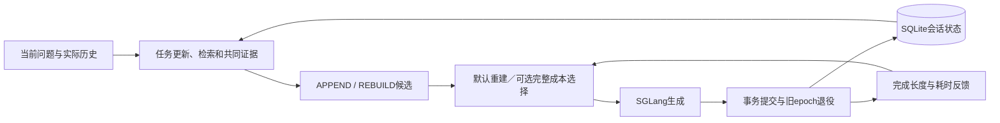

# 架构与机制

ContextKV面向多资料、长上下文、条件与证据动态变化的多轮问答。控制器是单Python服务；同一会话串行，不同会话并发，共享SGLang及检索资源。

## 机制原理与算法定位

最终默认Dense5以当前问题和实际QA进行稠密检索，选择原文后每轮REBUILD；这重组逻辑上下文，原生Radix/HiCache仍复用相同token前缀。A提供本轮材料，B使用固定重建策略，C负责持久化提交与引用退役。可选配置保留结构化任务状态和共同证据下的APPEND/REBUILD成本选择。质量通过任务、选材和真实回答评价优化；在线B的目标是预计完整耗时，GPU/Host容量进入准入和等待估计。显存与Host占用积分目前是实验指标，尚未作为加权目标参与联合求解。

1. **可选的选择性状态更新。** 对当前问题`q_t`、实际历史`H_t`和已提交状态`S_(t-1)`，解释器产生字段操作`Δ_t`，再执行`S_t = Apply(S_(t-1), Δ_t)`。任务及子需求按keep/replace更新，命名条件按保留、赋值、删除更新。该机制借鉴SOM-DST的选择性覆盖；本项目采用固定32B结构化解释开放字段，未训练原论文的槽位分类器。状态决定检索需求，原始问答继续作为生成上下文。
2. **原文选材与可选需求覆盖。** 对主任务及各子需求建立排序，按独立正文组选择最多`k=5`组。复合需求路径使用`F(E)=Σ_j max_(d∈E) 1/rank_j(d)`，先保留主任务首组，再逐次加入`F`边际增益最大的组。该目标具有收益递减性质，用排名奖励需求互补；它是覆盖代理，尚不是经过标定的答案支持性或充分性概率。单需求路径按相关性选择独立正文组。来源身份与正文存储分离，使同文来源共享文本、不同版本保留可解释身份。
3. **可选的追加/重建成本选择。** APPEND沿用已提交执行上下文并补充本轮新增材料；REBUILD由实际问答与本轮材料重新装配。两者满足相同必需证据集合，APPEND仍可能包含额外旧材料，因而输入和生成质量需要实测。对可行候选`a`，使用原生GPU就绪前缀、Host可恢复前缀、回载量、并发和队列状态，估计`T(a)=T_control+T_prepare/wait+T_forward_first+Σ_(i=1)^(L_hat-1) TPOT(n_a+i,c)`；`L_hat`来自已完成回答。选择预计耗时较小的候选，预测值相等时比较原生工作集需求及输入长度。当前是单轮选择，尚未预测未来回访价值或求解跨轮全局最优。
4. **代际提交与引用退役。** APPEND延续当前epoch；REBUILD建立新epoch。引擎完成回执到达后，在同一事务提交回答、状态和旧epoch退役记录，再由outbox worker解除旧原生会话引用。物理KV分配、分层与淘汰复用Radix/HiCache。这是支持上下文重组的系统协议，事务/outbox本身属于已有技术。

工程与实验重点是任务/来源适用性如何与真实缓存成本共同影响上下文重组。ContextPilot已研究上下文排序、去重和注释；RAGCache已研究分层缓存与实测成本；方案取舍由固定32B下的质量、完整响应及容量曲线决定，已有有效方法可直接采用。方法对照及采用状态见[参考工作](references.md#机制选型与研究差异2026-11-01核对)。

## A：任务与证据

默认检索通过`adapters/dialogue_query.py`组织实际QA视图，并由查询适配后的BGE稠密排序选材。启用解释器时，`adapters/conversation.py`用一次结构化解释维护`TaskFrame`：任务、主题、对象、命名条件和子需求。保留任务时承接已有需求；替换任务时更新需求。条件省略表示保留，空值表示删除。解释器读取实际问答和已有状态，明确回访时选择对应旧轮次；结果与回答一同提交。回访历史超过解释输入预算时，优先保留最近完整问答，并保留可容纳的原始旧问题和对应已提交状态；旧回答按完整单元保留或省略，省略情况进入追踪，不生成摘要，当前问题位于裁剪后输入末尾。联合选材时为可容纳的原文留出空间。模型声明回访却没有指定轮次时，保留未解析状态而不继承最近任务。生成和提交使用的实际历史不由这一步删改。

`controller/schema.py`定义共享请求和证据类型；已提交历史与任务状态由`conversation.py`投影。`hybrid_retrieval.py`复用BM25S、BGE-M3、RRF和BGE重排；主任务及子需求进入同一评分流程。默认按不同内容组选择材料，复合任务保留主任务首组，再按需求排名覆盖增加材料。来源窗口、原文结构和声明依赖由`corpus.py`等适配器提供。配置见[检索](guides/hybrid_retrieval.md)。

`controller/evidence.py`以资料库、文档、片段、版本和正文摘要标识证据。当前检索、历史回访、指定引用和依赖共同确定本轮材料及引用范围；同文来源保留独立身份并共享正文。历史回访本身不指定来源版本：若同一片段的当前检索与所选历史版本冲突，则两者进入共同材料，并向生成器标明各自来自当前检索还是历史轮次；检索来源不自动证明适用。明确指定的证据引用仍优先，其余不明版本冲突仍按原约束处理。

P3会话可显式从已提交的资料库快照迁移到当前检索器绑定的快照：请求带上预期的旧标识，控制器以原会话版本开始attempt，在新快照上检索并强制REBUILD和新epoch。只有引擎确认完成的结果与新历史、快照、epoch和旧epoch退役outbox在同一事务提交后，切换才生效；输出上限终止仍按原协议提交并标记截断。失败或未决结果继续保留旧快照，按原attempt恢复。旧工作进程不能无条件将已迁移会话切回旧索引，显式比较的是身份而非版本顺序。同一来源版本与正文在多个快照不变时，合并其快照来源记录；其他来源或适用元数据冲突仍拒绝。相同request ID的已提交检索请求按原快照重放，要在新快照重新回答需使用新ID。

索引仍在服务启动时加载；没有热切换或全局版本仲裁，快照ID必须由索引发布方保持唯一且不可变。显式`/turns`证据接口保持原有固定快照语义。保留冲突资料只能让生成器看到可选来源，不保证其正确判断生效时间和适用条件；长正文同时保留也会增加输入成本。

`candidates.py`与`templates.py`在同一快照、任务与证据集合上构造两个候选：APPEND复用执行上下文中的正文，REBUILD以实际问答和当前材料重建。版本变化、引用范围及真实token预算决定候选可行性。生成器接收完整原文与实际历史；任务解释用于承接需求和检索。

## B：完整成本决策

默认策略直接选择当前证据与实际QA的重建候选。配置`strategy: cost`时，`planner.py`读取同批只读缓存报价，调用`cost_model.py`比较预计完整耗时：本地控制开销、准备与等待、forward到首token、后续decode。实测成本按前缀、后缀、Host恢复量和并发插值；回答长度取已完成输出统计。

`admission.py`根据原生预算、活动请求和队列估计等待。容量预留沿用请求预算，服务时长使用经验输出分布；二者分别记账。预计成本相等时结合原生工作集和输入长度选择，测量范围外使用配置的固定策略。在线服务与离线回放共用`assemble_cost_model`。公式、拟合和测量口径见[成本标定](guides/stage_cost_model.md)。

## C：提交与KV生命周期

`service.py`组织候选、执行和反馈，`session_store.py`用SQLite事务保存实际问答、证据档案、执行账本、attempt和退役outbox。业务epoch关联原生会话generation及引擎restart身份。新结果完整落盘后，一次事务提交会话状态并登记旧epoch退役；后台worker处理outbox。

`engine_client.py`统一prepare、generate、status和retire。固定SGLang补丁提供报价、代际绑定、完成回执与引用退役；Radix/HiCache执行物理缓存管理。退役解除业务引用保护，物理空间按原生引用计数和淘汰规则回收。可选Host准入按请求累计备份页预算执行，细节见[引擎实现](../engine_patches/README.md)。

| 边界 | 处理方式 |
|---|---|
| 请求重试 | 同一request ID复用已保存attempt与结果 |
| 完整结果已保存、提交未完成 | 恢复提交同一结果 |
| 结果已提交、退役未完成 | 返回已提交回答，outbox继续处理 |
| 引擎重启 | 保留实际历史和证据，以新epoch重建 |

身份、完整结果与事务检查集中在接口和提交边界。日志、统计和离线导出独立于回答提交。HTTP部署及管理恢复入口见[接口](guides/http_retrieval.md)。

## 工具与运行边界

`controller/`、运行时资料/检索适配和SGLang桥接构成服务链路。共享请求类型定义在`schema.py`，在线检索不依赖MT-RAG任务读取器。退役处理由`Controller`管理，生成配置与输入装配分别归入`config.py`和`templates.py`。

`bench/`提供评测、结果分析和CPU模拟后端；`profiling/`采集成本、拟合及运行探针；`scripts/`准备环境和数据；`tests/`验证行为。它们不作为课题机制模块。标定结果是B的输入数据，测试结果保存在`runs/`。

配置、源码、索引文件和实验结果不通过层层文件hash控制运行或复算。正文摘要用于共享和版本识别，token与分词指纹用于原生缓存匹配；模型配置直接比较，检索索引使用声明的资料快照。

## 复用与适配

| 复用依据 | 本项目工作 |
|---|---|
| SOM-DST、JSON Merge Patch | 用选择性更新维护开放任务、条件与子需求 |
| BM25S、BGE、RRF、需求覆盖；Contextual Retrieval与原文窗口 | 将当前需求传递到检索，保留来源范围、原文坐标和依赖 |
| ContextPilot | 在不可变快照上构造共享材料的追加/重建候选，结合版本与正文跨度判定复用 |
| SGLang Radix/HiCache、阶段测量与队列分析 | 用原生报价和实际阶段成本决策，区分容量预算与服务长度 |
| 原生会话软引用、事务outbox、EfficientAgent工作集思想 | 关联业务epoch、提交和引用退役，适配Host备份预算 |

出处统一在[参考工作](references.md)，效果与尚未覆盖的场景统一在[数据与评价](data_and_evaluation.md)。
