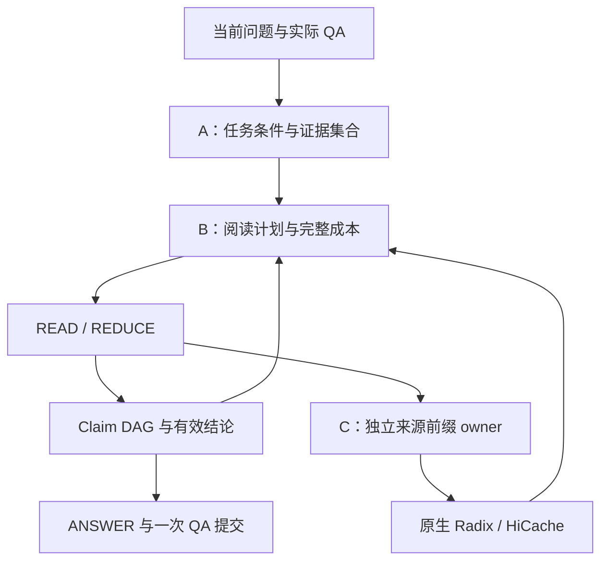

# 课题架构与机制

当前主线是任务证据、有限阅读计算和来源前缀保留的协同。共享类型位于 [context_schema.py](../controller/context_schema.py)；实际执行与提交位于 [execution.py](../controller/execution.py)、[service.py](../controller/service.py) 和 [session_store.py](../controller/session_store.py)。

## 共同状态与调用链

`TaskState` 表达当前任务、Need、条件更新、版本意图和工作历史。`EvidenceSet` 保存来源单元及必要依赖；`ContextPlan` 保存阅读步骤和预算；`ReadResult/ReadingOutcome` 保存实际结论、来源、覆盖和步骤成本。原文档案、最终模型窗口和物理 KV 是三个不同对象，分别由来源目录、上下文编译器和原生引擎维护。

## A：任务、证据与固定模型阅读协议

`adapters/history_state.py` 将实际会话解释为任务操作。条件撤销以谓词锚点和目标条件表达；`training/task_model.py` 使用现有 span/update/pointer 通道学习该操作。条件变更进入后续 Need、检索查询和回答条件。

`adapters/evidence_pool.py` 建立原文坐标、版本和依赖目录，合并当前检索、历史来源和缺口召回。同一原文命中多个 Need 时合并需求归属，保留最高召回分。`support_model.py` 计算单段与组合支持；`evidence_planner.py` 在正文预算及依赖闭包内组织候选集合。P1 的训练奖励来自绑定 reader 的实际回答差异。标记为 `evidence_set_only` 的 utility 资产在训练和推理时都使用同一输入范围，即任务状态、证据单元与支持图。动作、布局和执行上下文特征均置零。

Qwen3-32B 权重与解码参数冻结。`training.reader_audit` 只导出实际 READ/REDUCE/ANSWER traces，并用完整原文独立核验可见输入支持、来源和任务绑定，不生成 SFT 数据或保存 reader adapter。P0/P1 规划器分别与 `task_first + numeric_need_isolation`、`source_first + 共享提取` 组成四格；先固定实际输入定位协议贡献，再沿各格自己的真实历史运行 P3。既往 LoRA 的已付调用和训练费用只列为弃用支出，不计入改进结果。

## B：有限阅读、有效结论和收益选择

先从实际 ANSWER 窗口扣除系统、任务、工作历史、输出和来源元数据，再把可用结论份额分到 Need、READ 分片和有限 REDUCE 节点。生成输出上限与最终保留份额分别记录。READ 的完整输出结构同时出现在可见消息和原生 JSON 约束中。

READ 按实际 tokenizer 的输入容量与结构化输出容量打包。同来源、条件、版本下的 count/sum 共享一次实体／量值提取。Wire 5 的数值事实包含原文短摘录，并用短 ID 引用来源、条件、Need 和父事实。`numeric_need_isolation` 保留为对照。来源前缀使用固定系统消息，任务阅读指令放在来源之后的任务消息正文，供不同操作复用同一因果前缀。缺口由 `unresolved_needs` 统一计算：后续步骤完成终端 Need 后，早期缺口关闭；不同时间范围分别检索，相同关系合并父结论。

共享数值 READ 全部完成后，每个数值 Need 各声明一次显式 `numeric_select` REDUCE。Wire 6 的输出只列出选中的原事实父 ID，量值、实体、单位和来源沿用原事实。CPU 随后按各自 Need 的选中结果执行 count 或 sum。

归约计算分两类。

- `union/count/sum/group` 使用 CPU 的实体、条件、版本对齐与量纲换算，直接保留原始事实的父链。
- `summarize/compare/infer` 使用模型。超窗输入先分成 N 包，每包执行一次；随后只合并至少两个完整结果 bundle，因此最多再执行 N−1 个合并节点。不能继续合并的各根结论组成 forest，整体进入后续回答规划。

`ReductionState` 将一个逻辑归约的完整输入基底、有效结论 frontier 和完成状态挂在最后一个真实 `ReadResult` 上。它不增加模型调用。新全量基底完成后，替代同 Need/operation 的旧子集归约；旧事实依赖仍留在 Claim DAG。未被结论消费的输入与独立分片均保留。逐步骤账本按 step ID 计量实际执行。

`candidates.py` 先以短 ID、共享条件和版本表编译全部有效结论及完整来源路径，再用剩余容量放原文摘录。已读结论的引用与实际可见原文范围分别记录。累计读过的原文大小不会再次成为最终 ANSWER 的正文门槛；可行性由真实编译窗口、输出预算、完整覆盖和累计资源预算决定。

`plan_policy.py` 比较直接回答、继续阅读、补缺口和归约的预计质量增益与完整成本。已付成本始终进入预算，未来动作按实际原生报价与 `plan_profiles.py` 的状态条件化测量估计。成本优先使用当前 GPU 命中、Host 回载和并发范围对应的实测桶；未观测状态的经验外推单独记录。

`observed_actions` 模式把直接 ANSWER、一次 READ、一次 REDUCE、一次 GAP 放在同一已观察状态上配对。
GAP 仅在选中后执行并进入步骤账本；返回的新来源与原事实合并，再决定是否阅读。
质量模型学习实际最终质量差。新成本模型用动作前的原生缓存、压力和可编译首步报价预测动作加最终回答的绝对成本；GAP 和 CPU REDUCE 只使用动作前的批级状态。
在线在同一次原生观测下分别预测动作和 DIRECT，再计算带符号差；采集时不同分支的实测成本差保留为诊断，避免把执行顺序产生的预热收益当作动作收益。
已付成本加绝对分支成本约束总预算。明确终止且没有提交回答的分支按零交付效用计，原始评分缺失仍保留；暂停和未决分支不进入这类标签。
`observed_actions` 使用实时原生报价和配对得到的完整分支成本模型，不依赖整计划的执行 profile。
全来源任务先按原计划逐步完成必要 READ、数值选择和 CPU 归约，再比较继续动作与直接回答。
GAP 绑定当前检索器及采集时的材料限额。`whole_plan` 保留原执行 profile 与原生时间标定，作为独立对照。
新动作模型的原生采集与训练尚待完成。

## C：独立来源前缀与相对 native 的保留价值

`prefix_view.py` 按完整因果 token 路径识别来源前缀，`prefix_retention.py` 在业务 READ epoch 结束后以独立 owner 继续保护。Radix/HiCache 负责物理页匹配、迁移与淘汰；策略读取当前 active 保护集合，比较保留、延长或释放带来的边际净收益，共享因果页只收一次新增容量和驻留成本。预测使用访问间隔、GPU/Host 当前驻留与回载、两层容量压力、活动和排队请求数；已付控制成本不再次收取，原生已有的命中也不重复记作保护收益。

C 配对重放为 Native、TTL15、TTL60、TTL180 使用同一请求序列、DAG、外部压力和至少 180 秒的共同观察窗。并发窗口按 READ 实际完成顺序登记可选前缀，重放沿用记录中的请求到达间隔。保护期限独立于观察长度。实际原文页需求与原生回执分别记录无重访、GPU 命中、Host 回载和重算，混合访问保留各类页数，空闲驻留持续计费。每个窗口只执行一次 Native，再分别与三个 TTL 作差。active 集合边际估值、状态特征和多 TTL 入口已实现；新协议的原生实测、价值模型拟合及开发选择尚未完成。

## 提交、评价与成本

`service.py` 将多个内部步骤组织为一个用户 attempt；最终回答、实际会话状态和旧 epoch 退役记录在一次提交中保存。内部 READ/REDUCE 的生成、辅助模型、检索、等待、回载和提交开销分别进入完整账本。

公开评价复用作者指标规则。MTRAGEval 先完成各分量的可答性条件化，再计算聚合分；2Wiki 官方评价保留所有声明 gold 任务。共同完成子集用于诊断，完整队列用于方案选择。成本同时保存实际生成 token、完整响应、GPU/Host 物理积分与 unique KV 页占用；它们分别解释计算、时延和保护容量。
