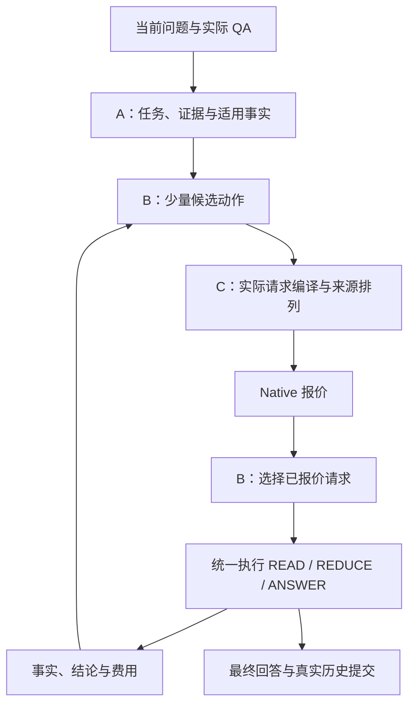

# 课题架构与机制

当前主线是有效原文/跨轮原子事实、有限阅读计算和缓存感知请求编译的协同。共享类型位于 [context_schema.py](../controller/context_schema.py)；实际执行与提交位于 [execution.py](../controller/execution.py)、[service.py](../controller/service.py) 和 [session_store.py](../controller/session_store.py)。

## 共同状态与调用链

`TaskState` 表达当前任务、Need、条件更新、版本意图和工作历史。`EvidenceSet` 保存来源单元及必要依赖；`ContextPlan` 保存阅读步骤和预算；`ReadResult/ReadingOutcome` 保存实际结论、来源、覆盖和步骤成本。原文档案、最终模型窗口和物理 KV 是三个不同对象，分别由来源目录、上下文编译器和原生引擎维护。

`controller/qa.py:DocumentQA` 是业务入口。`POST /documents` 将版本化原文登记到同一 SQLite 的 document_sets/text_blobs；`POST /sessions/{id}/query` 与 `bench.study` 调用同一个 ask。临时资料与预建语料沿同一检索/执行路径，登记、在线编码和查询费用分别保留。

登记资料的来源范围在任务解释前绑定：目录与可复用 READ 合同只投影本次资料，包含范围外事实前提的合同整份排除；实际 QA 历史与条件继续保留。未指定登记资料时沿用公共语料目录。

## A：任务、证据与固定模型阅读协议

`adapters/history_state.py` 将实际会话解释为任务操作，保留每个 Need 显式的条件关联。条件替换/撤销只改写引用目标条件的 Need；共享条件由多个 Need 引用同一 ID。`training/task_model.py` 已接通锚点分组、Need 的主体/条件/前驱边与 scope，条件 key/value/predicate 分组及多标签更新目标；目录选择、source_turns 和任务回访恢复也进入监督、损失、解码、严格 v3 资产与评价。该实现尚未产出经训练与开发评价证明有效的学生资产。线上解释后的状态进入检索查询和回答条件。每个 Need 的召回查询只附加其 condition_ids 指向的活跃条件，共享条件须显式关联；当前问题的广义召回流另行保留。

`adapters/evidence_pool.py` 建立原文坐标、版本和依赖目录。task-first E0 使用 `source_rows_pr3` 原行/长行分片，source-first A 使用 canonical 窗口；运行 manifest 记录该选择。目录合并当前检索、历史来源和缺口召回。同一原文命中多个 Need 时合并需求归属，保留最高召回分。`support_model.py` 计算单段与组合支持；`evidence_planner.py` 在正文预算及依赖闭包内组织候选集合。P1 的训练奖励来自绑定 reader 的实际回答差异。标记为 `evidence_set_only` 的 utility 资产在训练和推理时都使用同一输入范围，即任务状态、证据单元与支持图。动作、布局和执行上下文特征均置零。

Qwen3-32B 权重与解码参数冻结。`training.reader_audit` 导出实际 READ/REDUCE/ANSWER traces，直接审核其中的 `actual_output`，用可见输入和完整原文分别核验支持、来源和任务绑定；不再另生成目标答案，不生成 SFT 数据或保存 reader adapter。P0/P1 规划器与两种阅读协议组成归因对照，分别沿自己的实际历史运行 P3。完整联合入口直接读取冻结的 P0 共享 A study 配置，四格共用其支持模型、查询资产、阅读协议与预算。既往 LoRA 的已付调用和训练费用只列为弃用支出，不计入改进结果。

任务教师 wire 为 `owned_task_graph_v7_visible_token_boundaries`，语义版本为 `task_need_semantics_v3_anchored_owned_graph`。教师引用可见窗口的 `boundary_tokens`，映射回原消息 owner 和半开字符坐标 `TextRef(start,end)`；持久化保留原文坐标。Need 的请求锚点保留所求关系，`subject_refs` 绑定当前或历史中的实际对象；独立审核同时检查回指。全局检索 query 先放当前问题，再放活跃需求与已选历史，并剔除已退役条件的原文坐标；逐 Need 召回仍只附加自己的对象和条件。Need 与 Condition 必须有实际锚点，实际输入、输出与调用费用由标注入口记录。

版本意图只表达用户当前或继承的来源版本／生效日期限制；等待时长与年龄属于待答事实或资格条件。没有这类版本限制时使用 `current` 和空 `time_refs`；目录日期与 `reference_date` 只帮助解析实际日期限制，不能自行产生 `as_of`。`time_refs` 仅引用对应日期或时间短语。

在线检索由 `ServingRetriever.configure_study(interpreter, tokenizer)` 绑定，`retrieve_pool(snapshot, query, request_id)` 返回任务、来源池与检索状态。`Controller.serve_turn(context_plans=...)` 或 `EvidenceSelection.context_plans` 注入计划，`extend_open_needs(plan, open_needs, claims)` 返回带新增原文和阅读单元的 `EvidencePool`。支持评分的查询含每个 Need 的 scope、条件和完整版本意图，区分版本锚点与最终适用版本。先评单段，再按配置评 pair/triple；`selection.utility: support_coverage` 对各 Need 取集合内最大适用性乘联合支持，再求均值。数值效用保持原值；达到阈值且每个选中的最佳支持 contract 都为 `complete` 时才声明 `answer`，数值满分的 `partial` 仍不完整。

集合搜索展开依赖闭包，每层合批计量正文与实际 REBUILD prompt。每个 Need 在达到最佳支持值的 bundle 中，先保留完整支持，再取主体单元最高的现有 reranker 分作为锚点相关性；互补 bundle 的所有主体及其依赖必须同时入集，不能用高分锚点替代必要的低相关桥接来源。零支持的相关性为零，集合相关性为各 Need 锚点分的均值；依赖和额外背景不加分。beam 与最终返回顺序均为效用、完整 Need 数、相关性、token 成本；Pareto 使用相同四个维度，避免短泛规则凭同一饱和支持分支配更相关的完整来源。这是已有支持和发布版 reranker 的独立排序，不把相关性当作回答质量概率。

初始 A 材料交接在搜索和可选集合评估后、构造阅读计划前完成：固定 B 与 `observed_actions` 只接收语义第一名，避免下游 `fixed_choice` 再按输入长度重选不同材料；observed 的直接 ANSWER 与下一 READ/REDUCE/GAP 均基于这个实际材料状态。只有解析后的 `plan_gain.mode=whole_plan` 保留多个 A 集合供整计划对照。GAP 搜索仍在内部保留候选，先选择包含未读来源的集合，再返回一个选中结果。beam、动作与布局候选复用已评分支持，不重复调用教师。

`selection.mode=ranked` 是同一 A 入口的选材对照：复用发布版重排顺序、依赖闭包、正文与实际 ANSWER 窗口预算，跳过支持评分和集合搜索；任务条件、版本、事实复用及 B/C 执行不变。GAP 仍使用原缺口检索与重排，只以未读范围为候选根，所需旧依赖保留在实际 READ 中，原 passage 额度只扣新增部分。默认 `support` 保留已有冻结配置，ranked 的质量与端到端收益以实际对照决定。

教师通过 `budget_teacher_input` 先保留当前问题与目录，再按当前任务优先、历史相关性次序选入任务闭包，最后加入其他历史窗口。闭包包含活跃条件及其更新目标、Need 前驱与对应原文；整个 system/user 消息使用实际 tokenizer 统一计量。预算外历史任务不进入输出 schema。rollout 保存实际目录、日期与 scope，标注、训练和评价复用同一观测与目录选择规则。输入不可见的监督不参与拟合，评价保留其分母与不可见原因。

`all_supplied_documents` 在支持评分与集合搜索之前确定。配置或 Need 明确要求全资料覆盖且具有实际来源边界时，直接生成一个覆盖该范围的阅读计划。该路径记录 `selection_policy_heads_used=false`；选材路径继续使用现有支持与集合搜索。跨轮恢复只恢复文档级元数据，表格身份与标题由原文窗口重建，保持同一来源的因果 token 前缀稳定。表头、标题、注释先作为数据窗口依赖读取，已覆盖依赖不再单独建立 READ。

`controller/fact_reuse.py` 从同会话已提交的物理 READ 构建可见提取 contract。任务解释同时绑定当前 Need 和可复用 contract；版本、hash、范围、字段和条件匹配后，只导入原子事实。逻辑复用节点不复制历史模型费用；当前 count/sum/group 重新选择和运算。`complete` 的覆盖按来源区间并集计算，旧新 unit ID 不同也不重复读取；`facts` 不冒充完整提取。支持 backend 的请求内 memo 延续到 GAP，QA 结束释放。

B 的冻结资产身份保留模型、tokenizer、索引及实际计算配置，排除进程重启编号、服务地址和 model-scope 记录文件的位置。离线观测导出从对应测量段的真实 generation manifest 计算该身份；原始观测 digest、manifest 路径与内容 hash 同时保留，配对采集仍核对实际加载的资产。

B 的收益监督直接复用固定官方 RB_llm 的 prompt、parser 与归一化，使用原始用户请求、真实 QA 历史和实际最终可见材料及结论来源闭包；`answer_evaluation_view` 同时服务训练与最终评价。TaskState、模型支持分和未见的参考原文不进入该官方评价上下文。完整原文保留在独立审计材料中，P1 的四项诊断也以原始对话和完整来源判断。

执行登记与实际评分身份分开：离线重评复用原答案、输入和成本，原登记保持不变，派生标签记录实际 rubric；无 QA 的零效用来自完成率规则，不冒充 judge 评分。官方分数与逐题原文审计分别报告，评分模型的条件误判不视为已证实的正确性提升。

## B：有限阅读、有效结论和收益选择

先从实际 ANSWER 窗口扣除系统、任务、工作历史、输出和来源元数据，再把可用结论份额分到 Need、READ 分片和有限 REDUCE 节点。生成输出上限与最终保留份额分别记录。READ 的完整输出结构同时出现在可见消息和原生 JSON 约束中。

READ 按实际 tokenizer 的输入容量与结构化输出容量打包。同来源、条件、版本下的 count/sum 共享一次实体／量值提取。Wire 5 的数值事实包含原文短摘录，并用短 ID 引用来源、条件、Need 和父事实。`numeric_need_isolation` 保留为对照。来源目录按固定 2048-token、最多 8 个非空原文行形成窗口；超长行使用实际 tokenizer 切分，普通行和表格行保持完整。`source_windows` 保持原文窗口与坐标稳定，把多个完整窗口和依赖闭包按实际输入/输出容量合并为一次 READ。窗口身份不等于模型调用边界。source-first 的系统与原文段跨操作一致；数值、bridge、条件、运行别名和输出 schema 均在来源之后。超出实际输入/输出份额的完整窗口明确不进入执行。固定窗口的最终净资源收益由完整质量与成本实验评价。缺口由 `unresolved_needs` 统一计算：后续步骤完成终端 Need 后，早期缺口关闭；不同时间范围分别检索，相同关系合并父结论。

共享数值 READ 全部完成后，每个数值 Need 各声明一次显式 `numeric_select` REDUCE。Wire 7 对每个原事实父 ID 给出必填布尔选择；量值、实体、单位和来源沿用原事实。固定执行与滚动动作共用 `reduction_partitions`，在报价前同时按实际消息输入与 wire7 紧凑布尔结果的输出容量分包，每包独立执行和计费。最后一包的 `ReductionState` 绑定完整逻辑基底与全部已选 frontier，CPU 随后按各自 Need 执行 count 或 sum。

归约计算分两类。

- `union/count/sum/group` 使用 CPU 的实体、条件、版本对齐与量纲换算，直接保留原始事实的父链。
- `summarize/compare/infer` 使用模型。超窗输入先分成 N 包，每包执行一次；随后只合并至少两个完整结果 bundle，因此最多再执行 N−1 个合并节点。不能继续合并的各根结论组成 forest，整体进入后续回答规划。

固定执行与滚动策略复用 `reduction_schedule`；滚动策略只报价并执行下一包，然后重观察。完整逻辑基底及 frontier 在最后一个真实调用完成时发布，中间状态仍保留未消费事实。

`ReductionState` 将一个逻辑归约的完整输入基底、有效结论 frontier 和完成状态挂在最后一个真实 `ReadResult` 上。它不增加模型调用。新全量基底完成后，替代同 Need/operation 的旧子集归约；旧事实依赖仍留在 Claim DAG。未被结论消费的输入与独立分片均保留。逐步骤账本按 step ID 计量实际执行。

`candidates.py` 先以短 ID、共享条件和版本表编译全部有效结论及完整来源路径，再用剩余容量放原文摘录。已读结论的引用与实际可见原文范围分别记录。累计读过的原文大小不会再次成为最终 ANSWER 的正文门槛；可行性由真实编译窗口、输出预算、完整覆盖和累计资源预算决定。

`action_policy.py` 在当前状态比较直接回答、一次 READ、一次 REDUCE 和一次 GAP。`plan_policy.py` 保留完整计划对照的调度与预算接口。

`observed_actions` 模式把直接 ANSWER、一次 READ、一次 REDUCE、一次 GAP 放在同一已观察状态上配对。反事实收益采用 `infer_bridge_ready_or_one_gap_one_terminal_read_v4`：首动作之后，只对尚未满足的 infer 桥接需求接至多一次终端 READ；已有就绪来源优先，否则至多一次 GAP。线上与反事实均由 `bind_read_parents` 绑定未解需求的相关父结论。直接 ANSWER 不续接。线上仍仅执行首动作后重新观察，监督与收益资产绑定相同协议和 `observed_feature_schema=pre_action_budget_support_state_v2`。价值与成本特征同时包含 A 的支持/桥接估计、Need 前驱、已观察终端支持与桥接缺口，以及实际已付 token/墙钟、已执行步骤及对应剩余预算；无界额度用独立标记表达。可选后续在硬步骤不足以完成 READ+ANSWER 或 GAP+READ+ANSWER 时直接进入终端 ANSWER，不启动无预算步骤。
GAP 仅在选中后执行并进入步骤账本；返回的新来源与原事实合并，再决定是否阅读。线上与离线共用 `action_proposals.gap_retrieval_plan`，仅排除实际已读来源闭包；未读候选仍可召回，passage 上限为已读数量加声明新增额度，并受原总上限约束。反事实 REDUCE 使用与线上工厂相同的事实基底，不按原 READ Need 别名或 extract 类型再次筛选。
质量模型学习实际最终质量差。新成本模型用动作前的原生缓存、压力和可编译首步报价预测动作加最终回答的绝对成本；GAP 和 CPU REDUCE 只使用动作前的批级状态。
在线在同一次原生观测下分别预测动作和 DIRECT，再计算带符号差；采集时不同分支的实测成本差保留为诊断，避免把执行顺序产生的预热收益当作动作收益。
B 的 `input_protocol` 额外绑定 `merged_source_windows_actual_coverage_reused_facts_compiled_choice`、实际规范来源窗口粒度与完整 reader fingerprint；观察、分支、配对、拟合及加载沿用同一身份，缺失或不匹配时拒绝旧资产。真实状态保留已复用 seed、已读覆盖及编译器选中排列，`pre_action_input` 将原生报价与实际执行输入绑定。禁用事实复用是显式机制消融，其开关不改变资产可接受的协议身份，实际 seed 差异保留在状态中。

成本资产声明 `prefix_control_scope=native_excludes_prefix_control`。价值 C 开启时，B 仅给候选首个 READ 加入最近实际完整 callback 的均值；没有观测时诊断保留未知。`prefix_control_ms` 仍是唯一实际计费字段，已付 callback 费用进入累计成本，原生报价中的命中效果不再额外抵扣。
已付成本加绝对分支成本约束总预算。明确终止且没有提交回答的分支按零交付效用计，原始评分缺失仍保留；暂停和未决分支不进入这类标签。
`observed_actions` 使用实时原生报价和配对得到的完整分支成本模型，不依赖整计划的执行 profile。
全来源任务先按原计划逐步完成必要 READ、数值选择和 CPU 归约，再比较继续动作与直接回答。
GAP 绑定当前检索器及采集时的材料限额。`whole_plan` 保留原执行 profile 与原生时间标定，作为独立对照。
动作收益资产由 `training.plan_gain_workflow --mode observed_actions` 采集、终止标注和拟合；开发文件报告实际配对质量差的误差，在线质量和时延由完整队列评价。

REDUCE 的完整基底与 frontier 在首次写入 `COMPLETE` 前统一绑定。GAP 的 `RESULT_READY` 直接复用已保存资料，完成账本、后继计划和进度在一个事务中提交，恢复不会重复检索或生成。

## C：选择前编译、报价与执行后登记

`RequestCompiler` 供 Controller、ReadingExecutor、滚动动作和 READ 成本报价共用。作者 ContextPilot 的 CPU index/reorder 只提出来源排列；沿用项目实际系统、历史、条件、结论与引用编译。所有排列先变为实际 input_ids，再读 Native 报价，选中输入原样执行。固定策略以新增预填充 token、Host 回载和长度选择排列；收益策略按绑定当前协议的成本模型决策。

每次成功完成的 READ 与直接 ANSWER 都按实际正文几何、完整因果前缀与回执登记，输出截断或 JSON 解析失败不抹去已经产生的 KV。来源登记不等于保留；`prefix_retention.mode=native` 不触发 TTL。

### 可选的独立来源保留

旧 lease 的保持、续租与新前缀在同一次逻辑保护容量 `protection_budget_tokens` 内竞争；分配器以同一去重净目标比较绝对边际价值与新增容量收益密度两次构造，保持仅使用剩余期限，不发续租调用，未选旧项释放。同 owner 只选一个期限。读取需求由 scope、完整因果页路径和正文 token 范围共同确定；相同首正文页但不同完整路径是不同需求，共享页按并集占保护容量。实际 GPU/Host 放置与容量仍由 Native 管理，各层额外驻留使用独立价格。

`prefix_view.py` 按完整因果 token 路径识别来源前缀，`prefix_retention.py` 在业务 READ epoch 结束后以独立 owner 继续保护。Radix/HiCache 负责物理页匹配、迁移与淘汰；策略读取当前 active 保护集合，比较保留、延长或释放带来的边际净收益，共享因果页只收一次新增容量和驻留成本。预测压缩为过去访问状态、当前原生驻留、压力/并发组合三个粗特征；训练按独立会话组等权，同窗 TTL 不扩充样本；已付控制成本不再次收取，原生已有的命中也不重复记作保护收益。

C 配对目标为 `paired_native_retention_v6`，需求规则为 `exact_complete_causal_prefix_and_body_ranges_v1`，控制规则为 `owner_call_only_fixed_decision_once_v1`。配对重放为 Native、TTL15、TTL60、TTL180 使用同一请求序列、DAG、外部压力和至少 180 秒的共同观察窗。并发窗口按 READ 实际完成顺序登记可选前缀，重放沿用记录中的请求到达间隔。保护期限独立于观察长度。实际原文页需求与原生回执分别记录无重访、GPU 命中、Host 回载和重算，混合访问保留各类页数，空闲驻留持续计费。每个窗口只执行一次 Native，再分别与三个 TTL 作差。单 owner 标签的 `retention_control_ms` 测量实际保留调用（ledger＋retain），共同 inspect 成本另存 `paired_inspection_control_ms`。集合选择扣除候选 owner 调用费、增量驻留价格及外部请求代价；完整 callback 的固定费用仅在整个集合净值中计一次，分配时已付费用不改变边际排序。正 collateral 不另计叠加奖励；单前缀完整窗口预测单独与两臂窗口成本差比较。固定 DAG 回放解析捕获时的输出，新增生成响应用于实际成本计量。相同来源需求事件的预期读取节省取已覆盖的最大值，共享页按租期增量计费。观察保护集合、分配、释放及保留由同一分配锁串行执行。

配对工作流按捕获时的粗特征桶选择两组会话互不相交的完整训练窗口，并匹配独立开发窗口；选择依据为实际可观察性、调用预算与固定种子。清单直接传入重放。真实重放特征决定最终拟合覆盖，每个 feature/scope/TTL 桶至少需要两个独立会话组；无支持桶时不写空模型。多 TTL 仍是同窗重复测量，完整集合净收益由共同负载的 Native/value 对照验证。

前缀观察、分配和完成登记共用分配锁。访问去重与策略完成分别记录；未完成策略恢复执行，原生已经接受的保留通过回执/租期核实后复用。原生明确返回 `PREFIX_NOT_RESIDENT` 时记为保留机会消失，业务 READ 继续。

## 提交、评价与成本

`service.py` 将多个内部步骤组织为一个用户 attempt；最终回答、实际会话状态和旧 epoch 退役记录在一次提交中保存。内部 READ/REDUCE 的生成、辅助模型、检索、等待、回载和提交开销分别进入完整账本。

`StepRecord` 的消息、epoch 和回执使用共享规范类型，SQLite 读取统一由 `load_record` 还原；跨轮事实投影和步骤恢复消费同一类型。

SQLite 的 `turn_plans` 保存计划，`execution_steps` 保存输入、原生 epoch、输出、解析结果和计时；`reading_progress` 与后继计划原子保存缺口扩展及辅助用量。内部生成使用独立步骤请求和临时 epoch，完整结果保存后登记退役 outbox；重试按步骤账本与原生 status 恢复，最终只提交一次 QA。`reader_*_tokens` 统计 READ/REDUCE/ANSWER，`auxiliary_*_tokens` 统计任务、检索、支持与 gap 调用，`total_*` 为两者之和；未测得的辅助 token 保留空值。`profiling.reading_measurements` 仅从 dev 步骤的实际回执与客户端计时导出校准点，缺失末 token 观测的记录不补成估计。

公开评价复用作者指标规则。MTRAGEval 先完成各分量的可答性条件化，再计算聚合分；2Wiki 官方评价保留所有声明 gold 任务。共同完成子集用于诊断，完整队列用于方案选择。成本同时保存实际生成 token、完整响应、GPU/Host 物理积分与 unique KV 页占用；它们分别解释计算、时延和保护容量。

`bench.quality.export_evaluation` 从最终 `evidence_spans` 的实际原文区间，以及 `ReadingOutcome` 最终 answer plan 各结论的来源叶子生成评分上下文。重叠区间合并，结论独占来源保留，未读档案正文不扩入上下文。`reading_conclusions` 同时保存实际结论表与未解需求；完整 `audit_evidence` 另作原文核验。官方导出和项目 judge 共用该投影。LlamaIndex 的早期 compact/refine 原文片段从实际步骤 `source_view.evidence_spans` 投影，并保留步骤、生成类型及输入 hash 证明；末次实际片段沿用最终可见清单。中间输出按原始模型文本保留，不构造 ClaimGraph 事实，也不把仅被检索的正文加入评分上下文。矩阵显式登记 `selection.baseline`，冻结与配对报告使用同一实际存在的方法。

`bench.capacity_workflow --full-queue` 在 c1/c4 都执行固定 B / 收益 B × Native / ContextPilot 请求编译四格（E1—E4），四格的 `prefix_retention` 均为 Native。共同参照为 `B6_native`，同时执行 `LlamaIndex_native` 外部参照及 `S3_contextpilot_no_fact_reuse`（只禁用 `reading.fact_reuse`）主消融。每格均读取原声明的 350 题、77 会话 IDs，沿自身实际 P3 历史推进；固定到达与全部在线费用不变。E0 和 TTL/value 是显式可选对照，固定 B 不依赖收益资产。汇总的主四格交互绑定请求编译与 B 的实际因素，不把价值保留当作编译贡献。原两轮诊断和 `whole_plan` 保留独立入口。

联合汇总按矩阵既有分区声明分别呈现公开基准、参考历史诊断与构造机制任务，保留原指标、完整分母及未知区间。比较身份核对模型、队列、预算、到达计划和 SLO；完整队列相对 P95 仅在双方完整交付且全部评分时提供，资源变化读取实际成本账本。

固定到达负载将原定请求到达时间传入 `Controller.serve_turn`，因此 B 的已付墙钟预算、步骤账本与最终完整响应使用同一起点，包含真实历史依赖和并发槽前等待。

联合比较还绑定声明的 GPU/Host token 容量、测量设备数量、主机平台、GPU 型号/显存/驱动及实际原生缓存配置。原始 UUID 与设备索引保留在运行观察中；同主机同型号同容量的不同卡可作对照。缺少硬件或原生配置观测时不产生“可比”结论。

## 本轮尚未完成

LlamaIndex 的 `execution.dialogue_mode: llamaindex` 通过统一 Controller/SessionStore 执行上游 history condense 与 compact/refine。外部问题凝练后以该真实查询执行 hybrid＋发布版 reranker，不经过项目任务解释/支持规划；各次 LLM 调用由项目引擎、步骤回执及原生报价计量。外部方法使用独立物化的检索配置，不继承主线查询 adapter 或 selector。

当前在更新后的 `test-0523` 环境恢复验证；事实复用/合并阅读后的 B 标签与配对训练仍须按当前监督身份生成。GPU 端到端和完整队列质量/成本目标尚未验收，代码接线与 CPU 检查不代替真实结果。
