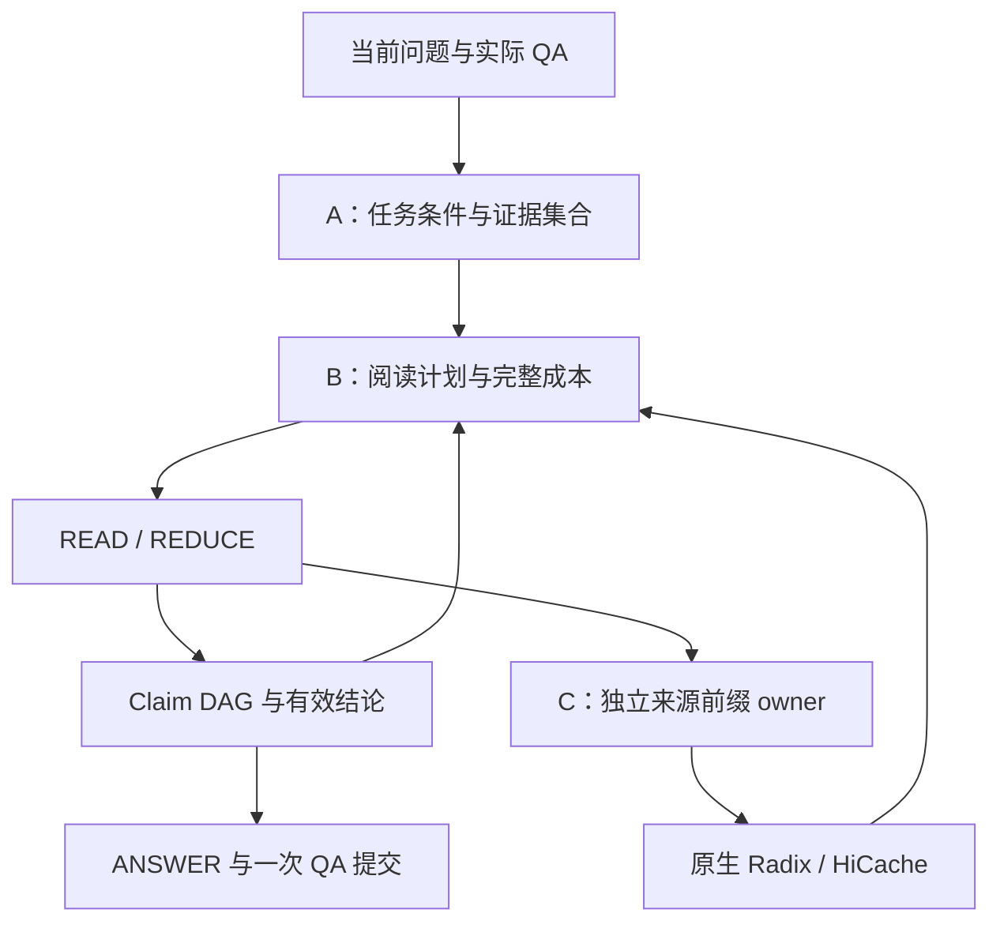

# 课题架构与机制

当前主线是任务证据、有限阅读计算和来源前缀保留的协同。共享类型位于 [context_schema.py](../controller/context_schema.py)；实际执行与提交位于 [execution.py](../controller/execution.py)、[service.py](../controller/service.py) 和 [session_store.py](../controller/session_store.py)。

## 共同状态与调用链

`TaskState` 表达当前任务、Need、条件更新、版本意图和工作历史。`EvidenceSet` 保存来源单元及必要依赖；`ContextPlan` 保存阅读步骤和预算；`ReadResult/ReadingOutcome` 保存实际结论、来源、覆盖和步骤成本。原文档案、最终模型窗口和物理 KV 是三个不同对象，分别由来源目录、上下文编译器和原生引擎维护。

## A：任务、证据与固定模型阅读协议

`adapters/history_state.py` 将实际会话解释为任务操作，保留每个 Need 显式的条件关联。条件替换/撤销只改写引用目标条件的 Need；共享条件由多个 Need 引用同一 ID。`training/task_model.py` 已接通锚点分组、Need 的主体/条件/前驱边与 scope，条件 key/value/predicate 分组及多标签更新目标；目录选择、source_turns 和任务回访恢复也进入监督、损失、解码、严格 v3 资产与评价。该实现尚未产出经训练与开发评价证明有效的学生资产。线上解释后的状态进入检索查询和回答条件。每个 Need 的召回查询只附加其 condition_ids 指向的活跃条件，共享条件须显式关联；当前问题的广义召回流另行保留。

`adapters/evidence_pool.py` 建立原文坐标、版本和依赖目录。task-first E0 使用 `source_rows_pr3` 原行/长行分片，source-first A 使用 canonical 窗口；运行 manifest 记录该选择。目录合并当前检索、历史来源和缺口召回。同一原文命中多个 Need 时合并需求归属，保留最高召回分。`support_model.py` 计算单段与组合支持；`evidence_planner.py` 在正文预算及依赖闭包内组织候选集合。P1 的训练奖励来自绑定 reader 的实际回答差异。标记为 `evidence_set_only` 的 utility 资产在训练和推理时都使用同一输入范围，即任务状态、证据单元与支持图。动作、布局和执行上下文特征均置零。

Qwen3-32B 权重与解码参数冻结。`training.reader_audit` 导出实际 READ/REDUCE/ANSWER traces，直接审核其中的 `actual_output`，用可见输入和完整原文分别核验支持、来源和任务绑定；不再另生成目标答案，不生成 SFT 数据或保存 reader adapter。P0/P1 规划器与两种阅读协议组成归因对照，分别沿自己的实际历史运行 P3。完整联合入口直接读取冻结的 P0 共享 A study 配置，四格共用其支持模型、查询资产、阅读协议与预算。既往 LoRA 的已付调用和训练费用只列为弃用支出，不计入改进结果。

任务教师 wire 为 `owned_task_graph_v7_visible_token_boundaries`，语义版本为 `task_need_semantics_v3_anchored_owned_graph`。教师引用可见窗口的 `boundary_tokens`，映射回原消息 owner 和半开字符坐标 `TextRef(start,end)`；持久化保留原文坐标。Need 与 Condition 必须有实际锚点，实际输入、输出与调用费用由标注入口记录。

在线检索由 `ServingRetriever.configure_study(interpreter, tokenizer)` 绑定，`retrieve_pool(snapshot, query, request_id)` 返回任务、来源池与检索状态。`Controller.serve_turn(context_plans=...)` 或 `EvidenceSelection.context_plans` 注入计划，`extend_open_needs(plan, open_needs, claims)` 返回带新增原文和阅读单元的 `EvidencePool`。支持评分的查询含每个 Need 的 scope、条件和完整版本意图，区分版本锚点与最终适用版本。先评单段，再按配置评 pair/triple；`selection.utility: support_coverage` 对各 Need 取集合内最大适用性乘联合支持，再求均值。集合搜索展开依赖闭包并用实际 tokenizer 计量完整 prompt；beam、动作与布局候选复用已评分支持，不重复调用教师。

任务视图先预留完整当前问题，再为相关来源目录、历史指针及原文分配有限份额；预算外历史图候选同步移除。rollout 保存实际目录、日期与 scope，标注、训练和评价复用同一观测与目录选择规则。输入不可见的监督不参与拟合，评价保留其分母与不可见原因。

## B：有限阅读、有效结论和收益选择

先从实际 ANSWER 窗口扣除系统、任务、工作历史、输出和来源元数据，再把可用结论份额分到 Need、READ 分片和有限 REDUCE 节点。生成输出上限与最终保留份额分别记录。READ 的完整输出结构同时出现在可见消息和原生 JSON 约束中。

READ 按实际 tokenizer 的输入容量与结构化输出容量打包。同来源、条件、版本下的 count/sum 共享一次实体／量值提取。Wire 5 的数值事实包含原文短摘录，并用短 ID 引用来源、条件、Need 和父事实。`numeric_need_isolation` 保留为对照。来源目录按固定 2048-token、最多 8 个非空原文行形成窗口；超长行使用实际 tokenizer 切分，普通行和表格行保持完整。`source_windows` READ 每次执行一个完整窗口与其来源依赖闭包，按来源坐标排序，不随任务预算重新拼包或切片。source-first 的系统与原文段跨操作一致；数值、bridge、条件、运行别名和输出 schema 均在来源之后。超出实际输入/输出份额的完整窗口明确不进入执行。固定窗口的最终净资源收益由完整质量与成本实验评价。缺口由 `unresolved_needs` 统一计算：后续步骤完成终端 Need 后，早期缺口关闭；不同时间范围分别检索，相同关系合并父结论。

共享数值 READ 全部完成后，每个数值 Need 各声明一次显式 `numeric_select` REDUCE。Wire 7 对每个原事实父 ID 给出必填布尔选择，避免稀疏列表漏掉已读事实；量值、实体、单位和来源沿用原事实。CPU 随后按各自 Need 的选中结果执行 count 或 sum。

归约计算分两类。

- `union/count/sum/group` 使用 CPU 的实体、条件、版本对齐与量纲换算，直接保留原始事实的父链。
- `summarize/compare/infer` 使用模型。超窗输入先分成 N 包，每包执行一次；随后只合并至少两个完整结果 bundle，因此最多再执行 N−1 个合并节点。不能继续合并的各根结论组成 forest，整体进入后续回答规划。

`ReductionState` 将一个逻辑归约的完整输入基底、有效结论 frontier 和完成状态挂在最后一个真实 `ReadResult` 上。它不增加模型调用。新全量基底完成后，替代同 Need/operation 的旧子集归约；旧事实依赖仍留在 Claim DAG。未被结论消费的输入与独立分片均保留。逐步骤账本按 step ID 计量实际执行。

`candidates.py` 先以短 ID、共享条件和版本表编译全部有效结论及完整来源路径，再用剩余容量放原文摘录。已读结论的引用与实际可见原文范围分别记录。累计读过的原文大小不会再次成为最终 ANSWER 的正文门槛；可行性由真实编译窗口、输出预算、完整覆盖和累计资源预算决定。

`action_policy.py` 在当前状态比较直接回答、一次 READ、一次 REDUCE 和一次 GAP。`plan_policy.py` 保留完整计划对照的调度与预算接口。

`observed_actions` 模式把直接 ANSWER、一次 READ、一次 REDUCE、一次 GAP 放在同一已观察状态上配对。反事实收益采用 `infer_bridge_ready_or_one_gap_one_terminal_read_v3`：首动作之后，只对尚未满足的 infer 桥接需求接至多一次终端 READ；已有就绪来源优先，否则至多一次 GAP。直接 ANSWER 不续接。线上仍仅执行首动作后重新观察，监督与收益资产绑定相同协议和 `observed_feature_schema=pre_action_budget_support_state_v2`。价值与成本特征同时包含 A 的支持/桥接估计、Need 前驱、已观察终端支持与桥接缺口，以及实际已付 token/墙钟、已执行步骤及对应剩余预算；无界额度用独立标记表达。可选后续在硬步骤不足以完成 READ+ANSWER 或 GAP+READ+ANSWER 时直接进入终端 ANSWER，不启动无预算步骤。
GAP 仅在选中后执行并进入步骤账本；返回的新来源与原事实合并，再决定是否阅读。线上与离线共用 `action_proposals.gap_retrieval_plan`，仅排除实际已读来源闭包；未读候选仍可召回，passage 上限为已读数量加声明新增额度，并受原总上限约束。反事实 REDUCE 使用与线上工厂相同的事实基底，不按原 READ Need 别名或 extract 类型再次筛选。
质量模型学习实际最终质量差。新成本模型用动作前的原生缓存、压力和可编译首步报价预测动作加最终回答的绝对成本；GAP 和 CPU REDUCE 只使用动作前的批级状态。
在线在同一次原生观测下分别预测动作和 DIRECT，再计算带符号差；采集时不同分支的实测成本差保留为诊断，避免把执行顺序产生的预热收益当作动作收益。
已付成本加绝对分支成本约束总预算。明确终止且没有提交回答的分支按零交付效用计，原始评分缺失仍保留；暂停和未决分支不进入这类标签。
`observed_actions` 使用实时原生报价和配对得到的完整分支成本模型，不依赖整计划的执行 profile。
全来源任务先按原计划逐步完成必要 READ、数值选择和 CPU 归约，再比较继续动作与直接回答。
GAP 绑定当前检索器及采集时的材料限额。`whole_plan` 保留原执行 profile 与原生时间标定，作为独立对照。
动作收益资产由 `training.plan_gain_workflow --mode observed_actions` 采集、终止标注和拟合；开发文件报告实际配对质量差的误差，在线质量和时延由完整队列评价。

REDUCE 的完整基底与 frontier 在首次写入 `COMPLETE` 前统一绑定。GAP 的 `RESULT_READY` 直接复用已保存资料，完成账本、后继计划和进度在一个事务中提交，恢复不会重复检索或生成。

## C：独立来源前缀与相对 native 的保留价值

旧 lease 的保持、续租与新前缀在同一次容量分配中竞争；分配器以同一去重净目标比较绝对边际价值与新增容量收益密度两次构造，避免大项阻挡更高总收益的小项组合；保持仅使用剩余期限，不发续租调用，未选旧项释放。同 owner 只选一个期限。读取需求由 scope、完整因果页路径和正文 token 范围共同确定；相同首正文页但不同完整路径是不同需求，共享页只在容量与驻留中去重。

`prefix_view.py` 按完整因果 token 路径识别来源前缀，`prefix_retention.py` 在业务 READ epoch 结束后以独立 owner 继续保护。Radix/HiCache 负责物理页匹配、迁移与淘汰；策略读取当前 active 保护集合，比较保留、延长或释放带来的边际净收益，共享因果页只收一次新增容量和驻留成本。预测压缩为过去访问状态、当前原生驻留、压力/并发组合三个粗特征；训练按独立会话组等权，同窗 TTL 不扩充样本；已付控制成本不再次收取，原生已有的命中也不重复记作保护收益。

C 配对目标为 `paired_native_retention_v5`，需求规则为 `exact_complete_causal_prefix_and_body_ranges_v1`；旧目标资产不能改名复用。配对重放为 Native、TTL15、TTL60、TTL180 使用同一请求序列、DAG、外部压力和至少 180 秒的共同观察窗。并发窗口按 READ 实际完成顺序登记可选前缀，重放沿用记录中的请求到达间隔。保护期限独立于观察长度。实际原文页需求与原生回执分别记录无重访、GPU 命中、Host 回载和重算，混合访问保留各类页数，空闲驻留持续计费。每个窗口只执行一次 Native，再分别与三个 TTL 作差。集合选择使用去重后的下一次 READ 收益，扣除本次控制、新增驻留价格与配对观测的外部请求代价；正 collateral 不另计叠加奖励；单前缀完整窗口预测单独与两臂窗口成本差比较。固定 DAG 回放解析捕获时的输出，新增生成响应用于实际成本计量。相同来源需求事件的预期读取节省取已覆盖的最大值，共享页按租期增量计费。观察保护集合、分配、释放及保留由同一分配锁串行执行。完整目标重访标签、线上需求键与独立会话分组在拟合和开发汇总中一致；不同完整需求的部分页重叠不重复认领整次下一 READ 的节省，逐 TTL 开发统计仅解释配对臂。

前缀观察、分配和完成登记共用分配锁。访问去重与策略完成分别记录；未完成策略恢复执行，原生已经接受的保留通过回执/租期核实后复用。原生明确返回 `PREFIX_NOT_RESIDENT` 时记为保留机会消失，业务 READ 继续。

## 提交、评价与成本

`service.py` 将多个内部步骤组织为一个用户 attempt；最终回答、实际会话状态和旧 epoch 退役记录在一次提交中保存。内部 READ/REDUCE 的生成、辅助模型、检索、等待、回载和提交开销分别进入完整账本。

SQLite 的 `turn_plans` 保存计划，`execution_steps` 保存输入、原生 epoch、输出、解析结果和计时；`reading_progress` 与后继计划原子保存缺口扩展及辅助用量。内部生成使用独立步骤请求和临时 epoch，完整结果保存后登记退役 outbox；重试按步骤账本与原生 status 恢复，最终只提交一次 QA。`reader_*_tokens` 统计 READ/REDUCE/ANSWER，`auxiliary_*_tokens` 统计任务、检索、支持与 gap 调用，`total_*` 为两者之和；未测得的辅助 token 保留空值。`profiling.reading_measurements` 仅从 dev 步骤的实际回执与客户端计时导出校准点，缺失末 token 观测的记录不补成估计。

公开评价复用作者指标规则。MTRAGEval 先完成各分量的可答性条件化，再计算聚合分；2Wiki 官方评价保留所有声明 gold 任务。共同完成子集用于诊断，完整队列用于方案选择。成本同时保存实际生成 token、完整响应、GPU/Host 物理积分与 unique KV 页占用；它们分别解释计算、时延和保护容量。

`bench.capacity_workflow --full-queue` 对完整声明的 350 题在 c4 执行 E0_native 及固定 B / 收益 B × native / value 四格（E1—E4）；c1 只补 E1/E4。每格沿自己的实际问答历史推进。该入口直接使用冻结 A、动作收益与 C 资产，按当前 reader 配置绑定资源；原两轮诊断和 `whole_plan` 保留独立入口。

联合汇总按矩阵既有分区声明分别呈现公开基准、参考历史诊断与构造机制任务，保留原指标、完整分母及未知区间。比较身份核对模型、队列、预算、到达计划和 SLO；完整队列相对 P95 仅在双方完整交付且全部评分时提供，资源变化读取实际成本账本。

固定到达负载将原定请求到达时间传入 `Controller.serve_turn`，因此 B 的已付墙钟预算、步骤账本与最终完整响应使用同一起点，包含真实历史依赖和并发槽前等待。

联合比较还绑定声明的 GPU/Host token 容量、测量设备数量、主机平台、GPU 型号/显存/驱动及实际原生缓存配置。原始 UUID 与设备索引保留在运行观察中；同主机同型号同容量的不同卡可作对照。缺少硬件或原生配置观测时不产生“可比”结论。
