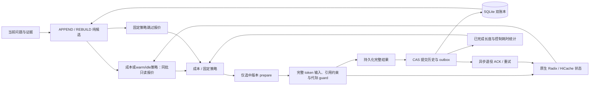

# 实现与事务边界

课题场景、A/B/C 的职责与当前推进顺序统一见[项目范围](project_scope.md)。本文描述现有工程接口与状态流转。

控制器为单 Python 服务，使用 SQLite WAL 保存跨进程一致状态。每个业务会话有串行异步锁，数据库以唯一索引限制一个未决 attempt。多会话可并发，部署默认一个 Uvicorn worker；本地演示使用 SQLite 和 CPU mock。

会话锁通过标准库弱引用登记，由持有者和等待中的协程维持生命周期，闲置后自动回收。SQLite保存持久历史和请求幂等状态。

## 应用层与模块接口

- `schema.py`定义不可变消息、证据、候选、报价和回执；`serialization.py`负责JSON持久化，直接复用原生编码器遍历token容器。
- `evidence.py`以corpus/document/passage/version/SHA256关联来源。短引用碰撞时延长新编号；必需集合来自当前选材、上游选定回访、显式引用和依赖闭包。下游不再按参数、标题或主题词重猜回访对象。新增证据在入口检查正文，内部复用已提交账本。
- `templates.py`与`candidates.py`基于同一快照和当前证据构造完整APPEND/REBUILD。APPEND复用实际执行上下文中的正文，REBUILD使用完整实际QA重建；版本冲突、历史同步、配置变化、恢复及窗口预算决定可行性。
- 相同正文可共享物理span，各来源保留独立ID、地址、版本、依赖与当前引用资格。短正文在别名说明更长时直接展开。引用位置、正文位置与来源映射一起提交；证据冗余按物理区间计一次。
- 模板统一提供`render_many`。Qwen3在确定的AddedToken边界复用共同分词段，其他模板完整编码；最终token IDs进入预算和原生报价。当前来源导航、引用约束及任务条件由两候选共用。
- 会话解释、检索、内容组选材和原文扩展通过`QueryContext`、检索/阅读材料及优先级接入候选构造。解析结果随attempt固定，成功后与QA提交；详细机制见[多轮意图](research/source_grounded_query_resolution.md)，数据与窗口配置见[混合检索](guides/hybrid_retrieval.md)、[文档结构](guides/doc2dial.md)和[表格关系](research/table_relations.md)。
- `planner.py`校验外部报价与候选身份，复用`cost_model.py`的完整执行成本。双候选成本/warm比较接收报价；实测范围以外执行配置的固定策略。公式见[联合决策](research/joint_optimization_model.md)，成本装配与反馈见[阶段成本](guides/stage_cost_model.md)。
- `engine_client.py`提供统一prepare/generate/status/retire/aclose接口。原生XGrammar约束本轮引用ID；SGLang负责实际缓存匹配、分配、调度、传输和淘汰，应用层通过epoch和回执关联执行结果。

## 持久状态

`sessions` 保存当前快照；`ledger_history` 保留每次提交与 P1 历史同步的版本引用。`text_blobs` 按 SHA256 保存唯一正文、提示消息及实际问答文本，archive、attempt 和执行账本通过 `$text` 引用重建，取消额外正文文件副本。引用和正文在同一 SQLite 事务中持久化；`load_record` 供在线恢复和只读冻结重放共用。实际 input/output IDs 保持原值。当前格式为 user_version=2；旧数据库不自动迁移，使用新的 state 目录，原实验库保持原样。

`attempts` 保存请求身份、选中计划、prepare 身份、epoch、完整结果及处理阶段。`request_id` 在同一业务会话内唯一；相同 ID 的不同请求报冲突。数据库保证请求只有一个执行者，按阶段推进并保留已选计划和完整结果。计划与新 epoch 在 prepare RPC 前一起落盘；prepare ACK 与提交标记在 generate RPC 前一起落盘。

一个事务同时写入新 QA、执行账本、当前 epoch、已提交 attempt 和旧 epoch 退役 outbox。事务内重新检查 attempt 阶段与 snapshot version。旧当前epoch在新版本提交后退役。

EventLog 是非事务性诊断输出。序列化或写入失败通过独立错误报告暴露，不改变业务成功/失败；提交后的成本反馈和诊断位于业务异常处理之外，不能把 COMMITTED 记录标成 attempt_failed。研究评测文件的导出失败仍使该实验交付不完整，但不回滚已经提交的真实回答。

多会话的后台退役通知合并到一个运行中的worker。慢退役期间新提交的outbox由下一轮快照继续处理，不为每个已完成请求积压一个等待锁的task；传输结果未知或退役尚未完成时，记录保留在outbox中等待重试。程序错误和协议身份错误写入`epoch_retire_worker_failed`事件，并由`drain`收取；后续已提交回答正常返回。`drain`等待期间保留同一worker引用，新的退役通知继续合并；取消关闭时先结束worker再关闭引擎。缓存诊断计数保存在receipt/事件中，离线报告将无效计数列入`receipt_work.invalid_counters`并排除其对应统计，回答状态保持原值。

引擎侧只保留有限的已退役epoch和终态操作记录，活动/在途记录不参与淘汰。过期后的退役重试以原生generation绑定确认旧引用是否仍存在，ACK不会删除较新的引用。原生缓存重置时同步更换研究restart标识；完整实际历史、幂等状态和待确认outbox继续由SQLite保存。保留窗口与原生机制见[引擎合同](../engine_patches/README.md#观测与恢复合同)。

## 故障恢复

| 状态 | 恢复行为 |
|---|---|
| 构造/报价失败 | 标记失败，语义档案不变 |
| prepare 响应丢失 | 保留 operation ID；恢复时幂等取得原 generation，再清理 |
| 请求已提交但响应丢失 | 查询 scheduler status；只有完整结果可直接恢复提交 |
| 完整结果已落库、提交失败 | 保留 RESULT_READY，同一结果恢复 CAS，不重新采样 |
| 新账本已提交、退役响应丢失或仍在处理 | 保留新答案，outbox 重试 |
| 退役程序或协议错误 | 保留outbox，记录维护错误，由drain报告；后续回答正常提交 |
| APPEND 结果被放弃 | 标记下一轮强制新 epoch；恢复成功后才退役原 epoch |
| 引擎重启 | 原始档案保留；旧实例引用失效，完整重建 |

Mock 与真实 SGLang 的 status 在有限窗口保留完整输出。真实补丁在完整 HTTP 结果交付前将输出与 receipt 发布到有 TTL 和字节上限的恢复缓存；SSE 收到终态 receipt 和 `[DONE]` 后提交。超过恢复窗口或引擎重启后，无法恢复完整结果时，显式放弃已确认终态的结果并使用新 request ID 重试。未知或仍在途的请求继续按恢复流程处理。

准备阶段遗留 attempt 的 `--abandon` 是管理恢复操作，仅在旧控制器已经停止后使用。API定期调用同一drain路径收取后台结果并处理待退役操作；一次维护异常不会终止定时重试，下一轮仍按outbox中的同一操作与代际身份重试。错误未恢复或重试任务已停止时，`/health`返回503与`degraded`，成功排空后恢复；服务关闭取消正常结束重试任务。CLI退出前排空；outbox在进程重启后继续存在。

## 引擎与计量

Mock 模型为 CPU 确定性状态机，用于页边界、共享前缀、软引用、在途副本与故障注入测试。GPU 性能由真实引擎测量。

真实引擎采用固定SGLang及ContextKV协议，配置指纹覆盖模型、tokenizer、template、namespace和cache key。原生B0/B1使用对应基线通道。

退役 ACK 表示软引用已撤销，物理 free 为零。分配、淘汰和传输由原生 admission、锁和完成事件驱动。账本记录逻辑 prompt 长度，物理占用由原生 allocator 计数。

研究客户端与原生基线默认使用 SSE，记录首个非空输出 chunk 和最后一个新增 token chunk。完整响应时间涵盖终态发布和账本提交。非流式或恢复重放的客户端 TTFT 记为未知；服务端时间单独记录。

客户端单调时钟只计算端到端时序；服务端时钟只计算服务器阶段和全局唯一 slot 积分；CUDA event 在原生 ACK 完成点提供传输耗时。探针测得的 `first_token` 已包含服务器排队、恢复、Prefill，不重复累加同一段时间。占用峰值来自观测采样，并非瞬时分配器峰值；缺失数据与事件截断均保留标记。

`ablation.epoch_retirement=false` 让文本 REBUILD 沿用原生 session，P1 历史同步和故障恢复仍创建新 epoch。成本分项消融使用冻结模型并关闭在线残差更新。标定、开发集选择和测试分别记录。
