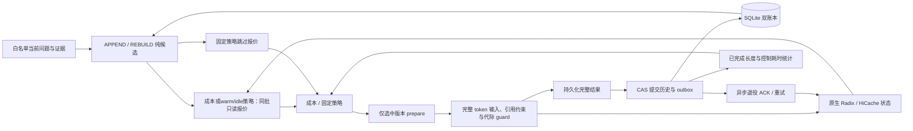

# 实现与事务边界

课题场景、A/B/C 的职责与当前推进顺序统一见[项目范围](project_scope.md)。本文描述现有工程接口；可选研究分支不自动成为主流程前置。

控制器为单 Python 服务；SQLite WAL 是跨进程一致性的边界。每个业务会话有串行异步锁，数据库另有一个未决 attempt 的唯一索引。多会话可并发，部署默认一个 Uvicorn worker。无需数据库服务或 GPU 即可运行正确性演示。

会话锁通过标准库弱引用登记，由持有者和等待中的协程维持生命周期；闲置后自动回收，不随已完成会话永久积累。持久历史和请求幂等仍由SQLite负责，无需锁过期参数或清理线程。

## 应用层

- `schema.py` 定义 frozen dataclass，集合与消息使用不可变结构。`serialization.py` 按类型恢复 JSON，不使用 pickle；写入由原生 JSON 编码器遍历 token 容器，dataclass/集合只做浅层适配，保持原规范字节。
- `evidence.py` 以 corpus/document/passage/version/SHA256 定义身份，稳定引用发生短 hash 碰撞时仅延长新编号。回访只从已归档原文恢复；必须证据先统一形成，再构造候选。
- `templates.py` 对完整 prompt 分词；保留证据原文的消息内字符 span、身份和来源。ByteTemplate 只用于模拟；HuggingFaceTemplate 固定 revision，每个候选只渲染一次；Qwen3 在已核实 AddedToken 边界按请求复用共同分词段，其他 tokenizer 沿用完整 prompt 编码。与原生 apply_chat_template 分词结果的一致性放在 tokenizer 测试中验证。
- 完全相同的正文可共享一个完整物理 span，各来源保留独立 ID、标题、地址、版本、依赖及本轮引用资格。别名显式指向已有正文，声明位置与正文位置一起提交；APPEND 可复用历史执行消息中的正文，只有归档或旧回答包含文本时不能共享。短正文若声明更长则照常展开；最终预算与报价始终使用实际完整 tokens。正文冗余和长度统计按物理区间计一次，ContextPilot 按来源声明所在轮次对齐。这里改变输入组织，不进行任意位置 KV 拼接，缓存匹配仍由 SGLang 处理。
- `candidates.py` 保留完整原始 QA。APPEND 只省略可用正文 span 证明仍在输入中的材料；历史同步、配置变化、冲突版本、恢复或超预算可使其不可行。证据不相交时仍可能复用历史 token 前缀，故共同引用范围之外的旧材料不再直接触发重建，而由 B 根据原生报价比较保留旧上下文与重建的成本。
- 当前消息包含共同的来源定位表：合法ID、来源、标题和已声明章节，不再按词匹配摘录片段或生成用途指引。模型侧只保留引用和阅读所需元数据，完整身份/provenance仍在账本；旧已提交消息保持原样，两种候选使用同一本轮导航，真实tokens进入成本与预算。共享回答协议要求先回答有依据部分，再明确缺失内容。
- Hybrid检索从已有评分池选择至多五个不同内容组，避免相同标题/正文重复占据名额；已知版本、父级范围和依赖参与分组，既有显式条件融合仍保留主任务锚点。选择后解析精确EvidenceKeys及依赖闭包，A/R使用同一结果。本轮引用资格跟随所选来源，旧档案不删除。分组不增加索引搜索或模型调用；普通前五段的不同正文保留，新增材料的适用性及实际回答仍需核查。
- 显式来源窗口将同源、同文档/版本/章节的相邻原文放入`supporting_contexts`，不伪造检索评分或改变原排名。位置索引只在语料加载时建立，原文不按offset拼接；HTTP、控制器CLI和Native统一解析补充段落及依赖后进入共同A/R。默认关闭，当前适用边界见评价文档。默认解释服务与主生成服务分开，只有8B生成实例使用现有8B成本表。
- 原始文档阅读视图在既有检索之后恢复匹配片段所在的完整自然段及周边原文，合并重叠窗口后替代未声明结构的切片。原始排名保存在`retrieval_contexts`，实际阅读集合进入共同A/R和成本/提交；参数anchors从窗口原文提取，已有章节/依赖闭包保持原路。阅读片段使用带派生版本的稳定ID，同一原文窗口可由不同小片段命中并复用。
- `engine_client.py` 与原生对照共同复用 SGLang 的 XGrammar/regex 约束，只允许本轮合法 ID 出现在规范 `[E_…]` 引用中。没有第二次生成、事后替换引用或改写历史；引用覆盖与语义支持仍需独立检查。
- `cost_model.py` 按 prefix/suffix/host-load/concurrency 复用固定耗时测量和插值结构。长度先验另外检查回答协议；未绑定或不同协议不沿用旧长度分布，使用配置先验及本会话已完成历史。等待预测优先使用本服务最近 128 个已提交输出的实际长度，容量预留继续使用原生预算。
- `planner.py` 比较预计完整成本，追加/重建分别使用最近完成请求的控制耗时；误差带仅作诊断，相同成本才比较原生工作集。未支持范围使用既有回退。耗时模型默认冻结，`observe` 的可选残差更新与长度/控制耗时反馈分开，不需要训练。

校验集中在数据进入、引擎响应和持久提交边界。新传入证据在候选入口校验一次内容 hash，内部共用证据索引并信任已提交的不可变账本；归档时不重复哈希或读回已有正文。报价身份由计划器统一校验，成本模型直接使用已校验的数据。保留用于证据身份、实际输入关联和请求幂等的 hash，以及 CAS、epoch 代际和完整回答提交约束；不为内部正常数据增加重复防御层。

## 持久状态

`sessions` 保存当前快照；`ledger_history` 保留每次提交与 P1 历史同步的审计副本。语义历史与执行消息、实际 input/output IDs 分开。证据文本另按内容 SHA256 存储。

`attempts` 保存请求身份、选中计划、prepare 身份、epoch、完整结果及处理阶段。`request_id` 在同一业务会话内唯一；相同 ID 的不同请求报冲突。跨控制器重复 begin 不会获得执行权。状态只能前进，已选计划和已完成结果不能由旧对象覆盖。计划与新 epoch 在 prepare RPC 前一起落盘；prepare ACK 与提交标记在 generate RPC 前一起落盘，避免无外部调用间隔的重复持久化。

一个事务同时写入新 QA、执行账本、当前 epoch、已提交 attempt 和旧 epoch 退役 outbox。事务内重新检查 attempt 阶段与 snapshot version。新版本提交前绝不退役旧当前 epoch。

多会话的后台退役通知合并到一个运行中的worker。慢退役期间新提交的outbox由下一轮快照继续处理，不为每个已完成请求积压一个等待锁的task；失败仍留在原持久outbox，由既有周期重试或显式drain处理。此处不改变原生淘汰策略，也不将减少控制器任务误报为释放GPU KV。

## 故障恢复

| 状态 | 恢复行为 |
|---|---|
| 构造/报价失败 | 标记失败，语义档案不变 |
| prepare 响应丢失 | 保留 operation ID；恢复时幂等取得原 generation，再清理 |
| 请求已提交但响应丢失 | 查询 scheduler status；只有完整结果可直接恢复提交 |
| 完整结果已落库、提交失败 | 保留 RESULT_READY，同一结果恢复 CAS，不重新采样 |
| 新账本已提交、退役失败 | 保留新答案，outbox 重试；不能回滚 |
| APPEND 结果被放弃 | 标记下一轮强制新 epoch；恢复成功后才退役原 epoch |
| 引擎重启 | 原始档案保留；旧实例引用失效，完整重建 |

Mock 与真实 SGLang 的 status 在有限窗口保留完整输出。真实补丁在完整 HTTP 结果交付前将输出与 receipt 发布到有 TTL 和字节上限的恢复缓存；SSE 必须收到终态 receipt 和 `[DONE]` 才可提交。超过恢复窗口或引擎重启后，无法恢复完整结果时需要显式放弃已确认终态的结果并使用新 request ID 重试。该协议不提供跨引擎重启的 exactly-once 生成。未知或仍在途的状态不会被超时自动当作失败。

准备阶段遗留 attempt 的 `--abandon` 是管理恢复操作，仅在旧控制器已经停止后使用。API 会定期重试退役，CLI 退出前排空；outbox 在进程重启后继续存在。

## 引擎与计量

Mock 模型为 CPU 确定性状态机，用于页边界、共享前缀、软引用、在途副本与故障注入测试。其 token slot 和耗时不能用于 GPU 性能结论。

真实引擎必须匹配固定 SGLang commit 及研究协议能力，配置指纹同时覆盖模型、tokenizer、template、namespace 和 cache key。普通未补丁服务器不能冒充 epoch guard 支持者。原生 B0/B1 使用单独的基线通道。

退役 ACK 表示软引用已撤销，物理 free 为零。真实分配、淘汰和传输仍走原生 admission、锁和完成边界。账本中逻辑 prompt 长度不能当作唯一物理占用。

研究客户端与原生基线默认使用 SSE，记录首个非空输出 chunk 和最后一个新增 token chunk，终态发布开销不计入末 token 时刻。完整响应和账本提交仍计入完成时间。非流式或恢复重放没有客户端首 token 观测，故 TTFT 保持未知；不能用服务端首 token 墙时填补客户端指标。

客户端单调时钟只计算端到端时序；服务端时钟只计算服务器阶段和全局唯一 slot 积分；CUDA event 在原生 ACK 完成点提供传输耗时。探针测得的 `first_token` 已包含服务器排队、恢复、Prefill，不重复累加同一段时间。占用峰值来自观测采样，并非瞬时分配器峰值；缺失数据与事件截断均保留标记。

`ablation.epoch_retirement=false` 让文本 REBUILD 沿用原生 session，P1 历史同步和故障恢复仍创建新 epoch。成本分项消融使用冻结模型，不能再用总延迟残差把被移除的成本学回去。完整标定冻结、开发集选择和测试数据彼此分离。
