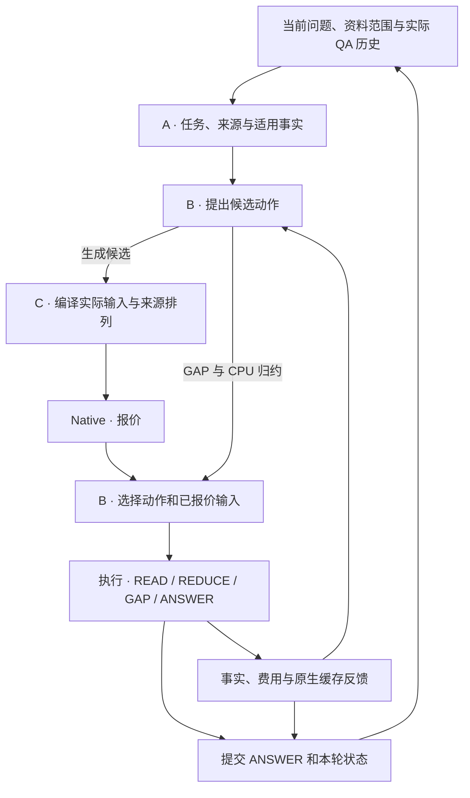

# 课题架构与机制

`DocumentQA` 是资料登记、HTTP 问答与 `bench.study` 的共同入口。登记的版本化原文与会话账本共用 SQLite。所有方法使用固定 Qwen3-32B 生成模型。

## 共同状态与调用链

`TaskState` 保存当前 Need、条件、版本意图和工作历史。`EvidenceSet` 保存版本化来源及依赖，`ContextPlan` 声明阅读步骤和预算，`ReadingOutcome` 保存实际结果、覆盖与步骤账本。原文档案、模型实际可见内容和物理 KV 分别由来源目录、请求编译器和 Native 管理。[共享类型](../controller/context_schema.py)

## A · 任务、证据与跨轮事实

任务解释从当前问题与实际 QA 提取 Need、主体、前驱和适用条件。条件替换与撤销只影响引用该条件的 Need，工作历史按原坐标移除失效条件。逐 Need 检索、支持、READ 和 ANSWER 使用条件键、值和谓词的同一原文解析规则。READ 和 ANSWER 同时接收实际版本时间原文。教师在预算内以可见窗口的 token 边界引用原文，持久化时还原为消息与半开字符坐标。[任务解释](../adapters/history_state.py) · [任务投影](../controller/context_budget.py)

登记资料的范围在解释前生效，来源目录和复用合同均按本次范围投影。解释后先过滤适用版本，再展开来源依赖。全资料覆盖、GAP 与事实复用共用同一有效资料范围。当前研究配置使用 BM25＋BGE dense 混合召回与发布版 BGE reranker。`selection.mode: ranked` 按重排顺序、依赖闭包、实际 ANSWER 窗口及 passage 额度选材。固定 B 与收益动作 B 消费一个初始材料集合。可选 `selection.mode: support` 另评单段和互补组合，按支持效用、完整 Need 数、相关性和 token 成本选择。`whole_plan` 对照保留多个集合供下游决策。[检索与选材](../adapters/study_retrieval.py)

规范来源窗口按实际 tokenizer、原文坐标和版本定义，当前粒度为 2048 token、最多 8 个非空原文行。超长行按 tokenizer 切分，其他行保留完整。标题、表头与注释随数据窗口的依赖闭包读取。source-first 将当前条件、事实别名和输出协议放在稳定原文之后，多个窗口可合并进一次 READ。[来源窗口](../controller/source_windows.py)

同会话已提交的 READ 产生可见复用合同。当前任务解释选择适用合同，并核对版本、内容 hash、范围、条件和字段。逻辑复用节点导入原子事实，当前统计仍按本轮 Need 选择和计算。`complete` 按实际原文区间并集核算覆盖，`facts` 只导入事实。历史 claim ID 用于追溯，当前调度依赖取自生产者的 `ReadResult.step_id`，GAP 重建保留已完成逻辑节点。[事实复用](../controller/fact_reuse.py) · [动作提案](../controller/action_proposals.py)

## B · 阅读、计算与停止

从真实 ANSWER 窗口扣除任务、历史、输出和来源元数据后，再分配结论份额。READ 同时按实际输入和结构化输出预留打包窗口及依赖；预留考虑事实结构、非空行和正文长度。最终 ANSWER 先编译有效结论与来源链，再使用剩余空间容纳原文摘录。逐步账本区分实际可见原文与已读结论的来源。[窗口分配](../controller/context_budget.py) · [阅读计划](../controller/reading.py)

source-first ANSWER 的实际顺序为系统、稳定原文、工作历史、当前任务与完整结论。原文直接入口与阅读后回答共用消息组装；选材测量和最终窗口使用相同布局。APPEND 延续已提交的 token 前缀，新增资料与当前任务追加在其后。

同来源、版本与条件的数值 Need 共享提取。各 Need 的 `numeric_select` 按原事实 ID 生成布尔选择，按实际输入和输出容量有限分包，最后一包登记完整基底和已选事实。CPU 执行 `union/count/sum/group` 并保留来源父链，模型执行必要的 `summarize/compare/infer`。模型归约按有限输入分包，只有能合并至少两个完整结果才继续合并；未合并的结果也可进入 ANSWER。全资料覆盖与统计操作按任务要求完成；所选来源读完后的必要数值运算同样走固定规则。可选 REDUCE 受收益资产覆盖约束。[执行与归约](../controller/execution.py)

固定 B 在原文实际完整可见或结论充分时跳过阅读。收益 B 在当前状态比较直接 ANSWER、下一 READ、当前 REDUCE 与一次 GAP。普通所选来源任务可回答已有依据的部分并说明缺口；全资料和统计任务仍检查覆盖与运算。选中 GAP 后才检索，未读范围为候选根，实际 READ 保留旧依赖，原 passage 额度只扣新增来源。每次执行后重新观察事实、缺口、预算和缓存状态。[动作决策](../controller/action_policy.py) · [滚动执行](../controller/rolling_policy.py)

离线配对在同一已观察状态以当前材料上的 ANSWER 为基准。首动作后，尚未满足的 infer 桥接需求优先接一次就绪的 READ，必要时可先接一次 GAP；每条分支保存实际输入、成本和官方 RB_llm。无提交回答的确定终止按零交付效用标注，原始评分留空。已完成 READ 分支的 ANSWER 前状态可作为独立派生观测，沿用当时的事实、实际终端报价和已付费用。[配对入口](../training/plan_gain_workflow.py)

质量头用岭回归拟合相对直接 ANSWER 的最终质量差。绝对成本头用交付答案的分支拟合，失败分支继续参与质量监督和费用汇总。成本特征包括首步实际输入、预填充与 Host 回载报价、剩余必读正文和输出额度、GAP 查询与排队量。固定后续预测用于排序。准入另计已付逻辑 token、当前请求、最终回答固定输入与输出，以及已登记的必要后续步骤。有限时间预算使用独立开发会话的低估余量，每步复查实际已用时间。`input_protocol` 绑定来源、编译和预算语义。[收益与成本模型](../training/plan_gain_completion.py) · [预算预留](../controller/context_budget.py)

## C · 编译、Native 报价与缓存反馈

`RequestCompiler` 为 source-first READ 和 ANSWER 使用同一系统消息及原文格式。相同原文窗口按相同顺序进入请求时，两类请求的完整来源前缀相同。任务、历史、条件、引用映射与检索排名在来源之后。Native 编译使用原顺序，`cache_compilation.mode: contextpilot` 另使用作者 CPU index/reorder 提出排列。排序按报价比较新增预填充、Host 回载和输入长度。选中动作执行同一已报价输入，APPEND 保持已提交前缀。[请求编译器](../controller/request_compiler.py) · [来源格式](../controller/source_prompt.py)

编译时由实际 tokenizer 同时生成 token 与原文区间，候选绑定 READ/REDUCE 的步骤和输出 schema。报价、执行和回执复用编译结果。步骤账本保存正文 token 区间与因果边界，ContextPilot 索引据此登记已执行排列。原生回执记录实际预填充和 Host 回载。与所选报价配对时，记录提交时的报价年龄与工作量差值。Native Radix/HiCache 管理页匹配、迁移和淘汰。[来源前缀](../controller/prefix_view.py)

可选 TTL/value 在独立 owner 的保护预算中比较保留、续租和释放。读取需求按完整因果前缀与正文范围确定，共享页按并集占容量。价值比较相对 Native 的额外节省，扣除控制、驻留和挤出代价；配对 Native、TTL15/60/180 复用同一到达轨迹和观察窗。控制费用进入已付账本，B 可使用实际 callback 均值预测首个 READ 的控制开销。[可选保留策略](../controller/prefix_retention.py)

有限联合决策在同一轮比较有效原文、完整事实或归约结论、原文与结论混合三类实际 ANSWER 输入，并为两个就绪 READ、必要归约和 GAP 留出候选位。原文候选独立检查实际来源覆盖，结论候选检查 Need 和归约依据。各表示共用编译器、Native 报价和完成预算。[候选与滚动执行](../controller/rolling_policy.py)

`DemandState` 从已观察事实和步骤投影剩余 Need、来源范围、缺字段与依赖。每个选项随同请求生成自己的保留增量。需求策略取就绪后续请求与已执行输入的共同因果前缀，按实际 GPU 报价截到页边界，并要求共享部分至少包含一页原文正文。Native 压力下为仍需的路径分配短租，按后续请求和共享页分别去重。所选增量在下一步前应用，原报价仍保留观察时的命中。ANSWER 终止时释放该会话的需求 owner。[需求](../controller/demand.py) · [保留](../controller/prefix_retention.py)

## 提交、评价与成本

一个用户 attempt 可以包含多个内部步骤。最终回答、真实会话状态与旧 epoch 退役记录在一次提交中保存；下一轮据此读取实际 QA、已提交事实与来源目录。固定到达时间统一用于累计预算和完整响应，包含历史依赖及并发槽前等待。账本分别记录生成及辅助 token、完整响应、GPU/Host 物理积分和 unique KV 页；未测量的辅助用量保留空值。[服务与提交](../controller/service.py) · [账本](../controller/session_store.py)

资料登记事件记录实际时间窗口和 CPU 用量，完整成本索引按事件身份排重。登记工作量单列，GPU/Host 费用使用共用采样积分。

### 故障恢复

步骤账本保存实际输入、原生 epoch、回执、解析结果与进度。内部模型调用在保存 SUBMITTED 后遇到传输异常，会按原调用 ID 查询 Native 状态。已有结果直接回放，明确终止或结果过期时保存已知费用。辅助 HTTP 调用以 call ID 登记提交和回执，解析失败仍计费。GAP 已保存的返回材料与后继计划原子提交，最终 QA 只提交一次。

### 当前比较

评分从实际最终可见原文和结论来源闭包投影，完整原文独立供审计。LlamaIndex 的投影还包括实际中间 compact/refine 输入所见的原文片段。[评分投影](../bench/quality.py)

`bench.capacity_workflow --full-queue` 声明 350 题、77 会话。c1/c4 分别执行 E1–E4 的固定／收益 B × Native／ContextPilot 四格、E5 的有限表示及 E6 的需求保留。每格使用自己的实际 P3 历史、共同到达序列及完整费用口径。外部参照 `LlamaIndex_native` 使用上游历史凝练、混合检索、发布版重排与 compact/refine。`S3_contextpilot_no_fact_reuse` 关闭 E4 的跨轮事实复用。[矩阵](../configs/study_matrix.yaml) · [运行入口](study/final_runbook.md)
