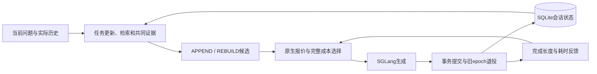

# 架构与机制

ContextKV面向多资料、长上下文、条件与证据动态变化的多轮问答。控制器是单Python服务；同一会话串行，不同会话并发，共享SGLang及检索资源。

## A：任务与证据

`adapters/conversation.py`用一次结构化解释维护`TaskFrame`：任务、主题、对象、命名条件和子需求。保留任务时承接已有需求；替换任务时更新需求。条件省略表示保留，空值表示删除。解释器读取实际问答和已有状态，明确回访时选择对应旧轮次；结果与回答一同提交。

`controller/schema.py`定义共享请求和证据类型；已提交历史与任务状态由`conversation.py`投影。`hybrid_retrieval.py`复用BM25S、BGE-M3、RRF和BGE重排；主任务及子需求进入同一评分流程。默认按不同内容组选择材料，复合任务保留主任务首组，再按需求排名覆盖增加材料。来源窗口、原文结构和声明依赖由`corpus.py`等适配器提供。配置见[检索](guides/hybrid_retrieval.md)。

`controller/evidence.py`以资料库、文档、片段、版本和正文摘要标识证据。当前检索、显式回访、指定引用和依赖共同确定本轮材料及引用范围；同文来源保留独立身份并共享正文。

`candidates.py`与`templates.py`在同一快照、任务与证据集合上构造两个候选：APPEND复用执行上下文中的正文，REBUILD以实际问答和当前材料重建。版本变化、引用范围及真实token预算决定候选可行性。生成器接收完整原文与实际历史；任务解释用于承接需求和检索。

## B：完整成本决策

`planner.py`读取同批只读缓存报价，调用`cost_model.py`比较预计完整耗时：本地控制开销、准备与等待、forward到首token、后续decode。实测成本按前缀、后缀、Host恢复量和并发插值；回答长度取已完成输出统计。

`admission.py`根据原生预算、活动请求和队列估计等待。容量预留沿用请求预算，服务时长使用经验输出分布；二者分别记账。误差接近时结合原生工作集和输入长度选择，测量范围外使用配置的固定策略。在线服务与离线回放共用`assemble_cost_model`。公式、拟合和测量口径见[成本标定](guides/stage_cost_model.md)。

## C：提交与KV生命周期

`service.py`组织候选、执行和反馈，`session_store.py`用SQLite事务保存实际问答、证据档案、执行账本、attempt和退役outbox。业务epoch关联原生会话generation及引擎restart身份。新结果完整落盘后，一次事务提交会话状态并登记旧epoch退役；后台worker处理outbox。

`engine_client.py`统一prepare、generate、status和retire。固定SGLang补丁提供报价、代际绑定、完成回执与引用退役；Radix/HiCache执行物理缓存管理。退役解除业务引用保护，物理空间按原生引用计数和淘汰规则回收。可选Host准入按请求累计备份页预算执行，细节见[引擎实现](../engine_patches/README.md)。

| 边界 | 处理方式 |
|---|---|
| 请求重试 | 同一request ID复用已保存attempt与结果 |
| 完整结果已保存、提交未完成 | 恢复提交同一结果 |
| 结果已提交、退役未完成 | 返回已提交回答，outbox继续处理 |
| 引擎重启 | 保留实际历史和证据，以新epoch重建 |

身份、完整结果与事务检查集中在接口和提交边界。日志、统计和离线导出独立于回答提交。HTTP部署及管理恢复入口见[接口](guides/http_retrieval.md)。

## 工具与运行边界

`controller/`、运行时资料/检索适配和SGLang桥接构成服务链路。共享请求类型定义在`schema.py`，在线检索不依赖MT-RAG任务读取器。退役处理由`Controller`管理，生成配置与输入装配分别归入`config.py`和`templates.py`。

`bench/`提供评测、结果分析和CPU模拟后端；`profiling/`采集成本、拟合及运行探针；`scripts/`准备环境和数据；`tests/`验证行为。它们不作为课题机制模块。标定结果是B的输入数据，测试结果保存在`runs/`。

配置、源码、索引文件和实验结果不通过层层文件hash控制运行或复算。正文摘要用于共享和版本识别，token与分词指纹用于原生缓存匹配；模型配置直接比较，检索索引使用声明的资料快照。

## 复用与适配

| 复用依据 | 本项目工作 |
|---|---|
| SOM-DST、JSON Merge Patch | 用选择性更新维护开放任务、条件与子需求 |
| BM25S、BGE、RRF、需求覆盖；Contextual Retrieval与原文窗口 | 将当前需求传递到检索，保留来源范围、原文坐标和依赖 |
| ContextPilot | 在不可变快照上构造共享材料的追加/重建候选，结合版本与正文跨度判定复用 |
| SGLang Radix/HiCache、阶段测量与队列分析 | 用原生报价和实际阶段成本决策，区分容量预算与服务长度 |
| 原生会话软引用、事务outbox、EfficientAgent工作集思想 | 关联业务epoch、提交和引用退役，适配Host备份预算 |

出处统一在[参考工作](references.md)，效果与尚未覆盖的场景统一在[数据与评价](data_and_evaluation.md)。
