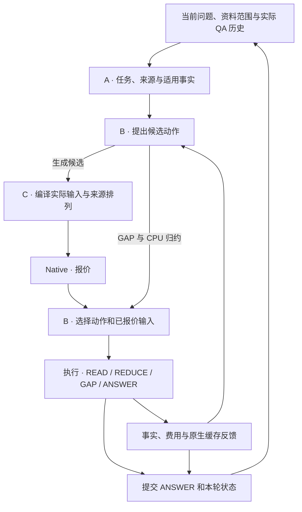

# 课题架构与机制

`DocumentQA` 是资料登记、HTTP 问答与 `bench.study` 的共同入口。登记的版本化原文与会话账本共用 SQLite。所有方法使用固定 Qwen3-32B 生成模型。

## 共同状态与调用链

`TaskState` 保存当前 Need、条件、版本意图和工作历史。`EvidenceSet` 保存版本化来源及依赖，`ContextPlan` 声明阅读步骤和预算，`ReadingOutcome` 保存实际结果、覆盖与步骤账本。原文档案、模型实际可见内容和物理 KV 分别由来源目录、请求编译器和 Native 管理。[共享类型](../controller/context_schema.py)

## A · 任务、证据与跨轮事实

任务解释从当前问题与实际 QA 提取 Need、主体、前驱和适用条件。条件替换与撤销只影响引用该条件的 Need，工作历史按原坐标移除失效条件。逐 Need 检索、支持、READ 和 ANSWER 使用条件键、值和谓词的同一原文解析规则。READ 和 ANSWER 同时接收实际版本时间原文。教师在预算内以可见窗口的 token 边界引用原文，持久化时还原为消息与半开字符坐标。等待教师 HTTP 响应时释放检索锁，费用按当前请求核算。[任务解释](../adapters/history_state.py) · [任务投影](../controller/context_budget.py)

登记资料的范围在解释前生效，来源目录和复用合同均按本次范围投影。解释后按版本及各 Need 明确声明的类别条件筛选来源，再展开来源依赖。全资料覆盖、GAP 与事实复用共用这一适用性规则。检索复用 BM25、BGE dense、RRF 和可选发布版 reranker；实际启用的 stage、查询适配器和重排资产由 retriever 配置与运行 manifest 记录。`selection.mode: ranked` 消费实际检索相关性顺序，按依赖闭包、实际 ANSWER 窗口及 passage 额度选材，不会单独启用 reranker。固定 B 与收益动作 B 消费一个初始材料集合。可选 `selection.mode: support` 另评单段和互补组合，按支持效用、完整 Need 数、相关性和 token 成本选择。`whole_plan` 对照保留多个集合供下游决策。[检索与选材](../adapters/study_retrieval.py)

规范来源窗口按实际 tokenizer、原文坐标和版本定义，当前粒度为 2048 token、最多 8 个非空原文行。超长行按 tokenizer 切分，其他行保留完整。标题、表头与注释随数据窗口的依赖闭包读取。source-first 将当前条件、事实别名和输出协议放在稳定原文之后，多个窗口可合并进一次 READ。[来源窗口](../controller/source_windows.py)

同会话已提交的 READ 产生可见复用合同。当前任务解释选择适用合同，并核对版本、内容 hash、范围、条件和字段。逻辑复用节点导入原子事实，当前统计仍按本轮 Need 选择和计算。`facts` 导入原子事实及来源；`complete` 同时生成已读覆盖，供当前计划扣除完成区间。历史 claim ID 用于追溯，当前调度依赖取自生产者的 `ReadResult.step_id`，GAP 重建保留已完成逻辑节点。[事实复用](../controller/fact_reuse.py) · [动作提案](../controller/action_proposals.py)

## B · 阅读、计算与停止

从真实 ANSWER 窗口扣除任务、历史、输出和来源元数据后，再分配结论份额。READ 同时按实际输入和结构化输出预留打包窗口及依赖，预留考虑事实结构、非空行和正文长度。最终 ANSWER 先编译有效结论与来源链，再按模型窗口和累计 token 预算中较小的剩余额度补充原文摘录。逐步账本区分实际可见原文与已读结论的来源。[窗口分配](../controller/context_budget.py) · [阅读计划](../controller/reading.py)

`reading.input_target_tokens` 用于原文分包。执行时按实际输入与输出检查模型窗口，并计入累计 token；计划命名或结论份额更新造成的少量提示增长不会把分包目标变成额外拒绝条件。REDUCE 继续按实际父事实的输入份额分包。

source-first ANSWER 的实际顺序为系统、稳定原文、工作历史、当前任务与完整结论。原文直接入口与阅读后回答共用消息组装；选材测量和最终窗口使用相同布局。APPEND 延续已提交的 token 前缀，新增资料与当前任务追加在其后。

同来源、版本与条件的数值 Need 共享提取。解析器在同一次 READ 中用原文摘录或唯一记录 ID 绑定事实，从对应窗口恢复数量、单位、版本与依赖。显式分隔的字段行也可直接产生候选事实。同一范围共用一次 `numeric_select`，按原事实 ID 为各 Need 独立判断对象范围、条件与度量，再生成布尔视图。分包使用实际输入和输出容量，最后一包登记完整基底和已选事实。CPU 执行 `union/count/sum/group` 并保留来源父链，模型执行必要的 `summarize/compare/infer`。模型归约按有限输入分包，只有能合并至少两个完整结果才继续合并。ANSWER 保留当前归约未合并的事实以及多跳 READ 引用的前提。全资料覆盖与统计操作按任务要求完成，所选来源读完后的必要数值运算同样走固定规则。可选 REDUCE 受收益资产覆盖约束。[阅读与原文绑定](../controller/reading.py) · [执行与归约](../controller/execution.py)

联合方案对明确命名同一记录类别的全资料 count/sum 请求先做 CPU 投影。全部原始记录行能按同一字段和单位绑定时，投影登记原文覆盖和事实，随后使用原有 count/sum 归约和 ANSWER 编译。跨轮事实已完整覆盖当前 Need 时直接复用；其余情况先尝试当前原文的完整投影，成功后用该结果统一构成初始事实，避免与部分旧事实重复计数。不适用投影的任务沿用已有事实继续模型 READ 与 `numeric_select`。

固定 B 在原文实际完整可见或结论充分时跳过阅读。收益 B 在当前状态比较直接 ANSWER、下一 READ、当前 REDUCE 与一次 GAP。两者在提交前都检查统计任务的来源覆盖、未解字段和已完成运算。范围已完整覆盖且确无合格记录时，计数和求和输出零值并保留来源证明。语义任务在资料范围读完后可回答已有依据的部分并报告未解决点，完整覆盖与问题可回答性分别判断。模型 infer/compare 同时接收当前 Need 的事实、前驱 Need 的结论根及 OpenNeed 指定的父事实。选中 GAP 后才检索，未读范围为候选根，实际 READ 保留旧依赖，原 passage 额度只扣新增来源。每次执行后重新观察事实、缺口、预算和缓存状态。[动作决策](../controller/action_policy.py) · [滚动执行](../controller/rolling_policy.py)

离线配对在同一已观察状态以当前材料上的 ANSWER 为基准。首动作后，尚未满足的 infer 桥接需求优先接一次就绪的 READ，必要时可先接一次 GAP；每条分支保存实际输入、成本和官方 RB_llm。无提交回答的确定终止按零交付效用标注，原始评分留空。已完成 READ 分支的 ANSWER 前状态可作为独立派生观测，沿用当时的事实、实际终端报价和已付费用。[配对入口](../training/plan_gain_workflow.py)

质量头按动作类别分别用最多 4 叶的回归树拟合相对直接 ANSWER 的最终质量差，线性岭回归保留为实际对照。以 `(state_key, direct.record_id)` 为决策单位，每个状态内候选误差取均值，使候选数量不改变该状态的总权重。树的叶值为加权训练收益均值，线上只遍历分裂节点。绝对成本头按唯一已交付真实分支拟合，失败分支继续参与质量监督和费用汇总。完整剩余目录、首步实际输入、预填充与 Host 回载报价、GAP 查询和排队量作为动作前特征；目录中的每个 READ 不因此成为本次已决定的调用。可选动作按有界后续的预测排序，统计所需的 READ 与归约按必做步骤调度。

回答表示另用真实终端状态上的原文、结论、混合回答配对监督。混合表示作为当前直接回答参照；其余表示使用各自实测质量差。没有对应标签的表示不赋予零质量损失。终端采集复用实际可执行的 ANSWER 候选，保持已完成阅读及其费用。

准入使用独立的完整逻辑 token 与步骤预留：已付费用、当前请求、已登记的必要 READ/REDUCE，以及最终结论通路的 ANSWER 输入和输出。已知事实按实际执行消息与 tokenizer 计量，确定性计算可直接投影其结果；尚未产生的内容使用已有输出上限和保留结论份额。事前终端输入按 facts 表示计量，真正选择 ANSWER 时再按该候选的原文、结论和历史精确计量，补充原文使用实际剩余额度。READ 改组后重新分配未完成部分的结论份额，已完成结果保持原分配。时间与 GPU/Host 费用使用实测资产预测；有限时间预算同时使用独立开发会话的低估余量及可用的真实余程观测。`input_protocol` 绑定实际输入语义；成本资产另标明完整预算特征口径。[收益与成本模型](../training/plan_gain_completion.py) · [预算预留](../controller/context_budget.py)

## C · 编译、Native 报价与缓存反馈

`RequestCompiler` 为 source-first READ 和 ANSWER 使用同一系统消息及原文格式。相同原文窗口按相同顺序进入请求时，两类请求的完整来源前缀相同。任务、历史、条件、引用映射与检索排名在来源之后。Native 编译使用原顺序，`cache_compilation.mode: contextpilot` 另使用作者 CPU index/reorder 提出排列。排序按报价比较新增预填充、Host 回载和输入长度。作者索引还返回真实执行过的来源序列：仅连续路径前缀可提出未完成 READ 的局部改组，依赖闭包和原分包器仍负责容量。组织候选沿用两个 READ 的决策额度，完整剩余 READ 分别编译报价，选中目录在执行和租约变更前持久化。选中动作执行同一已报价输入。跳过阅读与后续决策共用已编译的合法 ANSWER 候选。APPEND 保持已提交前缀。[请求编译器](../controller/request_compiler.py) · [来源格式](../controller/source_prompt.py)

编译时由实际 tokenizer 同时生成 token 与原文区间，候选绑定 READ/REDUCE 的步骤和输出 schema。同一轮滚动决策复用完全相同的 READ 消息的 tokenizer 结果，按最新 Native 状态重新报价。步骤账本保存正文 token 区间与因果边界，ContextPilot 索引据此登记已执行排列。原生回执记录实际预填充和 Host 回载。与所选报价配对时，记录提交时的报价年龄与工作量差值。Native Radix/HiCache 管理页匹配、迁移和淘汰。[来源前缀](../controller/prefix_view.py)

完整预算中的多个未来请求批量编译。Qwen 模板的 AddedToken 消息边界隔离了各段编码，单条与批量编译共用稳定段的 token 和坐标；正文没有改变时复用该段编码。

可选 TTL/value 在独立 owner 的保护预算中比较保留、续租和释放。读取需求按完整因果前缀与正文范围确定，共享页按并集占容量。价值比较相对 Native 的额外节省，扣除控制、驻留和挤出代价；配对 Native、TTL15/60/180 复用同一到达轨迹和观察窗。控制费用进入已付账本。B 用已交付训练分支的实际 READ 次数均值乘以实测 callback 均值，未有次数观测时只计当前确定执行的 READ；owner 新建和续期单独计一次。[可选保留策略](../controller/prefix_retention.py)

有限联合决策在同一轮比较有效原文、完整事实或归约结论、原文与结论混合三类实际 ANSWER 输入，并为两个就绪 READ、必要归约和 GAP 留出候选位。原文候选独立检查实际来源覆盖，结论候选检查 Need 和归约依据。各表示共用编译器、Native 报价和完成预算。[候选与滚动执行](../controller/rolling_policy.py)

`DemandState` 从已观察事实和步骤投影剩余 Need、来源范围、缺字段与依赖。每个选项随同请求生成自己的保留增量。需求策略取就绪后续请求与已执行输入的共同因果前缀，按 Native 的可恢复边界对齐到页，并要求共享部分至少包含一页原文正文。报价分别暴露 GPU/Host 就绪区间和各层硬锁之外的可淘汰区间；仅有 Host 副本的前缀也可获得短租。

GPU 压力由消费者之前已知步骤的累计新增 KV 与已观测并发负载估算。Host 压力按原生 write policy、已有及进行中的副本和请求准入额度投影可写增长；同次报价还观察当前运行与排队请求的真实输入、已生成输出及剩余输出额度。前序共享因果页只计一次，已用备份配额从各请求额度扣除。GPU 可淘汰页计回载或重算风险；当前仅在 Host 中存在的可淘汰页另计失去最后副本的风险，同一因果页不在两层重复加值。规则保留风险 token 单位，真实延迟与驻留费用由回执计量。

可见后续工作能被两层剩余容量容纳且没有旧租约时，直接使用原生缓存，跳过 owner 查询与分配。保留只对后续请求锁定前仍可淘汰的页计价值，保护容量按完整因果前缀的共享页并集计量。一个前缀可服务多个后续请求，同一因果页只计第一次未来消费；已覆盖页不再新增收益。中间动作的保留增量在下一步前应用，当前请求要使用的短租保留到该步执行完，再由下一次决策处理。最终 ANSWER 持久化原生回执后，释放本次执行的需求短租并提交本轮状态。执行确认失败或会话关闭时，在同一事务登记释放，由退役流程执行。[需求](../controller/demand.py) · [保留](../controller/prefix_retention.py)

READ 只是对 Need 的一次尝试；结果尚未返回时，原文回答仍可使用已读来源前缀。保留策略启用且本轮已有 READ 时，编译 raw/hybrid ANSWER 的来源投影供保留策略识别消费者。READ 完成后重新编译实际终端输入。语义缺口已关闭时，raw/hybrid 的原文仍可构成缓存需求，facts-only 输入不产生该需求。

剩余请求从候选目录的来源 token 范围投影。keep 使用旧租约剩余期限；renew 复用同 owner；旧租约与 new 共同进入 `allocate_retention()`，未选中的附加保护释放。消费者到达时间由前序步骤、排队和已观察耗时估计。收益按消费者及因果页去重，驻留按逐页时间并集计量。来源观察 callback 和 owner 变更费分别进入预算。

需求保留默认按已知下次消费选择有淘汰风险的前缀及最短可用期限，控制费用由实际 owner 调用更新。已付配对可通过 `allocation: paired_value` 单独启用毫秒费用估值。配对回放把覆盖该前缀全部正文因果页的首个 READ 或 ANSWER 作为消费者；同一前缀可出现在更长的回答输入中。只在这些页的实际 GPU、Host 或重算分布变化时记首 token 时间差。在线仅给第一个符合条件的后续消费者分配该前缀的收益，按消费者与页去重，再扣除控制、驻留和挤出代价。不同前缀长度按实测单位 token 获取费用缩放；该收益均分到自身因果页，再乘一次消费者的风险比例，短前缀不因消费者更长而重复折扣。控制费用保持固定。选中 ANSWER 时，其使用的租约保留到回执后释放。

### 联合决策的成本范围

上下文组织决定后续原文需求与结论表示；C 据此分配保护，随后的真实 Native 报价把命中、回载和重算反馈给 B。收益/成本头的标签覆盖首动作与有界后续，完整路线预留负责逻辑 token 与步骤准入，时间和物理资源按实测资产判断，两者分别记录。

保留净值用于租约分配。Native 实际分支费用已经包含该次运行中的未来淘汰；当前配对资产尚未给出“选中动作实际触发的消费者 × 本次保留干预”的分支增量。租约净值还包含控制、驻留价格和挤出费用，因此不直接从 B 的延迟预测再扣一遍。相同上下文能力的 `context_cache_demand` / `context_cache_order` 比较衡量额外保留的实际增量。

## 提交、评价与成本

一个用户 attempt 可以包含多个内部步骤。最终回答、真实会话状态与旧 epoch 退役记录在一次提交中保存；下一轮据此读取实际 QA、已提交事实与来源目录。固定到达时间统一用于累计预算和完整响应，包含历史依赖及并发槽前等待。账本分别记录生成及辅助 token、完整响应、GPU/Host 物理积分和 unique KV 页；未测量的辅助用量保留空值。[服务与提交](../controller/service.py) · [账本](../controller/session_store.py)

资料登记事件记录实际时间窗口和 CPU 用量，完整成本索引按事件身份排重。登记工作量单列，GPU/Host 费用使用共用采样积分。

### 故障恢复

步骤账本保存实际输入、来源边界、原生 epoch、回执、解析结果与进度。重试用账本中的消息、token、来源边界和输出协议恢复内部 READ/REDUCE；已提交步骤先按原调用 ID 查询 Native 状态。已有结果直接回放，明确终止或结果过期时按原生回执保存已付费用，生成 token 数随终态回执记录。辅助 HTTP 调用以 call ID 登记提交和回执，解析失败仍计费。GAP 已保存的返回材料与后继计划原子提交，最终 QA 只提交一次。

### 当前比较

问答响应分别返回直接可见原文的 `visible_evidence_manifest` 与结论引用的 `conclusion_source_manifest`。后者将引用 ID 绑定到原文 URI、版本和坐标。评分使用相同的来源闭包。评分临时材料在汇总后清理。LlamaIndex 的投影还包括实际中间 compact/refine 输入所见的原文片段。[评分投影](../bench/quality.py)

`bench.capacity_workflow` 默认比较普通文档问答、ContextKV 与 LlamaIndex，主基线为 `RAG_native`。普通流程使用必要历史、基础检索重排、窗口内拼接和一次回答，直接使用 SGLang 原生缓存；追问的检索改写和最终回答都进入同一账本。现有 LlamaIndex 共用执行适配器，保留作者 compact/refine。相同上下文能力的三种缓存配置用于局部归因，其他模块对照按需选择。[矩阵](../configs/study_matrix.yaml) · [普通基线](../adapters/rag_dialogue.py) · [运行入口](study/final_runbook.md)

## 结果输出

运行中的会话状态用于事实复用和执行。正式 benchmark 结束后清理状态库、评分输入和原始采样，只保留质量、完成率、响应 P95、token、GPU/Host 积分和缓存工作量。动作决策不再输出候选池、报价、未来预测和完整输入的事件副本。
