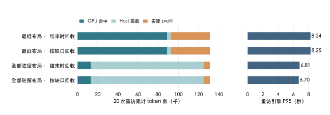

# ContextKV 结题报告：资源受限多轮文档问答中的上下文与 KV 缓存协同

固定 Qwen3-32B BF16 和并发 4，ContextKV 完成四个公开题集共 4,722 轮的生成与评分。**在有同期原版对照的三个全量题集上，VersionQA 和 Loong 同时提高质量并降低完整 P95，MT-RAG 以 1.09 分的质量损失换得 16.1% 的延迟下降。** MultiDoc2Dial 复用历史外部基线。四个题集的固定 20 题验收均通过，全量结果收窄了这一结论的适用范围。

课题的核心贡献是把证据需求传给引擎，再把引擎实际保留下来的前缀、可用页数与获取费用传回选材器。交换未来需求可以改变下一轮证据顺序，改变可用容量可以改变同一份文档交付的粒度。下面分别给出公开队列中的系统效果和固定证据后的机制效果。

## 1. 主实验：质量与完整响应延迟

当前生成配置为 `27155ec`，原版为 `cda1d04`。同期运行使用 H200、8 GiB GPU KV 池、64-token 页和贪心解码。普通 RAG 将检索证据与历史拼接后使用 Native 回答，LlamaIndex 使用其 condense/refine 流程。MultiDoc2Dial 和 MT-RAG 回放各系统自己的回答历史（P3），VersionQA 和 Loong 使用题目给定的历史（P1）。每个会话收到回答后才提交下一轮，所有会话共享四个并发名额。[实验设置与复现入口](final_runbook.md)

**表 1　全量主结果。** 每格为质量（0–100，越高越好）／完整 P95（秒，越低越好）。质量分别为 MultiDoc2Dial 答案 F1、MT-RAG 经可回答性调整的三个官方分项均值的调和平均、VersionQA 作者二值评分的正确率和 Loong 作者百分制评分的均值。完整 P95 从到达计至最终回答，包含排队。各题集独立比较。

| 题集（轮数） | 原版 | 最终 ContextKV | 普通 RAG | LlamaIndex | 最终版相对同期原版 |
|---|---:|---:|---:|---:|---|
| MultiDoc2Dial（4,094） | — | 24.92 / 413.71 | 16.12 / 878.56¹ | 16.18 / 1,034.85¹ | 缺同期原版 |
| MT-RAG（205） | 53.61 / 36.92 | 52.52 / 30.97 | 48.33 / 73.03 | 54.02 / 74.83 | −1.09 分，P95 −16.1% |
| VersionQA（100） | 67 / 96.42 | 73 / 72.56 | 75 / 96.53 | 74 / 96.57 | +6 分，P95 −24.7% |
| Loong（323） | 67.07 / 668.84 | 69.59 / 564.70 | 31.46 / 555.69 | 36.50 / 551.36 | +2.52 分，P95 −15.6% |

¹ MultiDoc2Dial 的两项外部结果来自 `d4af354`，同为 661 个会话、4,094 轮、P3 和并发 4，使用另一组 GPU，部分时段有其他实验并行。该批早期 ContextKV 为 24.97 / 510.28。延迟可作历史参考。其余三行的四组方法均已全量评分。VersionQA 的普通 RAG 质量最高，Loong 的 ContextKV 质量最高而 LlamaIndex 延迟最低。[本次全量数据](../../results/full_qa_20261123.json) · [MultiDoc2Dial 历史 P3 对照](../../results/full_multidoc_p3_20261116.json)

**表 2　固定 20 题的复测。** 单元格口径同表 1。最终版取重复运行的中位数，MT-RAG 三次，其余两次。对照列各取一次完整运行。按课题验收口径，质量提高 5 分或保住质量且完整 P95 降低 15% 即达标。[验收目标](task_spec.md)

| 题集 | 原版 | 最终 ContextKV | 普通 RAG | LlamaIndex | 完整 P95 降幅 |
|---|---:|---:|---:|---:|---:|
| MultiDoc2Dial | 17.68 / 9.32 | 18.42 / 7.06 | 12.35 / 14.67 | 12.21 / 15.44 | 24.2% |
| MT-RAG | 59.94 / 9.45 | 60.63 / 6.94 | 56.99 / 25.50 | 56.99 / 23.19 | 26.6% |
| VersionQA | 80 / 18.15 | 85 / 13.91 | 85 / 20.38 | 80 / 19.55 | 23.4% |
| Loong | 71.75 / 39.82 | 77.00 / 28.45 | 29.50 / 42.04 | 46.00 / 41.33 | 28.6% |

MT-RAG 三次分别得 61.28、60.63、59.68 分。在同一次全量运行中，固定题单的 5 个会话所含的 20 题得 60.88 分，这些会话的另 24 轮得 60.30 分，另外 21 个会话的 161 轮得 50.29 分。小队列的重复性和题单对总体的代表性是两个不同问题。[固定题单与各次测量](../../results/paired_qa_20261122.json)

## 2. 系统成本：队列、预填充、解码与缓存驻留

**表 3　最终版全量成本。** 排队和取得名额后的耗时取构成完整 P95 的同一对请求，按相同权重插值，两列相加等于完整 P95（有舍入误差）。token 和 GPU/Host 内存占用时间积分均为整组总量。

| 题集 | 尾部排队 / 取得名额后（秒） | 实际 prefill / 输出（token） | GPU 命中 / Host 回载（token） | GPU / Host（GiB·s） |
|---|---:|---:|---:|---:|
| MultiDoc2Dial | 411.46 / 2.25 | 2,311,855 / 363,267 | 400,640 / 102,848 | 192,042 / 65,821 |
| MT-RAG | 25.57 / 5.40 | 201,834 / 25,020 | 23,616 / 2,880 | 17,627 / 5,276 |
| VersionQA | 70.55 / 2.02 | 89,253 / 8,568 | 19,200 / 5,120 | 5,913 / 1,655 |
| Loong | 559.10 / 5.60 | 2,473,818 / 37,431 | 20,032 / 4,288 | 51,549 / 14,598 |

Loong 完整 P95 缩短 104.14 秒，其中构成该分位数的排队时间缩短 103.83 秒。整组少做 192,233 个 prefill token，少生成 1,945 个 token。MT-RAG 的输入减少 37,811 个 token，GPU 与 Host 合计命中增加 768 个，实际 prefill 减少 38,579 个，输出反而增加 425 个。四套全量的 4,722 次最终回答均走 Native。驻留优先提出的额外证据集合在四个题集中分别胜出 75、3、1、0 轮。公开队列表明缓存状态确实参与了选材，混合解码的收益由下节单独计量。[逐配置成本与路由回执](../../results/full_qa_20261123.json)

## 3. 核心机制：双因素消融、双向干预与生效边界

**图 1　前缀目录 × 回收时机。** 在 6 GiB 池中固定 20 道 Loong 题、每份文档的可见原文和问题，预热完整前缀及其后缀，再按引擎报价决定重访顺序。左图统计实际工作量，右图计重访引擎耗时，预热和报价在计时区间之外。[四组原始记录](../../results/kv_residency_20261122.json)

只保留最近布局时，两种回收时机都只能报出 0/20 个完整布局，实际 prefill 均为 38,610 token，均分均为 41。引擎报告全部驻留布局后，两组都能报出 20/20 个完整布局，实际 prefill 均降至 6,354，Host 回载由 3,584 增至 111,424。此时把回收时机从请求结束改为分配出现缺口，重访 P95 由 6.81 降至 6.70 秒，均分由 55.75 升至 56.25。**这组预填充降幅可归因于目录扩大了选材器能看见的布局。** 评分还受到证据顺序与引用编号的影响。

| 实验 | 固定项与干预 | 观察及其含义 |
|---|---|---|
| 需求能否反向影响选材 | 同题预热两种顺序，只交换 agent 声明的未来布局需求，再做相同的并发冷分配 | 6 GiB 联合配置中 8/20 题的 GPU 驻留优势反转，下一轮选材随之反转。证明需求、驻留与选材形成闭环。[干预记录](../../results/kv_residency_20261122.json) |
| 报价能否兑现 | 独立 20 题，固定证据顺序与 prefill，优先保留已排队请求选定的前缀 | GPU 命中 9,280 → 40,256，Host 回载 80,640 → 49,664。自然回答同为 43.75 分，计入预热的 P95 为 10.88 → 10.95 秒。该机制独立减少搬运。[准入消融](../../results/kv_admission_20261122.json) |
| 混批能省多少解码时间 | 每批 3 个 Native 与 1 个已有独立块的 InfoFlow 请求。固定输出，每种长度观察 315 个混合步 | 共享 QKV、O 和 MLP 投影后，8K / 16K 单步中位数由 55.40 / 57.06 降至 22.94 / 24.57 毫秒。自然结束的重访 P95 由 11.19 / 15.89 降至 8.77 / 12.93 秒，16K 长题均分由 32 降至 28.6。[混合执行消融](../../results/mixed_decode_20261122.json) |
| 冷建是否值得 | 固定 20 道长文，倒序首访、正序重访。从冷池自动路由，或预建后强制复用 | 全程自动的 40 次请求均走 Native。同样预建条件下，单 token 重访强制 InfoFlow 使 prefill 由 133,903 降至 45,341，但重访 P95 由 3.07 升至 7.21 秒。MT-RAG 全量也只有 5 轮具有跨整页复用潜力。[冷建与重访](../../results/kv_cold_start_20261123.json) |
| 排序是否影响自然答案 | InSCIt 固定历史、问题和证据成员，交换文章顺序与驻留侧 | 40 组配对中，命中更多的一侧在等长输出时快 39 次，自然结束时快 24 次。20 道顺序配对的自然耗时差绝对值中位数为 239.33 毫秒，等长时为 2.35 毫秒。排序决策须计入生成长度与事实覆盖。[顺序及事实标注](../../training/assets/inscit-order-facts.jsonl) |

**代价校准与并发敏感性。** 在 H200 上用 20 个训练提示校准 Native 单价，得到 0.108 毫秒/token。独立 20 请求按旧价、新价、新价、旧价交替，含预热的 P95 为 8.96、8.02、8.03、8.97 秒，两种单价各有一道长题进入 InfoFlow，选中的题不同。较早版本在每项 20 题、4 个会话的 P3 队列中将并发从 1 调至 4，MT-RAG 完整 P95 为 27.21 → 11.43 秒，MultiDoc2Dial 为 8.66 → 8.90 秒。不同队列的等待和执行占比决定并发收益。[单价交替对照](../../results/mixed_decode_20261122.json) · [并发对照](../../results/concurrency_20261116.json)

## 4. 上下文与学习模块消融

**表 4　同版本移除模块。** 早期版本 `992a30c`，P1、并发 4，每项 20 题，表内为质量／完整 P95 秒。主机上的另一组 GPU 同期执行其他任务。各列用于比较该版本内部的策略，最终版的主结果见表 1。[消融配置、触发次数与原始结果](../../results/module_ablation_20261116.json)

| 题集 | 完整配置 | 按排序选材（ranked） | 继续扩展（expand） | 关闭结构计算（no_compute） |
|---|---:|---:|---:|---:|
| MultiDoc2Dial | 26.80 / 6.69 | 23.15 / 11.83 | 26.82 / 6.30 | 26.70 / 5.36 |
| MT-RAG | 66.99 / 13.30 | 64.43 / 48.43 | 64.50 / 13.88 | 67.25 / 11.45 |
| Loong | 56.25 / 41.09 | 54.00 / 43.70 | 56.25 / 40.74 | 59.75 / 40.44 |

集合选材相对 ranked 在三项均提高质量并缩短 P95，MT-RAG 的 prefill 为 25,081 对 323,744 token。三套小队列的完整配置都未产出结构化计算结论。另取 20 道构造计算题，8 题实际产出结论，回答含全部目标数值的题数由 13 增至 14，部分参考历史本身含目标数值。CPU 计算的质量证据限于这些触发样本。

| 针对性实验 | 已有结果 |
|---|---|
| 容量反馈改变上下文 | 15 道指标分档题 × 40 个容量观测，600 次定价中有 208 次切换为指标行原文。独立 20 道金融题的均分由 54.50 升至 69.25，完整 P95 由 90.10 降至 62.04 秒。固定 20 个金融请求、只改变 KV 池为 4 / 6 / 8 GiB 时，输入就绪至引擎返回的 P95 为 51.65 / 37.07 / 31.77 秒。[投影消融](../../results/range_projection_20261122.json) · [容量实验记录](results.md#上下文选择结构计算与停止) |
| 渐进读取与停止头 | 120 轮真实会话中首批 24 → 12 段，F1 为 26.90 → 27.23，完整 P95 为 15.10 → 13.10 秒。独立隔离停止头的系统特征后，91 对同输入同路径状态中，由驻留引起的 12 次虚假质量翻转降为 0。另一组 120 轮的 F1 / P95 为 27.17 / 13.16 → 26.92 / 13.51，停止头本身的端到端收益仍未得到验证。[渐进读取](../../results/paired_qa_20261122.json) · [停止头配对](../../results/stop_residency_20261122.json) |
| 集合头是否识别互补证据 | InSCIt 开发集的 16 对严格同位替换中，默认头排对 11 对。40 道题在已评分集合中按题取最佳，相关性前缀可达 82.21% 事实覆盖，纳入非前缀集合为 88.96%，实际采集时所选集合为 58.46%。前两项是已观测候选空间的事后上界。新集合权重的跨域在线增益尚未证实。[配对标签](../../training/assets/inscit-supported-swaps.jsonl) · [集合分析](results.md#辅助训练数据与评测边界) |
| 工程开销 | 四线程处理来自四套题单的 80 对文本，共享分词器使三套分词器的首次编码时间从 1.43–1.60 秒降至 0.18–0.19 秒，token ID、填充和偏移一致。同期独立 120 轮 F1 为 26.67 → 26.79，完整 P95 为 13.39 → 11.61 秒。[输入配对与线上计量](../../results/paired_qa_20261122.json) |

## 5. 误差分析、泛化与结论

**MT-RAG 的主要代价是证据覆盖。** 原版与最终版的忠实度 RL_F、回答质量分项 RB_llm、算法分项 RB_alg 均值依次为 0.723 / 0.634 / 0.379 和 0.699 / 0.617 / 0.376。188 轮有作者标注的相关段落，494 个题目与段落配对中，原版命中 86 对，最终版命中 71 对。在少交付证据的 31 轮里，实际历史相同的 4 轮 RL_F 平均提高 13.61 个百分点，历史也变化的 27 轮平均下降 16.63 个百分点。证据遗漏与历史传播共同变化，现有观测只支持前者覆盖下降的直接判定。[官方分项](../../results/full_qa_20261123.json) · [配对分析](results.md#全量题单上的端到端对照2026-11-23)

**VersionQA 的增益集中在可核验的范围信息。** 相对原版有 6 题由错转对，其余 94 题得分相同。指定版本内容检索从 10/20 升至 14/20，版本目录从 17/20 升至 19/20。隐式版本变化仍为 1/10。#015 漏掉含工单号的历史发布记录，#057 交付了模块首页，漏掉具体函数的弃用说明。[逐类得分和题号](../../results/full_qa_20261123.json)

**辅助训练的证据有明确范围。** Qwen3-32B 的生成权重固定。范围监督有 654 道训练题、191 道开发题，但 MultiDoc2Dial 自然训练问答只有 5/208 道要求全量覆盖。InSCIt 24 段候选池有 74 / 40 道训练／开发题，对应 582 / 314 个带逐事实标注的回答，可挖出 230 / 159 对覆盖变化样本。四个评测集与训练集的题号、会话号及完整历史加当前问句的精确交集均为零。MultiDoc2Dial 的训练与评测共用 488 篇文档和 4,110 个段落，该项衡量同一知识库中新会话的效果。公开全量结果为各配置的一次完整队列测量，固定题单复测次数见表 2，本文报告观察差值。[训练资产、数据划分与重复性](results.md#辅助训练数据与评测边界)

**结题判断。** 最有力的论文主张是：在容量紧张或长前缀重访的条件下，agent 声明未来证据需求、引擎返回真实驻留与容量，两侧可以共同减少预填充或搬运，并在相应负载上缩短尾延迟。VersionQA 和 Loong 给出了同期全量质量、延迟双赢的应用证据。MT-RAG 刻画了证据压缩的质量代价，MultiDoc2Dial 给出了完整真实历史下的交付结果。四套全量同时保质提速以及辅助头的普遍独立增益，均未获现有实验支持。
