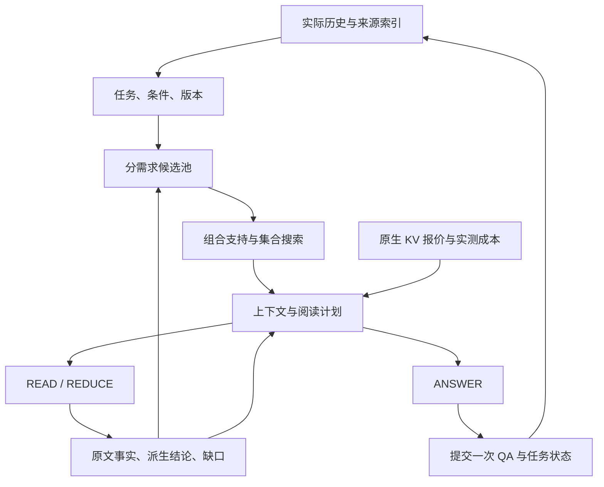

这是一份面向实现 agent 的研究与工程任务书。目标是在动态、多资料、多轮问答场景下，提高固定生成模型与资源预算内的回答质量，并把有效机制接入 ContextKV 的真实服务链路。技术取舍以场景效果、benchmark 得分和完整成本为依据。

评审基线：[ContextKV 7388008](https://github.com/issaddy/ContextKV/tree/7388008f56ec7176668321d00f69bd2f07639f0a)。以下新文件、接口、命令和参数属于待实现规格；仓库已有行为在“现有瓶颈”中给出依据。

# 1. 课题定义与完整交付范围

建议课题名称：**面向动态多资料多轮问答的任务状态驱动证据规划与预算化阅读系统**。ContextKV 负责将语义证据计划转化为可复用、可计量的上下文执行。

核心研究问题：①实际问答历史中，哪些信息仍然决定本轮对象、条件与版本？②给定正文预算，哪些证据必须共同出现才能支持回答？③资料超过单次窗口时，怎样完成全范围阅读、跨文档运算和多跳追踪？④在回答质量和语义范围确定后，怎样用原生 KV 报价选择上下文动作？

| 交付 | 必须形成的成果 |
|---|---|
| 任务与来源模型 | BGE-M3 查询适配器、历史选择头、跨度/关系头、版本意图头及训练数据 |
| 支持与集合模型 | 单段、双段、三段支持评分；适用性、回答状态与集合效用头；实际答案偏好数据 |
| 证据规划器 | 多来源候选池、依赖闭包、token 预算搜索、缺口检索、多集合候选 |
| 阅读系统 | READ/REDUCE/ANSWER 计划、来源跨度、派生结论、覆盖表、多跳 OpenNeed |
| 原生运行时 | 一次用户请求内多次生成、步骤记录、最终一次 QA 提交、完整成本归集 |
| KV 决策 | 合法 APPEND/REBUILD 动作、多候选原生报价与成本选择 |
| 实验系统 | 连续质量目标、同 token/等预算/等成本实验、真实历史闭环、长文与版本实验 |
| 最终材料 | 代码、两套训练资产、配置、逐题答案、训练清单、消融表、机制取舍及研究报告 |

固定生成阅读器为当前 Qwen3-32B 非思考模式；主实验采用当前 32K 单次上下文与 GPU/Host 配置。新增辅助模型的在线占用和耗时计入系统成本。两套训练资产分别承担任务建模和支持/效用建模；阅读策略使用覆盖状态、支持分和效用搜索。

完成范围包括训练、运行时接入与真实评测。第一个贯通版本用于验证数据流；完整课题继续交付组合证据学习、长文阅读与系统实验。

# 2. 现有瓶颈与对应改造

| 当前做法 | 对目标场景的影响 | 具体改造 |
|---|---|---|
| 实际 QA 从最近向前拼接，按编码长度删整轮 | 长回答挤占决定对象或版本的较早轮次 | 历史片段索引、指代指针、任务状态与工作历史 |
| dialogue 默认无结构化解释，requirements 分支未生效 | 条件修正、旧来源回访和版本选择缺少显式约束 | TaskState 与会话来源索引进入线上、离线同一接口 |
| Dense 候选固定选 5 个不同正文组 | 相似度不能表达资格段与步骤段等互补支持 | 以实际 token 为主预算，搜索单段和组合证据 |
| 跨度重排提高覆盖却降低回答分 | 训练目标与最终阅读收益不一致 | 用冻结阅读器的实际答案构造集合偏好 |
| REBUILD 拼接全部原始 QA | 工作历史缺少任务筛选，输入随会话增长 | 编译所选历史、条件、证据与回答计划 |
| 一轮只有一次 engine.generate | 长文扫描、多文档归纳和多跳阅读无法进入服务链 | 外层用户请求＋内层阅读步骤，最后一次提交 QA |
| candidate_id 仅含 action，planner 用 by_action 字典 | 同一种动作的多组证据无法独立比较 | candidate_id 含 set/plan/layout，按 ID 处理全部候选 |
| 开发选择先布尔质量资格、再选最快 | 更高质量配置没有连续竞争位置 | 连续质量目标与资源/延迟预算联合选择 |

源码依据：[dialogue_query.py](https://github.com/issaddy/ContextKV/blob/7388008f56ec7176668321d00f69bd2f07639f0a/adapters/dialogue_query.py)、[hybrid_retrieval.py](https://github.com/issaddy/ContextKV/blob/7388008f56ec7176668321d00f69bd2f07639f0a/adapters/hybrid_retrieval.py)、[candidates.py](https://github.com/issaddy/ContextKV/blob/7388008f56ec7176668321d00f69bd2f07639f0a/controller/candidates.py)、[planner.py](https://github.com/issaddy/ContextKV/blob/7388008f56ec7176668321d00f69bd2f07639f0a/controller/planner.py)、[service.py](https://github.com/issaddy/ContextKV/blob/7388008f56ec7176668321d00f69bd2f07639f0a/controller/service.py)、[experiments.py](https://github.com/issaddy/ContextKV/blob/7388008f56ec7176668321d00f69bd2f07639f0a/bench/experiments.py)。

仓库已有实验给出的直接方向：跨度监督重排使覆盖 79.6%→86.9%，同一行实际问答比较 RB_llm 0.826→0.802；完整父文档阅读使覆盖 0.639→0.812，回答分 0.836→0.804。因此本课题的学习对象包含条件适用、组合支持和实际答案收益。数据出处：[方法比较与取舍](https://github.com/issaddy/ContextKV/blob/7388008f56ec7176668321d00f69bd2f07639f0a/docs/data_and_evaluation.md)。

当前 Dense5 使用 MultiDoc-only 查询 LoRA，固定文档编码器。基线复现需要使用该检查点及原模型配置。旧 benchmark 配置中的 conversational/cost 路线与当前 Dense5 默认分别建实验条目。

# 3. 总体执行架构



系统维护四层状态：①真实发生的 QA；②从实际历史抽取的当前任务状态；③原文来源与阅读结论；④引擎实际执行账本。每层通过显式 ID 关联。

检索型请求围绕信息点选择证据。全资料型请求建立完整阅读范围，依次读完范围内窗口。两类请求共用来源跨度、支持模型、阅读结果和最终回答编译器。

服务入口只提交最终 ANSWER 形成的用户—助手轮次；READ 和 REDUCE 属于同一请求内部的计算步骤。

# 4. 数据契约：先固定接口，再并行实现

复用现有 `EvidenceKey`、`EvidenceBlock`、`TurnRecord`、`SessionSnapshot` 和引擎回执。在 `controller/context_schema.py` 定义下表契约，并由 `controller/schema.py` 引用。跨度坐标使用原始字符串的 Unicode 字符偏移；分词器 offset mapping 负责模型 token 与原文的对应。

| 类型 | 必备字段与含义 |
|---|---|
| TextRef | turn_id、speaker、start、end；指向实际 QA 的原文片段 |
| SourceSpan | span_id、source_key、start、end；指向资料原文，坐标与 prompt 位置分开 |
| Condition | condition_id、key_span、value_spans、relation_type、predicate_span、target_refs、supersedes |
| Need | need_id、anchor_spans、operation、subject_refs、condition_ids、predecessor_need_ids、scope |
| VersionIntent | mode=current/explicit/as_of/compare、document_families、version_ids、time_refs、source_turns |
| TaskState | task_id、raw_question、working_history、conditions、needs、version_intent、source_scope |
| RetrievalState | snapshot_version、committed_history、prior_task_states、archive_source_keys、source_index 引用 |
| EvidenceUnit | unit_id、source_spans、heading/table 元数据、条件/表头依赖、适用范围、正文 token 数 |
| SupportBundle | bundle_id、need_id、unit_ids、applicability、joint_support、支持跨度 |
| EvidenceSet | set_id、selected_units、dependency_closure、need_support、quality_prediction、token_cost |
| OpenNeed | need_id、missing_relation、bound_entities、temporal_scope、parent_claim_ids |
| EvidenceClaim | claim_id、need_id、kind=extract/derived、value/text、unit、conditions、source_spans、operation、parent_claim_ids |
| ReadTask | step_id、kind、need_ids、input_unit/claim IDs、predecessor_step_ids、input/output_budget、output_schema |
| ReadResult | claims、covered_units、support/conflicts、open_needs、原始输出与计时 |
| ContextPlan | plan_id、task_state、selected_set、coverage_scope、step DAG、answer_plan、预算与预测成本 |
| StepRecord | attempt_id、step_id、task、engine_epoch、输入输出、结果、原生 KV 回执及阶段计时 |

`Need.operation` 先实现 lookup、enumerate、procedure、compare、count、sum、group、infer。开放内容来自问题或历史跨度；操作类型与指针由模型预测。隐含条件通过 TIME、VERSION、PLATFORM、LOCATION 等关系或原文 predicate_span 表达。

```python
def interpret(turn: OnlineTurn, memory: RetrievalState) -> TaskState: ...
def retrieve_pool(state: TaskState, memory: RetrievalState) -> EvidencePool: ...
def score_support(state: TaskState, pool: EvidencePool) -> SupportScores: ...
def search_sets(state, pool, scores, budget) -> tuple[EvidenceSet, ...]: ...
def build_read_plan(state, evidence_set, coverage_scope, budget) -> ContextPlan: ...
def advance_read_plan(plan, results, budget) -> tuple[ReadTask, ...]: ...
async def execute_reads(attempt_id, snapshot, plan) -> ReadingOutcome: ...
def build_plan_candidates(snapshot, query, plan, template) -> tuple[PromptCandidate, ...]: ...
def choose_plan(candidates, quotes, cost_model, quality_model, budget) -> Plan: ...
```

扩展 `QueryContext.task_state`；`PromptCandidate` 增加 `context_plan_id`、`evidence_set_id`、`working_history_id`、`layout_id`、`quality_prediction`、`need_support`、`output_budget`。最终 `TurnRecord` 关联实际采用的 TaskState、证据集合和支持映射。

原文证据、READ 摘取事实、REDUCE 派生结论分别存储。派生结论通过 parent_claim_ids 保留计算或推理所用的输入。

# 5. 模块 A：任务、历史与版本联合学习

**模型选择。** 复用 BGE-M3 和现有查询侧 LoRA，文档向量由冻结文档编码器产生。查询侧共享编码器增加历史相关性、BIO 跨度、条件更新指针、需求操作、版本意图头。最终输出可执行的跨度与关系。

**历史选择。** 将实际 QA 按约 384 个模型 token 切成带轮次/说话人坐标的窗口，并用冻结编码器建立历史索引。每轮先取当前活动需求、最近两轮、该需求历史状态及其来源版本作为指针候选，再召回相关历史窗口。起始候选上限 16 个窗口，最终视图在 8192 编码 token 内按任务贡献选择。

“那之前呢”先解析为某个活动需求的时间/版本关系，再将被指向的需求原文、对象、条件与 BEFORE 标记组成查询；“改成 Linux”产生新条件并指向被替换的平台条件；话题回访通过历史任务与来源索引找回旧对象。

**条件状态。** 模型预测 KEEP、ADD、REPLACE、REMOVE、COMPARE 与目标指针，状态模块执行对应更新。条件保留来源轮次和文本坐标。COMPARE 可以同时激活两个版本分支；CURRENT 和 AS_OF 根据来源元数据确定适用版本。

**训练目标。**

```math
L_A = L_{retrieval}+\alpha_h L_{history}+\alpha_s L_{span}
      +\alpha_c L_{condition-link}+\alpha_o L_{operation}+\alpha_v L_{version}.
```

检索采用对比损失；历史头结合跨度标注及“移除某历史片段后的检索/回答变化”；跨度头采用 token 分类；条件/需求连接采用指针分类；版本与操作采用分类。各项按有效样本归一化，权重与温度在开发集固定。

训练起始配置为 LoRA rank 16、adapter 学习率 2e-4、任务头学习率 1e-4；这些是开发起点。同步训练查询表示和工作历史视图，并重新挖掘同主题异条件负例。

**输出资产与验收。** 产出 task-query adapter、任务头权重、历史索引构建器和评测脚本。报告相关历史选择、条件替换、版本选择、预算内适用来源召回，以及真实历史闭环答案分。贯穿样例包含长无关回答后的旧对象回访、平台纠正、历史版本与当前版本比较。

# 6. 模块 B1：来源目录、依赖闭包与候选池

资料索引补齐 document_family、version、valid_from/to、适用对象、章节、表格和原文跨度。发布日期与生效时间分别建字段。每个阅读单元维护标题、资格条件、定义、表头等依赖；跨章节依赖由解析结果和离线标注显式连接。

首轮候选池取 `current_top50 ∪ 每个 Need 的 top20 ∪ archive_top12 ∪ 显式版本来源`。这里的 top20 是每个信息点各 20 段。按来源/版本/跨度合并后，按每个 Need 和历史来源保留配额，形成初始 96 个主候选。依赖闭包随选定主候选展开，计入实际正文成本。

完全相同正文可以共享一个物理文本段，但每个来源的对象、版本和适用范围单独保留。相邻段落扩展依据章节、条件、定义和表格依赖。对版本比较，当前与历史版本各自进入需求分支。

全资料阅读的源目录直接来自用户提供的完整文档范围，独立于 96 个检索候选的计算配额。候选配额控制检索搜索成本；全资料覆盖表控制必须阅读的窗口。

修改 `ServingRetriever`：提供 candidate search、source fetch 和 archive lookup；由控制器规划器组织后续检索。线上 `ServingRetriever._retrieve` 与离线 `controller_context_provider` 共同接收 RetrievalState。

# 7. 模块 B2：学习单段与组合支持

**基座与头。** 采用 BGE-reranker-v2-m3 初始化共享交叉编码器。输入为“当前需求＋工作历史跨度视图＋有效条件＋版本范围＋一个或多个原文单元”。增加适用性、直接支持、桥接价值、组合支持、支持跨度和集合效用头。历史视图直接由已选原文跨度装配。

每个 Need 先用检索分缩至 24 个单段评分候选。支持头区分 complete、partial、background、contradict，并同时预测 applicability。表头、定义及资格条件进入相应单元的依赖上下文。

**组合评分。** 每个未完成 Need 保留 6 个桥接/补足候选，批量评估 15 个 pair。对于 infer 或仍有关系缺口的需求，保留前 2 个互补 pair，各扩展 3 个后继，最多评估 6 个 triple。后继查询由缺失关系与已绑定实体构成。组合输入按源跨度与依赖组装。

训练样本同时包含 A、B、A+B，以及 A+B+C 的删除任一成员对照。资格规则与办理步骤、定义与数值、关系链中的两个跳点都是组合正例；同主题但条件不符和冗余材料是重要负例。

**集合模型。** 用单段/组合编码结果构成 Need—证据二部图及组合边。两层小型注意力聚合器接集合效用头，输入包括每个需求的支持、条件一致性、正文冗余、跨度覆盖、旧材料占用、工作历史和动作/布局。该头与支持模型一并保存，搜索时复用已有编码与评分。

```math
L_B=\beta_a L_{applicability}+\beta_s L_{single}+\beta_g L_{group}
    +\beta_p L_{span}+\beta_u L_{utility}+\beta_d L_{disposition}.
L_{utility}=-\log\sigma\big(\hat Q(S^+)-\hat Q(S^-)\big).
```

集合效用来自冻结 Qwen3-32B 对候选集合的实际回答。训练奖励记录必要信息点、原文支持、条件/版本正确性和任务评分；各分量保存，偏好权重在训练配置中固定。

**回答状态。** 集合头同时学习 answer、partial、retrieval_gap、unanswerable、underspecified。训练集用完整适用来源与参考标注区分“召回遗漏”和“语料无答案”；在线 retrieval_gap 产生 OpenNeed，unanswerable/underspecified 进入相应回答组织。报告这些类别的混淆与条件化任务评分。

本模块的主验收是同正文 token 下的答案质量增益及必要点遗漏下降；单段分类指标和跨度覆盖用于解释收益来源。

# 8. 模块 B3：预算内集合搜索与缺口扩展

搜索状态为 `(已选单元 S，依赖闭包 D，逐需求支持，未完成关系，实际 token 数，质量预测，后续阅读成本)`。动作是加入一个单元、加入一个 pair/triple、结束当前集合、按 OpenNeed 进行定向补充。

正文 token 预算取代固定 5 组限制；各 benchmark 的来源数量约束由对应 profile 同时施加，例如 MTRAGEval Task C 最多 10 个原语料 passage。搜索在真实 tokenizer 下计入去重后的原文、来源标识、依赖、工作历史、指令及输出预留。共享正文按实际渲染并集计量。

```python
pool = retrieve_pool(task, memory)
scores = support_model.score_singles(task, pool)
bundles = support_model.score_groups(task, build_need_groups(pool, scores))
frontier = [empty_selection(task)]
for depth in range(search_profile.max_actions):
    proposals = expand_by_single_or_bundle(frontier, pool, bundles)
    proposals = close_source_dependencies(proposals)
    proposals = measure_with_tokenizer(proposals, working_history, output_budget)
    frontier = rank_by_utility_and_budget(proposals, beam_width=4)
sets = retain_quality_cost_frontier(frontier, max_sets=3)
open_needs = unresolved_needs(task, sets)
pool = extend_for_open_needs(pool, open_needs, search_profile)
sets = finish_search(task, pool, sets, budget)
```

初始 profile：束宽 4、最多 12 次集合扩展、最多保留 3 个质量/长度不同的集合；首轮增加一次定向缺口召回。上述数值控制搜索计算量，开发时报告搜索宽度和成本曲线。支持评分预计算，分支展开复用结果。

更长关系链在 READ 后产生实体与 OpenNeed，继续按阅读轮次预算检索。每次扩展记录新补齐的信息点、增加的原文和模型计算。搜索成本与阅读成本使用同一增量定义。

每个集合可产生多个合法执行候选，最终选择使用集合质量、完整耗时和原生 KV 报价。提交时保存实际采用集合及其支持映射。

# 9. 模块 C：覆盖驱动的长文阅读与多跳执行

**两种阅读范围。** `selected_sources` 围绕检索出的适用证据回答；`all_supplied_documents` 覆盖用户指定资料范围内的全部阅读窗口。全资料模式的效用分用于排列阅读顺序、装包和安排汇总，完成覆盖以实际读完窗口为准。

**阅读单元与装包。** 以标题、段落、表格行及表头依赖构建单元，再按真实 token 装成 READ 包。起始输入目标 12K，输出预算由需求数、条目密度和训练/开发输出分布决定。高密度列表与表格缩小输入包，为逐条抽取分配输出额度。覆盖表记录 `(scope_id, document_id, unit_id, read_step_id)`。

**READ 输出。** 每个事实包含实体、关系、值、单位、条件、版本和原文 span_id。模型选择本步骤已有的 span_id。输出同时给出冲突、已支持需求与 OpenNeed；原文坐标由索引解析。

**REDUCE 输出。** 操作类型为 union、compare、count、sum、group、infer。计数/求和先执行单位归一、实体对齐和确定性计算，保存输入 claim IDs；推理与比较使用来源连接的 claims，产生 derived claim。聚合过程保存中间分组和完整叶子来源。大规模 claims 按需求/对象/时间分组，形成多层 REDUCE。

**多跳扩展。** 如第一份资料给出机构 A 的上级 B，而问题需要 B 所属基金的设立时间，READ 生成绑定 B 的 OpenNeed。下一跳检索由原需求、B 和缺失关系组成，新来源产生新的 claim，再连接至父 claim。每次读取更新需求关系图与剩余计算预算。

**最终回答组织。** AnswerPlan 明确每个信息点、采用的 claim、所需原文片段及引用 ID。最终 ANSWER 消费工作历史、当前条件、结论与关键原文；完整叶子证据保存在步骤账本。回答所列事实可沿 claim 链追到原文。

```math
B_{history}^{(k)}+B_{source}^{(k)}+B_{instruction}^{(k)}+B_{output}^{(k)}\le32768,
C_{turn}=C_{task}+C_{retrieval}+C_{support}+\sum_k C_{READ/REDUCE/ANSWER}^{(k)}.
```

本模块首先覆盖项目已准备的 Loong 323 题，其中现有单次输入筛选只运行 122 题。新 reader 在单步 32K 内处理其完整资料，分别报告 323 题整体与原 122 题共同子集。该 323 题集合属于项目目前准备的长度组；扩展其他官方长度组单独列实验清单。

Loong 主对照包含：正文预算内相关性检索、全范围分块摘要/合并、需求驱动事实抽取与结构化 REDUCE。三者共享资料和生成模型；完整运行成本一并比较。

# 10. 模块 D：接入真实控制器与步骤生命周期

当前服务路径在一次检索之后装配候选，执行一次生成并提交。目标路径在同一个外层用户 attempt 内维护阅读计划及子步骤，ANSWER 完成后提交一次业务轮次。

在 `controller/session_store.py` 增加 `turn_plans(attempt_id, plan)` 与 `execution_steps(attempt_id, step_id, task, epoch, result, metrics)`。复用现有文本存储和原生回执。READ/REDUCE 的记录用于阅读图、下一跳检索和成本分析；raw_history 存储最终 QA。

```python
store.save_context_plan(attempt_id, context_plan)
outcome = await executor.execute_reads(attempt_id, snapshot, context_plan)
candidates = compiler.build_answer_candidates(snapshot, context_plan, outcome)
quotes = await engine.quote_batch(candidates, fingerprint)
selected = planner.choose(candidates, quotes, resource_budget)
answer = await executor.run_answer(attempt_id, selected)
store.commit_turn_and_outbox(attempt_id)
```

每个 READ/REDUCE 使用独立 step_id 作为引擎请求 ID，通过 prepare→generate 执行。结果保存后登记其临时 epoch 的引用退役；物理页的匹配、回载与淘汰由原生缓存管理。ANSWER 使用最终业务 epoch，安装执行账本并关联实际证据集合。

最终提交内容包括 TaskState、选中的支持映射、实际被阅读/用于回答的来源关系、AnswerPlan 与最终答案。候选池保存在规划轨迹；选中证据和实际阅读来源分别记录。一次用户请求使业务会话版本增加一次。

**输出协议需要按步骤拆开。** 当前 `engine_client.generate()` 会根据 citation_ids 设置 regex，`candidate_request()` 会提供 citation_ids。新增 `response_schema` 并提供独立 `step_request()`：READ 用 JSON schema 与本步骤 span ID；REDUCE 用 JSON schema 与前驱 claim ID；ANSWER 用自然语言和现有引用格式。每个请求使用该步骤的一种输出约束。

实现位置：`controller/engine_client.py` 的 native `/generate` 请求将 schema 传入 `sampling_params.json_schema`；保持原生 KV 回执和计时链路。SGLang 原生接口的该参数见[结构化输出文档](https://docs.sglang.io/docs/advanced_features/structured_outputs)。

第一版步骤按依赖串行执行，不同用户会话继续共享原生调度。依赖图正确贯通后，再测同轮独立 READ 并行。请求总耗时从收到用户问题到最终提交计时；模型工作量按步骤累计，资源积分在统一时间轴记录。

`TurnResponse` 增加 READ/REDUCE 数、总输入输出、辅助模型时间、实际 prefill、device hit、host load、各阶段耗时。首个内部 READ token 和最终对用户的首 token 分开报告。

# 11. 模块 E：上下文编译与 KV 成本规划

**工作历史。** REBUILD 从 TaskState 的相关历史跨度、有效条件、选中证据与 AnswerPlan 编译输入。原始 QA 始终作为持久会话记录。模板保留历史的说话人、轮次和来源标识。

**动作域。** APPEND 适用于任务/条件/版本延续、工作历史只增长、已有可见证据仍属于当前计划的情况；条件替换、来源移出、话题切换、历史收缩由 REBUILD 生成新的上下文。二者消费同一个语义计划。

**多集合。** 每轮保留最多 3 个集合，每集合按合法动作编译为候选。`candidate_id` 含 plan_id、set_id、history_id、layout_id、action；`planner.py` 按 candidate_id 比较全体候选。固定 action 的实验也在该 action 下比较各集合。

**布局。** 在证据与历史集合固定后比较现有布局、需求顺序、稳定证据前置三种布局，记录真实输入 token、回答质量与原生前缀命中。布局参数在开发集锁定。

**成本。** 调用现有 `quote_batch()` 和 `CostModel.predict_native()`，完整成本包括任务模型、召回、支持打分、准备/排队、READ/REDUCE、最终 prefill/decode。不同步骤与输出长度采用对应校准 profile。

```math
c^*=\arg\max_{c\in\mathcal C_{semantic,budget}}
\big[\hat Q(c)-\lambda_T\hat T_{complete}(c)-\lambda_G\hat G(c)-\lambda_H\hat H(c)\big].
```

λ 从开发集质量—成本曲线选定；在线只使用预测分与实测/预测成本。原生前缀命中基于编译后的 token 序列。证据 ID 相同提供逻辑复用线索，实际 KV 复用量由引擎报价与回执给出。

KV 因果实验先固定输入 token 序列，比较原生缓存与新增规划的成本；APPEND/REBUILD 和布局变化另做质量/成本配对实验。对共享页按唯一物理占用统计，GPU/Host PSS 与 KV slot 积分分别报告。

补充研究可在主链完成后加入保留价值：记录返回间隔、再次命中前缀、重算/回载耗时与边际页数，用开发负载估计返回概率，将“预计节省时间/页占用时间”用于软引用保留。该分支独立做并发与停顿负载消融。

# 12. 数据、监督与三阶段训练

**划分。** 保留各公开数据的原生 train/validation/test 与项目固定划分。新增版本族迁移实验将同族全部版本放在同一分组，作为额外泛化轨道。VersionQA 100 题与项目准备的 Loong 323 题作为评价资产；版本训练例与长文训练例由训练分区资料及独立训练语料构建。

| 数据文件 | 字段 |
|---|---|
| turns.jsonl | task_id、conversation_id、split、question、actual_history、snapshot_id、rollout_policy |
| sources.jsonl | source_id、document_family、version、valid_from/to、applicability、text、offsets |
| task_labels.jsonl | history_spans、condition_ops、need_spans、pointer_targets、version_intent |
| support_labels.jsonl | task_id、need_id、source_spans、single/group、relation、applicability、label_origin |
| preferences.jsonl | candidate_sets、合法动作、answers、各质量分量、token/时间成本、preferred_pairs |
| reading_traces.jsonl | context_plan、coverage_units、READ/REDUCE steps、claims、open_needs、最终答案 |

**阶段一：任务与支持监督。** 从 MultiDoc 训练会话及 supervision.jsonl 建跨度与来源映射；以训练分区至少 1 万轮作为首轮样本目标。负例包括同主题异对象、异条件、异版本和只有背景的材料。至少生成 1000 个训练会话的实际历史 rollout，并加入历史片段移除对照。使用教师批量标注与分层原文复核形成标签。

**阶段二：集合偏好。** 选择 2000 个训练轮，每轮 6 类候选集合：相关性排序、直接支持排序、互补支持、冗余材料、错误条件/版本、删除关键前提。对每集合执行最多 2 个合法上下文动作，规模上限 24000 次冻结阅读器回答。200 轮集成批包含在这 2000 轮中；报告实际集合、动作、回答与累计 token 数。

集合生成使用相同正文预算；奖励在同一问题与实际历史下比较。READ 路线的奖励按完整请求计量，READ/REDUCE 内部调用另计工作量。集合效用模型先用支持标签训练，再用答案偏好训练，最后根据新模型挖掘下一批困难集合。

**阶段三：阅读与回答联合开发。** 从训练资料构造列举、比较、计数、聚类和多跳任务，产生带原文跨度和运算图的读取轨迹。READ/REDUCE/ANSWER 共用冻结 Qwen3-32B；训练资产继续是任务模型和支持/效用模型。阅读规划的配额、输出预算和停止条件使用开发集选择。

**实际历史语义。** 公开评测保留作者问题序列并记录模型真实历史，额外标记 script_history_mismatch。另建从固定用户目标出发、依据实际回答生成下一问的动态场景轨迹。公开分数与新增轨迹分开报告。

**Oracle。** 历史对应的正确查询、候选池内预算最佳支持集合、完整适用证据用于离线归因。作者 gold span 先按实际历史中的对象/条件核对，再进入诊断；在线规划消费模型预测与实际可检索来源。

# 13. 配置与命令接口

新增 `configs/study.yaml` 与 `configs/study_matrix.yaml`。下面是首轮开发 profile；开发结束后在冻结清单中保存选定配置及训练资产路径。

```yaml
study:
  baseline_commit: 7388008f56ec7176668321d00f69bd2f07639f0a
  reader: qwen3_32b_nonthinking
  window_tokens: 32768
task_model:
  base: BAAI/bge-m3
  document_encoder: frozen
  history_unit_tokens: 384
  history_candidates: 16
  lora_rank: 16
support_model:
  base: BAAI/bge-reranker-v2-m3
  single_candidates_per_need: 24
  bridge_candidates_per_need: 6
  triple_seed_pairs: 2
  triple_successors_per_pair: 3
retrieval:
  current_top_k: 50
  per_need_top_k: 20
  archive_top_k: 12
  primary_pool_size: 96
selection:
  beam_width: 4
  max_actions: 12
  retained_sets: 3
  initial_gap_search_rounds: 1
  body_budget_grid: [2048, 4096, 8192]
reading:
  input_target_tokens: 12288
  output_budget_options: [512, 1024, 2048, 4096, 8192]
  coverage_modes: [selected_sources, all_supplied_documents]
  reduction_operations: [union, compare, count, sum, group, infer]
execution:
  actions: [REBUILD, APPEND]
  complete_cost: true
  step_records: true
```

资源上限、辅助模型部署位置、并发、累计计算预算和 P95 延迟预算在实验清单中明确。输出预算结合任务需求与输出长度分布选择；同 token 消融固定输出预算。

实现以下统一 CLI，由 `bench.study` 编排现有 adapter、run_sessions、quality 与 experiments，训练入口位于新增 training 包：

```bash
python -m bench.study prepare --config configs/study.yaml
python -m bench.study rollout --split train --config configs/study.yaml
python -m training.build_examples --config configs/study.yaml
python -m training.train_models --stage task --config configs/study.yaml
python -m training.train_models --stage support --config configs/study.yaml
python -m training.collect_rewards --config configs/study.yaml
python -m training.train_models --stage set_utility --config configs/study.yaml
python -m bench.study evaluate --split dev --matrix configs/study_matrix.yaml
python -m bench.study freeze --matrix configs/study_matrix.yaml --results runs/study/dev/results.jsonl
python -m bench.study evaluate --split test --frozen runs/study/frozen.json
python -m bench.study report --frozen runs/study/frozen.json
```

每条命令产出可供下一步直接读取的清单。训练与评测记录数据分区、模型权重、配置、实际题数和原始输出位置。

# 14. 文件职责与八个实现工作包

| 工作包 | 主要文件 | 交付与依赖 |
|---|---|---|
| WP0 基线与数据契约 | controller/context_schema.py；bench/study.py；configs/study*.yaml | 当前 Dense5 实验、资料清单、核心类型、统一 CLI；后续共同依赖 |
| WP1 任务与历史 | adapters/history_state.py；adapters/conversation.py；training/task_data.py；training/task_model.py | 历史索引、跨度/指针模型、条件与版本状态；依赖 WP0 |
| WP2 来源与候选池 | adapters/evidence_pool.py；adapters/corpus.py；adapters/serving_retrieval.py | 版本目录、阅读单元、跨章节依赖、线上/离线 RetrievalState；依赖 WP0/WP1 |
| WP3 支持与集合 | adapters/support_model.py；controller/evidence_planner.py；training/support_data.py；training/support_model.py | single/pair/triple 支持、集合效用、预算 beam、偏好权重；依赖 WP2 |
| WP4 阅读与运算 | controller/reading.py；controller/claim_graph.py；controller/reduction.py | 全范围覆盖、READ/REDUCE DAG、OpenNeed、计数/求和/比较；依赖 WP0/WP2，接 WP3 效用 |
| WP5 运行时接入 | controller/execution.py；controller/service.py；controller/session_store.py；controller/engine_client.py；controller/templates.py | 子步骤生成、结构化输出、最终一次提交、步骤成本；依赖 WP0/WP4 |
| WP6 上下文与 KV | controller/candidates.py；controller/planner.py；controller/cost_model.py；controller/context_budget.py | 多集合 ID、工作历史、合法动作、批量报价与成本选择；依赖 WP3/WP5 |
| WP7 实验与论文材料 | bench/study.py；bench/experiments.py；bench/quality.py；docs/study/ | 连续质量选择、完整矩阵、错误归因、真实历史和并发报告；贯穿各包 |

模型推理与资料读取放在 adapters；策略与上下文状态放在 controller；训练和离线标签放在 training/bench。运行时调用共同契约，评测入口直接走服务实际路径。

四 agent 分工：主 agent 维护契约、候选/成本规划、集成和最终评价；A 负责 WP1/WP2 与训练数据；B 负责 WP3 与偏好训练；C 负责 WP4/WP5。第二阶段分别收敛任务模型、集合效用和长文运行实验。

集成顺序：先固定契约与 Dense5 基线；并行开发任务、证据、阅读组件；贯通“一个 READ＋一个 ANSWER”的真实生成；随后加入组合证据、多跳、全资料覆盖、多集合 KV 决策；最后训练、冻结与全量实验。

# 15. 评测矩阵与连续质量目标

**主数据轨道。** MultiDoc2Dial、多轮 MT-RAG、项目固定 MTRAG-UN 集合、VersionQA、项目准备的 Loong 长度组。原始公开划分与项目清单分别保留；新动态场景轨迹和版本族迁移单独报告。

MT-RAG generation 的正式综合指标是 RL_F、RB_llm、RB_alg 的调和平均；Task C 最多返回 10 个原语料 passage。因此该 profile 在 token 预算外增加 distinct original passage IDs≤10，最终回答使用并导出该范围内的来源。检索 Task A 导出有序 10 段。对应题目类型/answerability 元数据只用于离线分析与监督。规则见 [MTRAGEval](https://ibm.github.io/mt-rag-benchmark/MTRAGEval/)。

保留项目现有 RB_llm/F1 历史报告，同时新增完整综合指标。MultiDoc 和 VersionQA 的项目评分明确标注指标来源。Loong 保留原始 0–100 分。每组报告题数、完成数、成功评分数与各原始指标。

为每个数据集指定主评分函数 `s_b`、归一化方式 `norm_b` 和权重 `w_b`，在开发矩阵启动前固定。工程汇总为：

```math
Q(m)=\sum_b w_b\,norm_b\big(s_b(m,D_b)\big),\qquad\sum_b w_b=1.
m^*=\arg\max_{m\in\mathcal M(C_{max},L_{95},M_{gpu},M_{host})} Q(m).
```

`s_b` 按对应评分器本来的聚合方式计算，MT-RAG 的调和平均保留其定义。工程 Q 与原始 benchmark 指标分别命名。开发选择在完整预定题集、物理容量、累计计算和完整响应 P95 预算内按连续 Q 排序；近等质量配置依次比较完整响应、GPU 积分与 Host 积分。近等阈值预先写入配置。

| 编号 | 增加的机制 | 主要回答的问题 |
|---|---|---|
| B0 | 当前 Dense5＋REBUILD | 当前基线 |
| Btoken | 相关性排序填满相同正文预算 | 增加阅读量的收益 |
| B1 | 任务/历史/版本状态 | 条件与历史来源选择是否改善 |
| B2 | 单段适用性和支持评分 | 相关与适用/支持的差异 |
| B3 | pair/triple 与集合搜索 | 互补证据是否有效 |
| B4 | 实际答案偏好训练 | 学到的效用是否改善最终答案 |
| B5 | AnswerPlan 与证据组织 | 阅读利用率是否改善 |
| B6 | 覆盖表、READ/REDUCE、多跳 | 长文和多文档运算是否改善 |
| B7 | 原生 KV 成本选择 | 固定质量范围内的执行成本 |
| Lmap | 全范围分块摘要与层次合并 | 结构化阅读相对普通分块阅读的收益 |

并做 B3/B4 的 direct-only、single+pair、single+pair+triple 对照；B6 的 coverage-only、claims、claims+typed REDUCE 对照；布局和输出预算各自单列消融。多数筛选在固定真实历史的同轮回放上进行，入选配置再运行 P3 自身历史闭环。

**同 token。** 固定问题、实际历史、候选池、模型、输出预算，在正文 2K/4K/8K 比较 Btoken 与集合机制，记录实际总输入 token。主比较是同一预算的分数差。

**等预算。** 固定硬件容量、累计在线计算上限和完整响应预算。累计计算包含辅助模型、组合打分、全部 READ/REDUCE 与 ANSWER。对照方法使用同样预算优化读取量。

**等成本。** 从开发曲线选择计算与完整响应实测成本均落入预定匹配区间的配置，例如相差≤5%，进行配对质量比较。未匹配的实测配置作为不同成本点展示。

**KV 对照。** 在相同输入 token、同一负载轨迹下比较缓存行为；另在相同语义计划下比较 APPEND/REBUILD。并发、停顿、话题切换和回访负载分别给出队列、prefill、host load、完整响应和资源积分。

**统计与选择。** 按会话或文档任务重采样计算配对区间。主预算点、分组、样本计划在实验清单中固定；根据开发集锁定方案后进行最终测试。机制结论同时检查主答案分与对应误差，形成质量—成本曲线。

# 16. 机制验收场景与阶段完成条件

| 场景 | 期待的中间机制 | 期待的最终结果 |
|---|---|---|
| 长无关回答后的旧对象回访 | 指针找回旧需求、相关历史和旧来源 | 回答针对被回访对象 |
| Windows 改为 Linux | 条件 REPLACE，相关需求继续 | 来源与步骤采用 Linux 条件 |
| 当前政策、此前政策、版本比较连续提问 | CURRENT/AS_OF/COMPARE 切换 | 三次答案的版本范围分别正确 |
| 资格段＋办理段 | pair 支持高于两个单段独立判断 | 条件和操作步骤同时完整 |
| 三跳实体追踪 | pair/triple 及 OpenNeed→检索→新 claim | 得到最终关系并保留来源链 |
| 全部文档计数/求和 | 全窗口扫描、实体去重、确定性聚合 | 与固定原文构造的期望数值一致 |
| 条件纠正后的多文档比较 | 当前状态进入每份文档 READ 与 REDUCE | 比较采用同一当前条件 |
| 同 action 的多个集合 | 候选 ID、报价和质量分别保留 | 选择对应质量/成本最优集合 |
| 多步骤的一次用户请求 | READ/REDUCE 独立步骤记录 | 最终增加一条 QA 与一次会话版本 |
| 相同 token 的缓存比较 | 实际 prefix/host load 回执 | 缓存成本差可由原生测量解释 |

验收分三层：功能层完成上述贯穿样例；学习层产出训练权重、持出集指标和答案偏好比较；系统层完成开发冻结、测试集、完整长文范围和负载实验。

每次实验交付逐题表：问题/实际历史、TaskState、候选池、被选集合、支持图、阅读步骤、最终答案、评分与完整成本。错误归因归入历史指代、条件/版本、候选召回、组合支持、原文抽取、跨文档运算、答案遗漏或执行成本。

覆盖升而答案分下降时，按条件冲突、组合支持和阅读利用率区分原因；来源已正确而答案遗漏时调整 AnswerPlan/READ 输出；长文事实正确而最终运算错时调整 typed REDUCE；KV 命中增加但完整耗时上升时分析辅助计算和排队。

最终主方案由实测支持的模块组成；每个实现分支保留对应消融结果与取舍依据。课题完整性由问题、机制、实现、训练和实验的闭环体现。

# 17. 可直接交给实现 agent 的执行指令

```codex-prompt
任务：基于 ContextKV 实现本任务书定义的完整课题。
仓库：https://github.com/issaddy/ContextKV.git
评审基线：7388008f56ec7176668321d00f69bd2f07639f0a。

目标是在动态多资料、多轮、条件修正、版本回访、长文阅读场景中，提高固定 Qwen3-32B 与既定资源预算下的 benchmark 质量和完整系统效果。方法选择依据效果，可直接复用已有研究方法。

请按以下顺序推进：
1. 阅读当前服务、检索、候选、规划、会话存储、评测链路，复现当前 Dense5 基线并建立 study 清单。
2. 固定 TextRef/SourceSpan/TaskState/Need/SupportBundle/EvidenceSet/OpenNeed/ReadTask/ReadResult/ContextPlan 契约。
3. 并行实现任务与版本模型、支持与集合模型、READ/REDUCE 运行时；主 agent 负责上下文预算、候选规划和集成。
4. 先贯通真实 READ＋ANSWER，再接入全资料覆盖、OpenNeed 多跳、pair/triple 支持、集合效用和原生 KV 成本选择。
5. 构造训练分区实际历史、条件版本负例、删除前提的组合对照及真实答案偏好；训练并保存两套模型资产。
6. 按预定同 token、等预算、等成本矩阵进行开发选择；冻结方案后运行公开测试、版本、长文和并发停顿实验。
7. 交付代码、配置、训练数据清单、权重、逐题结果、完整成本、消融和机制取舍。

实现要点：
- 开放条件与需求使用原文跨度、操作类型和指针表达。
- 候选池包括当前召回、逐需求召回、历史来源和指定版本。
- 以真实 token 与 benchmark 来源数量约束选择证据，计入条件和表头依赖。
- 单段、pair、triple 及集合效用进入真实选材路径。
- READ/REDUCE 是用户请求内部步骤，最终 ANSWER 只提交一次 QA。
- candidate_id 区分集合/布局/动作，planner 比较全部候选，持久化实际采用的支持映射。
- READ/REDUCE 使用对应 JSON schema，ANSWER 使用回答引用格式。
- 所有辅助模型与内部生成计入完整成本，KV 使用原生报价与回执。
- 开发目标以连续质量为主；公开原始指标与工程汇总分别报告。

本轮所有 review、实现和报告遵守：禁止防御性编程与防御性叙述。代码工作围绕任务状态、证据支持、预算阅读、生成执行、训练和评测展开。

各里程碑以可运行代码和真实输出验收。贯通版本完成后继续推进训练、长文与实验工作，直至任务书全部交付。
```

主 agent 的第一批任务：建立当前基线清单、固定共享契约、拆分三个并行实现包，并让三组代码尽早通过“条件修正→组合证据→一个 READ→最终 ANSWER”连接。随后按训练与评测阶段持续集成。

# 18. 可复用方法与依据

| 来源 | 在本课题中的具体用途 |
|---|---|
| [HAConvDR](https://aclanthology.org/2024.findings-acl.792/) | 历史相关性学习与对话检索训练 |
| [ConvDR](https://arxiv.org/abs/2105.04166) | 查询表示与监督迁移的参考 |
| [SetR](https://aclanthology.org/2025.acl-long.861/) | 按信息需求评价证据集合 |
| [Beam Retrieval](https://aclanthology.org/2024.naacl-long.96/) | 保留多个部分路径并扩展多跳证据 |
| [RAG-DDR](https://arxiv.org/abs/2410.13509) | 用实际 RAG 输出构造模块偏好学习 |
| [VersionRAG](https://arxiv.org/abs/2510.08109) | 版本目录、变更关系与版本意图路由 |
| [Learning to Plan and Generate Text with Citations](https://aclanthology.org/2024.acl-long.615/) | 回答信息点与来源绑定 |
| [Loong](https://aclanthology.org/2024.emnlp-main.322/) | 全资料、多文档与长上下文任务设计 |
| [BGE-M3](https://huggingface.co/BAAI/bge-m3) | 任务/查询编码基座 |
| [BGE-reranker-v2-m3](https://huggingface.co/BAAI/bge-reranker-v2-m3) | 单段与组合支持编码基座 |
| [SGLang Structured Outputs](https://docs.sglang.io/docs/advanced_features/structured_outputs) | READ/REDUCE 原生 JSON schema 输出 |
| [MTRAGEval](https://ibm.github.io/mt-rag-benchmark/MTRAGEval/) | 指标、返回 passage 数量和提交协议 |

以上方法为可复用的技术来源。这里提出的模型头、训练规模、搜索参数、联合状态和运行时接法是针对 ContextKV 的实现设计，最终取舍通过本任务书的实验矩阵确定。

项目源码与结果依据：[默认检索配置](https://github.com/issaddy/ContextKV/blob/7388008f56ec7176668321d00f69bd2f07639f0a/configs/retriever_dialogue.example.yaml)、[默认服务配置](https://github.com/issaddy/ContextKV/blob/7388008f56ec7176668321d00f69bd2f07639f0a/configs/qwen3_32b.yaml)、[线上检索](https://github.com/issaddy/ContextKV/blob/7388008f56ec7176668321d00f69bd2f07639f0a/adapters/serving_retrieval.py)、[候选构造](https://github.com/issaddy/ContextKV/blob/7388008f56ec7176668321d00f69bd2f07639f0a/controller/candidates.py)、[规划器](https://github.com/issaddy/ContextKV/blob/7388008f56ec7176668321d00f69bd2f07639f0a/controller/planner.py)、[会话存储](https://github.com/issaddy/ContextKV/blob/7388008f56ec7176668321d00f69bd2f07639f0a/controller/session_store.py)、[实验选择](https://github.com/issaddy/ContextKV/blob/7388008f56ec7176668321d00f69bd2f07639f0a/bench/experiments.py)、[已有实验报告](https://github.com/issaddy/ContextKV/blob/7388008f56ec7176668321d00f69bd2f07639f0a/docs/data_and_evaluation.md)。
