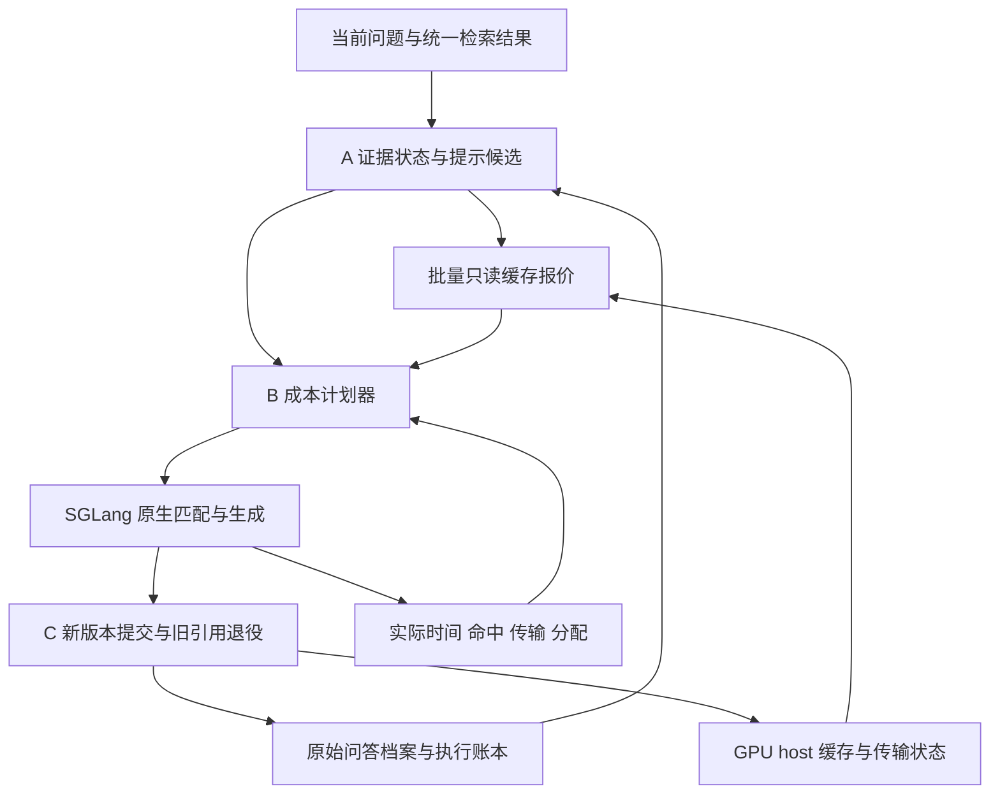
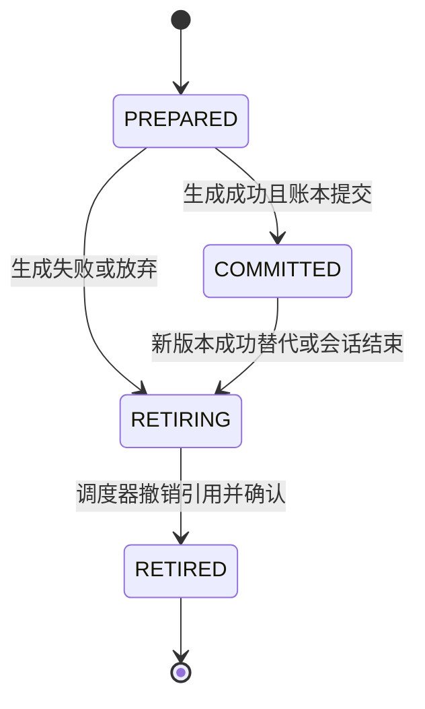

# 面向资源受限多轮文档问答的上下文与 KV 缓存协同优化研究

> 当前实施范围与优先级见[课题场景、目标与模块职责](docs/project_scope.md)。本文保留原设计依据；其中 Qwen2.5-7B、旧模型标定与大实验矩阵已过时，不是当前执行指令。当前使用已有 Qwen3 基座，训练不作为课题工程或验收前置。

## 完整技术方案与开发实验指南

- **版本**：2026-10-23 完整修订版。
- **交付格式**：Markdown；公式采用 LaTeX，架构采用 Mermaid，算法采用 Python 风格伪代码。
- **研究定位**：两项方法改进，加一项系统机制与协同优化贡献。
- **实施主线**：证据与稳定提示候选 → 实际成本计划选择 → 上下文版本与缓存生命周期。
- **证据状态**：本文完成了文献核对、指定版本源码静态审查、公开数据文件统计和小样例 CPU 检索 API 验证；未编译运行协同优化原型，也未取得 GPU 性能结果。文中参数是开发起点，性能预期均须实验验证。

## 目录

1. 研究结论与范围
2. 场景、数据依据和优化目标
3. 总体架构、工程模块与端到端流程
4. 模块 A：版本化证据与稳定提示候选
5. 模块 B：实际执行成本感知计划器
6. 模块 C：上下文版本感知缓存生命周期
7. 模块协同与统一决策
8. SGLang 源码审查与修改清单
9. 接口合同、并发一致性与故障恢复
10. 技术栈、代码组织与启动配置
11. 数据、检索和评测协议
12. 强基线、消融与实验矩阵
13. Profiling、指标和统计方法
14. 开发顺序、验收标准与工作量
15. 风险、失败边界与论文贡献
16. 附录：数据检查、配置与开发清单
17. 参考文献与源码永久链接

# 1. 研究结论与范围

## 1.1 最终选题与可交付成果

建议保留题目：

> **面向资源受限多轮文档问答的上下文与 KV 缓存协同优化研究**

实现一个单机多会话 RAG 原型：应用层维护证据和真实输入，在“继续追加”和“重建紧凑提示”之间进行成本选择；引擎层复用 SGLang 的前缀缓存、分层缓存和会话软引用，新增只读报价与上下文版本退役协议。工作重点是把文本变化、真实 KV 驻留、执行代价和物理资源回收对应起来。

| 技术模块 | 核心问题 | 首版新增内容 | 贡献定位 |
|---|---|---|---|
| A：证据与提示候选 | 证据重复或回访时，什么仍在当前可见输入中？ | 版本化证据、档案与执行双账本、无副作用 APPEND/REBUILD 候选 | 场景适配与方法改进 |
| B：成本计划器 | 当前缓存状态下，保留长前缀还是重新编码短提示更划算？ | 批量只读报价、实测代价模型、误差感知切换和滞回 | 主要方法贡献 |
| C：版本与缓存生命周期 | 新提示生效后，旧缓存分支何时撤销保留优先级？ | context epoch、成功提交、退役确认、失败恢复和资源核算 | 系统机制与协同优化贡献 |

**会话缓存本身不是本课题的新算法。** 固定版本 SGLang 已有 session-aware caching；本课题的增量是业务上下文版本与引擎会话引用之间的正确映射，以及它与文本选择、成本反馈的联合设计。[S1] [S4]

最低完整成果包括：可运行的控制器、有限范围的 SGLang 补丁、可复现的数据清洗与负载生成器、成本标定脚本、强基线和消融结果、质量与性能联合报告。无需同时发明压缩器、训练新模型和重写 attention kernel。

## 1.2 冻结首版边界

| 维度 | 首版选择 | 原因 |
|---|---|---|
| 引擎 | SGLang 固定 commit | 防止开发期间 API 和缓存实现漂移 |
| 模型 | Qwen2.5-7B-Instruct | dense GQA、FULL attention、较小 KV 足迹 |
| 硬件 | 单 GPU，TP=1，DP=1 | 降低跨进程、跨设备一致性风险 |
| 精度 | BF16 权重与 BF16 KV | 避免把量化收益混入上下文优化 |
| 缓存 | GPU + CPU host，两层 | 能研究容量、传输和复用间隔 |
| 文本动作 | APPEND、REBUILD | 两个动作已足够产生非平凡权衡 |
| 会话 | 同一业务会话串行，不同会话并发 | 保证历史提交顺序可解释 |
| 证据 | 固定检索配置、相同当前候选材料 | 防止通过不同检索结果制造收益 |
| 历史 | 首版完整保留原始用户问题和已完成答案 | 将收益先归因于证据和组织变化 |
| 排除项 | SSD/L3、MoE、SWA/Mamba、推测解码、多机、新 kernel | 控制毕业工作量与故障面 |

本方案使用的 SGLang 源码基准为 `3f36fc08331f64cd63c4fbbdf39cc402f38bb38b`。这是审查基准，不表示该提交在所有硬件上已通过安装和运行验证。

## 1.3 与相关工作的关系

| 工作 | 可借鉴机制 | 复用方式 | 本课题必须补足的部分 |
|---|---|---|---|
| ContextPilot | 上下文索引、对齐、精确去重、排序注释 | 复用索引或排序组件，适配自己的控制器 | 证据版本、当前可见性、候选隔离、失败后不提交 |
| TokenPilot | 前缀稳定、保守批量清理、生命周期门控 | 复用设计；适配代码或做策略级基线 | 本地 GPU/host 驻留、真实 Prefill/Decode 成本 |
| ReCAP | 持久历史状态、按当前请求选择、缓存兼容更新 | 论文机制参考 | 不把其热冷策略简化后冒称完整复现 |
| EfficientAgent | 复用工作集、host 写入准入、恢复是否划算 | 复用分析与策略思想，后续迁移 host 准入 | 原实现基于 vLLM/LMCache，不能直接作为 SGLang 插件 |
| SGLang | 精确前缀缓存、HiCache、会话软引用、锁与异步传输 | 直接复用引擎 | 只读联合报价、context epoch、退役 ACK 与遥测 |

ContextPilot 对应 `EfficientContext/ContextPilot`，不是其他同名项目；TokenPilot 对应论文 `2606.17016` 及其 LightMem2/LightRSI 实现；ReCAP 对应 `2609.40118` 的持久上下文图。核查时 ReCAP 官方仓库为空，因此不能声称已有完整实现可直接集成。[P1] [P2] [P3] [P4] [R1] [R2] [R3] [R4]

# 2. 场景、数据依据和优化目标

## 2.1 实际业务场景

面向动态证据上下文的多轮文档与知识问答，当前工程由单台有限 GPU 为多个会话提供服务。应用可包括政策与公共服务咨询、产品支持、学术资料、企业知识库和技术文档，不限定行业。用户连续追问、澄清条件、比较材料或切换话题；每轮检索到若干片段，相邻轮次可能重叠，也可能回访更早证据。以下技术文档示例用于解释机制，不构成应用范围限制。

例如，三个连续请求检索到 `{A,B} → {B,C} → {C,D}`：

- 每轮重建“原始问答历史＋本轮证据”，输入较紧凑，但上轮证据被移除或重排，后续前缀可能失配。
- 保持实际提示并只追加新证据，能够保留更多前缀，但逐渐累积当前不需要的旧材料。
- 重建后，旧分支可能仍有会话软引用；文本已经缩短，物理 KV 未必减少，其他会话仍可能遭到排挤。
- 用户轮间停顿期间，多会话的总工作集可能超过 host 容量；写回并不等于下轮能成功恢复。

研究对象是这些权衡，而不是预设“上下文越短越好”或“命中率越高越好”。

## 2.2 已核查的数据基础

固定版本 MTRAG 的 `mtrag-human/generation_tasks/RAG.jsonl` 有 **842 个逐轮任务、110 个会话**；其中 Cloud 域有 **205 个任务、26 个会话**。本次逐条统计的最大会话长度为 12 轮，每任务包含 5 个检索上下文块。它适合研究技术文档多轮服务，但不能直接称为天然超长会话数据集。[D1] [D2]

下表是对该固定文件进行的**完整证据块复现统计**。身份定义为 `(document_id, SHA256(text))`；排除每会话首轮；分母为所有剩余轮次的当前检索块数。

| 范围 | 当前证据块总数 | 上一轮出现过 | 任一历史轮出现过 | 历史出现但上一轮未出现 |
|---|---:|---:|---:|---:|
| Cloud | 895 | 188，21.01% | 277，30.95% | 89 |
| 全部域 | 3660 | 657，17.95% | 951，25.98% | 294 |

这是本方案的数据文件计算结果，复算逻辑见附录。**这些比例不是 token 重复率、前缀命中率，也不是 GPU 性能结果。** 同一块在不同位置出现，仍可能无法复用其 KV；多个不同块共享文本也不计入这里的精确复现。

这个画像支持三个实施决策：

1. 先测自然长度下的真实 token 前缀，不人为无限追加文档来制造冗余。
2. 当前证据多数可能是新块，必须测量控制器在低重叠条件下的额外开销。
3. 历史回访确实存在，维护“曾见过”集合不足以保证本轮证据可见。

## 2.3 正常业务基线

主要业务基线固定为：

> **固定系统提示＋完整原始问答历史＋本轮自然检索证据＋原生精确前缀缓存。**

完整历史只包括用户问题和实际/协议规定的答案；不默认把所有历史检索正文无限保留。还应加入原生会话缓存与分层缓存版本，作为更强工程基线。

布局、计划器和缓存策略的对比共用同一证据策略，包括第 4 章的当前证据、显式回访和条件依赖。恢复策略本身另做消融，避免把多拿到材料的收益归因于缓存。

优化不得依赖以下做法：减少当前证据数量而不评价质量、隐藏压缩模型调用、只统计服务端 Prefill、只在极端小 KV pool 上报告、把模型历史换成标准答案后仍宣称是真实闭环。

## 2.4 目标和约束

令 `π` 为上下文与缓存协同策略，优先优化：

$$
\min_{\pi}\ \mathbb{E}[T_{\mathrm{complete}}]
$$

同时报告满足 TTFT/TPOT SLO 的吞吐，满足：

$$
Q(\pi) \ge Q_{\mathrm{ref}}-\epsilon_Q,\qquad
M_G(t)\le B_G,\qquad M_H(t)\le B_H.
$$

这里 `Q` 是离线测得的质量指标，不是在线决策可读取的标注。`ε_Q` 由课题预先确定，例如以 1 个百分点作为候选非劣界限；是否满足须结合置信区间判断。样本量不足时应报告“无法确认非劣”，而不是把不显著差异当成质量相同。

在线首版使用结构性约束：当前必需证据覆盖、原始问答保留、版本合法、token 不超限。它们降低风险，但不能在数学上保证回答质量不下降。

# 3. 总体架构、工程模块与端到端流程

## 3.1 架构



应用层拥有语义状态，引擎拥有物理缓存；二者通过 token、配置指纹和版本接口连接。应用层不能直接持有并任意释放引擎的物理块地址。

## 3.2 工程组件划分

| 组件 | 职责 | 主要输入 | 主要输出 |
|---|---|---|---|
| Corpus Adapter | 加载原始文档、版本与 provenance | 文档和语料快照 | EvidenceBlock |
| Retrieval Adapter | 固定检索或真实检索 | 当前问题和允许历史 | RetrievedEvidence |
| Session Store | 记录原始问答、执行账本、epoch | 请求和生成结果 | 只读 SessionSnapshot |
| Candidate Builder | 构造 APPEND/REBUILD | Snapshot、当前证据 | PromptCandidate 列表 |
| Template Adapter | 使用固定 chat template | 消息或受控 token 续接 | 最终 input_ids、hash |
| Quote Client | 请求同批候选报价 | input_ids 和配置指纹 | CacheQuoteBatch |
| Cost Model | 预测候选执行成本 | 候选、报价、历史统计 | 分项成本与误差 |
| Planner | 可行性过滤、阈值与滞回 | 成本、预算、状态 | SelectedPlan |
| Engine Bridge | 原生生成与新增控制接口 | input_ids、engine session | 输出 token 与遥测 |
| Epoch Coordinator | CAS 提交、退役 outbox、重试 | 成功或失败事件 | 新账本、退役 ACK |
| Evaluator | 隔离标签的质量与系统评测 | 脱敏日志、离线标注 | 质量、延迟、容量报告 |

首版采用一个 Python 控制服务和一个 SGLang 服务，避免为每个模块建立独立网络微服务。Session Store 可使用 SQLite WAL；原始证据内容按 hash 存文件，便于调试和重放。

## 3.3 端到端流程

1. 按业务 `session_id` 获取串行锁，先恢复或拒绝该会话的未决 attempt，再读取已提交快照。
2. 根据指定评测模式，同步允许使用的既往历史并重新读取快照；加载固定检索结果或执行真实检索。
3. 对证据做版本确认和精确重复归并，产生共同的必需证据集合。
4. 在同一快照上构造两个候选，不更新任何已提交状态。
5. 使用固定 tokenizer/template 生成完整 `input_ids`，检查长度和证据覆盖。
6. 向 scheduler 所属进程请求一次批量只读报价。
7. 计划器选定文本动作；首版加载方式统一为原生 `NATIVE`。
8. 首轮、重建或强制恢复分配唯一 engine session ID，并幂等 prepare 取得 generation；追加复用当前 epoch 和 generation。
9. 将完整 `input_ids` 与 restart/generation guard 交给打补丁后的 `/generate`，由引擎完成实际匹配、预算检查、恢复和生成。
10. 收到完整成功结果后，在同一持久事务中提交原始问答、执行输入输出、可见证据、当前 epoch、attempt 结果和旧 epoch 退役 outbox。
11. 事务提交后发送 outbox 中的退役请求；等待或后台重试确认。
12. 记录实际分项成本；更新只依赖过去数据的代价统计。

报价不是资源预留。选中之后真实缓存可能变化，原生 admission、锁、传输完成检查始终拥有最终决定权。

# 4. 模块 A：版本化证据与稳定提示候选

## 4.1 痛点、复用与改进

痛点不只是重复文本：同一文档 ID 可能对应新版本；历史上见过的材料可能已在重建中移除；为了保持缓存而保留的旧证据可能与当前版本冲突；构造两个候选时，若调用会修改 `seen` 集合的 API，会使第二个候选受到第一个候选污染。

ContextPilot 可提供索引、对齐和去重的基础。源码核查发现，其 `ContextPilot.deduplicate` 会更新 `seen_docs` 和轮次；辅助 `process_conversation_turn` 的历史用于检索，但该路径的生成 prompt 只插入当前 context 与 question，没有实际插入 `conv_state.messages`。因此不能直接拿这个辅助路径作为本课题完整多轮基线。[C1] [C2] [C3]

本模块独立维护三个状态：

| 状态 | 含义 | 能否作为本轮省略证据的依据 |
|---|---|---|
| Archived | 原文曾获取，外部可恢复 | 不能 |
| Seen | 某次已提交执行使用过 | 单独不能 |
| Visible | 本候选实际 input_ids 中存在正确版本的完整材料 | 可以，仍要保留引用映射 |

先构造候选，再校验，再执行成功后提交。复用 ContextPilot 时，只使用经过封装的纯排序/索引读取；有状态写入延迟到提交之后，或放入候选私有副本。

## 4.2 数据结构

下列类型是本项目拟新增接口，不是 SGLang 的现成类。

```python
@dataclass(frozen=True)
class EvidenceKey:
    corpus_id: str
    document_id: str
    passage_id: str
    version: str
    content_sha256: str

@dataclass(frozen=True)
class EvidenceBlock:
    key: EvidenceKey
    source_uri: str
    title: str
    text: str
    token_ids: tuple[int, ...]   # 仅用于预算，最终以完整模板计数
    span: tuple[int, int] | None
    parent_section: str | None
    provenance: tuple[str, ...]

@dataclass(frozen=True)
class TurnRecord:
    turn_id: int
    user_text: str
    assistant_text: str
    assistant_output_ids: tuple[int, ...]
    finish_reason: str
    evidence_keys: tuple[EvidenceKey, ...]

@dataclass(frozen=True)
class Message:
    role: str
    content: str

@dataclass(frozen=True)
class ExecutionLedger:
    epoch_id: int
    engine_session_id: str
    history_version: int      # 与本次已提交原始问答版本一致
    messages: tuple[Message, ...]  # 成功后包含刚完成的 assistant 回答
    last_input_ids: tuple[int, ...]
    last_output_ids: tuple[int, ...]
    visible_blocks: frozenset[EvidenceKey]
    template_hash: str
    model_revision: str
    corpus_snapshot_id: str

@dataclass(frozen=True)
class PromptCandidate:
    candidate_id: str
    action: str                # APPEND / REBUILD
    snapshot_version: int
    messages: tuple[Message, ...]
    input_ids: tuple[int, ...]
    input_hash: str
    visible_blocks: frozenset[EvidenceKey]
    required_blocks: frozenset[EvidenceKey]
    build_ms: float
    feasible: bool
    reason: str | None
```

`visible_blocks` 必须由渲染器记录的原始证据正文 span、身份和 provenance 导出或核验，不能仅沿用上轮的集合。只出现引用 hint、答案转述或相似字符串，不算完整证据可见。`Message` 及其内含数据必须不可变；若使用字典则深拷贝，禁止两个候选共享可变 payload。文本 hash 与 version 同时保存：version 便于业务解释，hash 防止“版本号未变而内容变了”。

## 4.3 证据选择与预算

首版采用“保守当前证据＋显式回访”，不训练压缩器：

- 固定检索 top-k 的当前证据为 `R_t`，所有方法获得相同内容。
- 解析当前问题中显式出现的既有证据编号、文档版本、配置项，恢复相关原始片段，得到 `F_t`。
- 保留当前解析所需的标题、表头、适用条件、例外和版本说明，得到 `G_t`。
- 必需集合为 `E_t^{req}=R_t\cup F_t\cup G_t`。
- 原始用户问题和已完成答案完整保留。
- 精确重复只在内容、版本和引用映射一致时归并；不默认做语义相似去重。

共同 top-k、邻接扩展与截块规则在构造必需集合之前冻结。集合形成后不得现场削减；若超预算，统一进入明确的溢出处理：在另一个配置中提高共同上下文预算、使用预先定义且单独评测的抽取模式，或记录本轮超限失败。不能只让所提方法偷偷删掉必需证据。

增强版可以为可选证据定义：

$$
s(e)=w_r\,\mathrm{rel}(q_t,e)
+w_a\,\mathrm{anchor}(q_t,e)
+w_u\,\mathrm{recency}(e)
+w_c\,\mathrm{constraint}(e),
$$

再按 `s(e)/\mathrm{tokens}(e)` 贪心加入；必须先保留必需块及其条件闭包。该版本增加了证据选择差异，须作为独立质量—性能消融，不与纯布局收益混为一谈。

## 4.4 两种候选的精确定义

### APPEND

在已提交的实际消息账本后，增加本轮问题与必要的新材料：

$$
E_t^{new}=E_t^{req}\setminus V_{t-1},
$$

其中 `V_{t-1}` 是旧执行账本中**仍可见、版本合法**的证据。已可见证据可通过稳定编号引用，正文不重复加入。原有消息、证据顺序和来源头保持不变。

这一动作保留旧证据，因此可能更长。它只代表逻辑追加，不自动保证最终 token 全部追加；chat template、EOS 和重新编码都可能影响末端前缀，必须对真实 token 检查。

### REBUILD

从原始问答档案重新组装：

$$
P_t^{R}=\mathrm{Template}\big(S,\ H^{raw}_{<t},\
\mathrm{User}(q_t,E_t^{req})\big).
$$

`H^{raw}` 保留之前用户问题和完整已完成答案，移除旧 user payload 中历史检索正文；当前必需证据统一放在本轮用户消息中。显式回访需要的历史证据通过 `F_t` 恢复。

重建可能缩短输入，但通常从较早位置失去前缀。不能仅依据“删了多少 token”决定是否重建。

### 版本冲突

默认策略：若当前要求最新版本，而 APPEND 仍含相冲突旧版本正文，APPEND 判为不可行，转向重建。若问题本来要求比较版本，则新旧材料均保留并显式标注，不把旧版本当作垃圾删除。

语料快照在单轮内固定；请求执行途中发现文档更新，不原地修改已提交 input_ids，而是由下一请求处理。

## 4.5 稳定提示组织

- 固定系统说明、字段顺序、换行、证据编号格式和引用格式。
- 稳定编号由证据身份确定，不随检索排名变化；完整 hash 留在账本，prompt 用短编号。
- 短编号创建时检查碰撞，冲突则延长 hash 或分配不可变序号；跨轮、跨 epoch 引用映射保持一致。
- 动态检索分数、当前排名和时间戳不改写早期提示；有必要时放在本轮末尾的短映射中。
- 同批新证据按固定规则排列；排序优化只在新加入部分或重建时进行。
- 避免每轮把“最新问题/当前时间”写入系统消息。
- 证据指令要求使用原文支持答案、保留条件并在无法回答时说明；不能把检索文本视作更高优先级指令。
- 同一文档 ID、相同片段 hash 仅表明内容相同，KV 仍取决于其完整因果前缀及模型配置。

理论公共前缀定义为：

$$
\ell_t^a=\mathrm{LCP}\big(P_t^a,\ P_{t-1}\Vert Y_{t-1}\big).
$$

实际可复用长度还受引擎缓存插入范围、页面对齐、尾 token 未物化和驻留状态限制，因此 `\ell_t^a` 只用于诊断，不能替代引擎报价。

## 4.6 候选构建伪代码

```python
def build_candidates(snapshot, query, retrieved, policy, template):
    required = select_shared_required_evidence(
        query=query, retrieved=retrieved,
        archive=snapshot.archive, policy=policy,
    )
    verify_versions(required, snapshot.corpus_snapshot)

    candidates = []
    if snapshot.execution is not None:
        history_compatible = (
            snapshot.execution.history_version == snapshot.raw_history_version
            and not snapshot.history_sync_pending
        )
        if (history_compatible
                and append_has_no_disallowed_version_conflict(snapshot, required)):
            missing = required - snapshot.execution.visible_blocks
            append_msgs = append_current_user(
                snapshot.execution.messages,
                query, stable_order(missing),
                references=required & snapshot.execution.visible_blocks,
            )
            candidates.append(render_and_validate(
                "APPEND", append_msgs, required, snapshot, template
            ))

    rebuild_msgs = rebuild_from_raw_qa(
        snapshot.raw_history, query, stable_order(required)
    )
    candidates.append(render_and_validate(
        "REBUILD", rebuild_msgs, required, snapshot, template
    ))
    # 此处不修改 seen、epoch、archive 提交版本或真实缓存
    return tuple(candidates)
```

这里 `required`、`visible_blocks` 和集合运算均使用 `EvidenceKey`；渲染辅助函数通过当前只读证据快照解析对应 `EvidenceBlock` 正文，不把 key 当作正文。`raw_history_version` 标识当前允许使用的语义历史；外部历史同步只更新该版本并设置 `history_sync_pending`，不会伪造旧执行账本的版本。

首轮只有 REBUILD，旧 epoch 为 `None`。只有一个合法候选时直接采用；没有合法候选时走共同的超限/恢复规则，并记录失败原因。候选准备失败不影响此前已经提交的会话。

## 4.7 模块 A 的可检验收益

主要验证：当前证据覆盖和回答质量不降低时，真实有效前缀是否增加、重复正文是否减少、Prefill 是否减少。代价包括更长历史上下文、CPU 排序/模板化、回访恢复和可能的位置偏置。若重叠不足、保留旧证据拉长 Decode，模块 A 可以没有净收益；应据此缩小其作用，不修改数据来制造收益。

# 5. 模块 B：实际执行成本感知计划器

## 5.1 场景痛点与技术路线

固定 token 阈值忽略了三个事实：同一长前缀可能在 GPU、只在 host 或已经消失；删减后的 Prefill 代价随公共前缀和新增长度变化；短输入对长回答的 Decode 收益可能高于对短回答的收益。

TokenPilot 的批量清理和 ReCAP 的缓存兼容更新提示“不要每轮无条件改写”。本模块进一步把本地可测的驻留、加载、重算、Decode 和控制开销纳入选择。首版不训练强化学习策略，不建立长时域全局求解器，也不读取未来请求。[P2] [P3]

动作空间是：

$$
a_t\in\{\mathrm{APPEND},\mathrm{REBUILD}\},
\qquad m_t=\mathrm{NATIVE}.
$$

`NATIVE` 表示实际是否从 host 加载仍由 SGLang 原生匹配和 admission 决定。不得在模型里选择“强制重算”，实际却让引擎照常恢复，然后声称实现了该动作。

## 5.2 只读报价的必要性

已核查的 `UnifiedTreeCore.match_full_device_prefix` 提供 FULL/GPU 只读遍历基础。常规 `match_prefix` 可能拆分节点、更新访问时间，并执行 deferred actions；不能逐个调用它为两个候选“试算命中”。[S2] [S3]

新增 `quote_batch` 在 scheduler 的单一状态所有者中读取两个候选：

| 字段 | 语义 | 不应混淆为 |
|---|---|---|
| raw_match_tokens | 忽略部分可用性限制的逻辑匹配长度 | 可立即执行的命中 |
| max_match_tokens | 与 Req 一致的可匹配上限和页面对齐 | 完整 input 长度 |
| ready_gpu_prefix_tokens | 连续、已完成传输的 GPU 前缀 | 已分配但 H2D 尚未完成的 value |
| recoverable_prefix_tokens | 从根连续覆盖、GPU ready 或 host ready 的最长边界 | GPU 与 host 长度简单相加 |
| host_only_load_tokens | 要达到该边界真正需要 H2D 的部分 | host 全部副本数 |
| inflight_h2d / inflight_d2h | 在途、不应当作 ready 的范围或数量 | 已可复用 KV |
| free_gpu / free_host | 分配器当前空闲 slot | 含所有可淘汰节点的“保证空间” |
| evictable_by_class | 无引用/有软引用、未硬锁的可淘汰数量 | 本请求能立即独占的容量 |
| observed_seq / restart_id | 观察周期与引擎实例代际 | 资源预留凭据 |
| native_load_estimate | 按当前原生规则估计的恢复范围与不确定性 | 已承诺恢复量 |

`host_value != None` 不足以证明 D2H 完成，`device value != None` 也不保证 H2D 已结束。必须使用原生 pending 状态和已提交的完成元数据进行分类。

对首版普通生成，匹配上限通常先限制为 `input_len-1`，再按 page size 向下对齐；使用 `Req._compute_max_prefix_len` 一致逻辑，不在控制器复制一个永远成立的常数假设。只读 GPU 函数返回的第三项是整节点 pin 范围估计，不能当成匹配 token 数。[S2] [S6]

## 5.3 代价分解

候选 `a` 的预测完成时间：

$$
\widehat T(a)=C_{\mathrm{ctrl}}
+\widehat T_{\mathrm{queue}}(a)
+\widehat F_{\mathrm{restore+prefill}}(a)
+\widehat D(a).
$$

- `C_ctrl`：候选构造、模板化、检索/回访恢复、报价 RPC 和决策；共同成本在候选排序中可抵消，但最终端到端指标必须包含。
- `T_queue`：压力桶下的排队估计；首版不声称准确预测调度队列尾延迟。
- `F_restore+prefill`：按原生执行路径标定的联合成本，避免把重叠传输和计算重复计费。
- `D`：完整上下文对实际输出生成的成本。
- 旧 epoch 退役若在后台执行，计入系统资源成本和退役延迟，不无条件加到用户首 token 延迟；提交持久化若阻塞响应，则计入完成时间。

### Prefill

设 `g` 为执行时有效前缀，`m=n-g` 为需计算后缀。一个用于理解和拟合的结构是：

$$
\widehat F_{\mathrm{prefill}}(g,m,b)
=c_b+\alpha_b m+\beta_b
\left(mg+\frac{m(m+1)}2\right).
$$

这是正系数近似结构，不是 GPU 耗时精确公式。`b` 表示并发/批量压力桶，attention kernel、chunked prefill 和带宽饱和会引起分段行为。推荐最终采用二维查表或分段单调回归 `f(g,m,b)`。只按未命中 token 乘固定毫秒常数会漏掉长前缀 attention 成本。

### Host 恢复

$$
\widehat T_{\mathrm{H2D}}
=t_{\mathrm{launch}}+
\frac{B_{\mathrm{missing}}}{BW_{\mathrm{eff}}(B_{\mathrm{missing}},p)}.
$$

`B_missing` 是实际需恢复的 KV 字节，`p` 为传输压力。若使用分项解释：

$$
F_{\mathrm{restore+prefill}}
=T_{\mathrm{H2D}}+T_{\mathrm{prefill}}-T_{\mathrm{overlap}}.
$$

`T_overlap` 必须由时间线观察得到，首版也可以直接标定联合阶段时间，不强行推断重叠。D2H 通常为后台工作，应记录它对关键路径的干扰和总写入量，而不是把每次后台写入的完整耗时再次相加。

### Decode

$$
\widehat D(a)=
\sum_{j=1}^{\max(\widehat y_t-1,0)}
\widehat d(n_a+j,b_j).
$$

联合恢复/Prefill 阶段标定到首 token，Decode 项只计余下的 `ŷ_t−1` 步，避免首 token 双重计费。首版用按上下文长度和活跃 batch 桶标定的 TPOT 查表。`ŷ_t` 从此前已完成的输出长度、当前问题类型和 dev 分布估计；禁止使用本轮真实答案长度或后继问题。预测可用过去 4 轮的截断均值并向全局均值收缩，另用 P90 长度计算风险上界。实际长度仅用于事后误差归因。

## 5.4 容量与重建峰值

FULL GQA、TP=1、BF16 KV 的理论每 token 数据量为：

$$
b_{\mathrm{KV}}=2Lh_{\mathrm{KV}}d_hs.
$$

`L` 是层数，`h_KV` 是 KV head 数，`d_h` 是 head 维度，`s=2` 字节。不能使用 attention query head 数替代 KV head 数。

本课题区分三个量：

1. **进程预留显存**：权重、预分配 KV slab、CUDA graph 和 workspace；通常不会随一次缓存淘汰立即下降。
2. **KV pool 已占用物理 slot**：分配器中当前唯一块的占用，本方案主要容量指标。
3. **逻辑提示 token 总数**：有共享和副本，不能直接相加当成物理占用。

令 `U_G(τ)` 为实际占用的 GPU slot 字节：

$$
U_G(\tau)=U_G(t_0)+
\sum_{i:t_0<t_i\le\tau}\mathrm{alloc}_i-
\sum_{j:t_0<t_j\le\tau}\mathrm{free}_j,
\qquad
U_G^{peak}=\max_{\tau}U_G(\tau).
$$

`retire_ref` 事件自身的 `free=0`。只有引擎实际 eviction/free 后才减少占用。共享前缀按唯一块 ID 计一次；GPU 与 host 副本分层计算；在途缓冲单列。

候选侧可以估计新增 slot、当前硬锁和可淘汰量，但不能提前扣掉“预计旧分支会释放”的全部字节。首版以原生 admission 为最终约束：临时容量不足时排队或退回保守动作；不得绕过锁强制删除旧节点。

## 5.5 统一评分、误差与滞回

首版可直接取 `\widehat J(a)=\widehat T(a)`。在容量压力明显时，增强版加入未来一个短观察窗口内的资源占用价格：

$$
\widehat J(a)=\widehat T(a)+
\lambda_G\widehat A_G(a)+
\lambda_H\widehat A_H(a)+
\lambda_W\widehat B_{\mathrm{write}}(a),
$$

其中 `A_G,A_H` 是占用的时间积分，不是静态字节数。若 `T` 用 ms，`A_G,A_H` 用 GiB·s，`B_write` 用 GiB，则 `λ_G,λ_H` 单位为 ms/(GiB·s)，`λ_W` 为 ms/GiB；各候选使用相同窗口，按唯一物理 slot 的增量归因。默认这些价格先设为 0，证明单步成本反馈有效后，再测试压力价格。不要一开始同时调大量自由权重。

若 APPEND 合法，定义：

$$
\widehat\Delta=
\widehat J(\mathrm{APPEND})-
\widehat J(\mathrm{REBUILD}).
$$

仅当：

$$
\widehat\Delta >
\max\left(
\delta_{\mathrm{abs}},
\delta_{\mathrm{rel}}\widehat J(\mathrm{APPEND}),
z\,\widehat\sigma_\Delta
\right)
$$

且满足最小稳定轮数时重建。`σ̂_Δ` 从 dev 上配对预测误差或在线已有残差估计；不是凭空给出的统计置信保证。

| 参数 | 开发起点 | 搜索范围或处理 |
|---|---|---|
| δ_rel | 5% | 0%、5%、10%，仅 dev 调参 |
| δ_abs | 报价和决策开销 P95 的 2 倍 | 不固定为某台硬件的毫秒数 |
| z | 1 | 0、1、2 |
| min_stable_turns | 2 | 0、1、2、4 |
| 输出长度统计窗口 | 最近 4 个已完成轮次 | 不足则使用 dev 全局先验 |
| 最大重新报价次数 | 1 | 避免高压时反复计划 |
| 预测更新 | 先冻结离线模型 | 后续再加 EMA 校准消融 |

预算超限、证据版本失效或 APPEND 不合法时，质量/硬约束优先于滞回。未经过足够 profiling 的桶使用保守误差，或退回调好的固定策略。

## 5.6 决策伪代码

```python
def choose_plan(candidates, quotes, model, session, knobs):
    valid = [c for c in candidates if c.feasible]
    if not valid:
        return NoFeasiblePlan(reason="shared_context_policy_overflow")
    if len(valid) == 1:
        return Plan(valid[0], execution_mode="NATIVE")

    quote_by_id = {q.candidate_id: q for q in quotes.quotes}
    estimates = {
        c.candidate_id: model.predict_native(c, quote_by_id[c.candidate_id])
        for c in valid
    }
    append = find(valid, action="APPEND")
    rebuild = find(valid, action="REBUILD")

    if append is None:
        return Plan(rebuild, execution_mode="NATIVE")
    if rebuild is None:
        return Plan(append, execution_mode="NATIVE")

    if session.must_rebuild:
        return Plan(rebuild, execution_mode="NATIVE")
    if session.turns_since_rebuild < knobs.min_stable_turns:
        return Plan(append, execution_mode="NATIVE")

    delta = (estimates[append.candidate_id].cost
             - estimates[rebuild.candidate_id].cost)
    margin = max(
        knobs.delta_abs,
        knobs.delta_rel * estimates[append.candidate_id].cost,
        knobs.z * paired_error(append, rebuild, estimates),
    )
    chosen = rebuild if delta > margin else append
    return Plan(chosen, execution_mode="NATIVE",
                predicted=estimates, quote_seq=quotes.observed_seq)
```

容量风险检查在预测器/执行 admission 中处理；不能因“可淘汰”就标记“已预留成功”。

## 5.7 算例和收益边界

假设某轮 APPEND 为 12k tokens、REBUILD 为 7k tokens；下面数值**仅演示决策，不是测量结果**：

| 情形 | APPEND 联合恢复/Prefill | APPEND Decode | REBUILD 联合恢复/Prefill | REBUILD Decode | 选择趋势 |
|---|---:|---:|---:|---:|---|
| 长前缀仍在 GPU，短输出 | 30 ms | 200 ms | 180 ms | 150 ms | APPEND |
| GPU 失配、host 恢复昂贵 | 400 ms | 200 ms | 180 ms | 150 ms | REBUILD |
| 长输出放大上下文成本 | 30 ms | 1000 ms | 180 ms | 650 ms | REBUILD |

只有实际 profiling 才能确定这些相对关系。单步计划器可能错过“当前付出、后面多轮获益”的重建；这是首版有意接受的限制。增强版可增加 1 个未来轮次的期望项，但未来到达概率和长度只能用历史估计，须与 H=1 对比，不能使用测试集后继请求。

# 6. 模块 C：上下文版本感知缓存生命周期

## 6.1 为什么已有会话缓存仍需要版本

SGLang 顶层 `session_id` 只标记缓存引用，不替应用保存或续接文本；每轮仍要提交完整提示。会话引用是软保护：仍可以在内存紧张时被淘汰。关闭会话撤销引用，缓存可以继续存在并被复用。[S1]

源码显示，同一分支上的连续延长可以推进已有叶引用；较早 token 改写形成新的非祖先分支时，同一会话可能保留多个叶引用。业务上下文已重建，并不意味着引擎知道旧分支已退役。因此将业务会话与上下文 epoch 分开。[S4] [S5]

## 6.2 标识与状态

```python
@dataclass(frozen=True)
class ContextEpoch:
    business_session_id: str
    epoch_no: int
    engine_session_id: str    # 随机唯一，不复用
    session_generation: int  # prepare 返回并持久保存
    parent_epoch_no: int | None
    state: str               # PREPARED / COMMITTED / RETIRING / RETIRED
    reason: str
    engine_restart_id: str

@dataclass(frozen=True)
class RetireOperation:
    operation_id: str
    engine_session_id: str
    expected_generation: int
    engine_restart_id: str
    reason: str
    committed_ledger_version: int
```

`engine_session_id` 可由业务会话、单调 epoch 和随机 nonce 构成。它只放在请求元数据中，**不得写进提示正文或 cache_salt**，否则人为破坏跨 epoch 共享前缀。租户 namespace 如有需要保持稳定，所有方法一致。

状态转换：



`RETIRED` 指软引用生命周期结束，不指所有 KV 已删除。是否仍有缓存由原生策略和其他引用决定。

## 6.3 成功提交协议

1. APPEND 使用当前 epoch 和已保存 generation；首轮、REBUILD 或强制恢复创建唯一新 ID，幂等 prepare 取得并持久保存 generation。
2. 完整输入连同 restart/generation guard 交给引擎，在原生 auto-ensure 前校验；保留原生 request lock、host lock、admission 和传输完成检查。
3. 请求成功完成，取得实际 `output_ids`、finish reason 和拟新增的缓存完成 receipt。
4. 控制器以 `expected_ledger_version` 做 CAS；在同一持久事务中保存问答、实际执行账本、可见证据、新当前 epoch、attempt 结果以及待退役 outbox；执行账本的历史版本对齐提交后的原始问答版本，并清除历史同步标志。
5. 新版本已经成为当前版本后，发送旧 epoch 退役请求。
6. 调度器验证引擎代际和 session generation，调用原生引用撤销，并返回 ACK。
7. 控制器幂等标记 outbox 完成。

原生 `/close_session` 只完成异步 dispatch，HTTP 200 不是 scheduler 已执行的确认；应新增 `RetireEpochReqOutput` 并接通响应 communicator。[S7] [S8]

完整生成结果是业务提交依据；receipt 用于确认本次完成和缓存注册状态。缓存注册为 0 或未命中不应自动使正确答案失败，只说明本轮没有成功获得预期缓存收益。若是生成中断、输出不完整或请求身份无法确认，则不得提交为已完成答案。

## 6.4 故障处理

| 事件 | 文本状态 | 缓存/引用处理 |
|---|---|---|
| 候选生成或报价失败 | 保持旧账本 | 退回共同固定策略或返回明确失败 |
| 新 epoch 生成失败 | 不替换旧已提交历史 | 等原生取消/完成边界后，幂等退役候选 epoch |
| 部分流式输出后中断 | 记录失败尝试，不当完整答案加入历史 | 保留原生清理路径；下一次显式重试 |
| 生成成功，持久提交失败 | 结果进入恢复记录，不先退役旧 epoch | 根据 rid/attempt 恢复提交或明确重试 |
| 新账本已提交，旧 epoch 退役超时 | 新账本继续有效 | 只重试退役；不能回滚新答案 |
| 重复退役请求 | 保持现态 | 返回 already_retired，不重复递减 |
| 引擎重启 | 原始文本档案继续有效 | 旧缓存视作消失；restart_id 改变，重新完整输入 |
| 会话自然结束或租约到期 | 保留需要的文本档案 | 退役当前 epoch；清理所有未完成 outbox |
| 人工参考历史同步 | 生成新的协议历史版本 | 单列 history_sync 原因，不能计作证据重建收益 |

原生 closed-session tombstone 是有限集合，不承担永久业务幂等；本项目使用不可重用 epoch ID、自身持久 outbox 和调度器身份校验。首版还应保证同一业务会话最多一个未完成的业务 turn。[S4]

## 6.5 退役后的原生淘汰

固定源码的 `FullComponent._session_ref_eviction_strategy` 将是否有引用、引用数与已有 priority 组合；GPU 和 host 都使用此偏好。本项目首版只正确撤销已不代表当前业务计划的 epoch 引用，继续使用原生排序。[S5]

由此产生的效果是：

- 新版本在相同前缀上的引用仍然保护共享部分。
- 旧版本独有分支失去该业务会话的优先级，但其他会话引用继续存在。
- 活跃请求锁和在途传输锁不能被 soft-reference 退役覆盖。
- 没有内存压力时，旧 KV 可以继续驻留，避免无意义主动清空。
- 高压时，旧分支更容易先于当前工作集被正常淘汰。

因此首版应称为“复用两层原生策略的 epoch 生命周期机制”，不能称为全新 GPU/host 替换算法。

## 6.6 可选增强：host 写入准入

EfficientAgent 的公开实现以 vLLM＋LMCache 为基础，使用工作集压力和新增 refill 大小控制 host 保存。它提供有用起点，但不能直接安装到 SGLang 后宣布完成移植。[P4] [R4] [E1]

增强方案只拦截**可选缓存写入**，不绕过在途复制或请求正确性所必需的 staging。可采用：

$$
\widehat W_t=
\mathrm{UniquePrefixBytes}(\text{近期活跃会话}),
\qquad
p_t=[\widehat W_t>B_H]\land[\mathrm{occupancy}>\theta]
\land[\mathrm{recent\_evictions}>0].
$$

真实唯一前缀统计成本高时，可用活跃会话平均长度估计作为压力信号；不能把重复共享前缀直接相加后称为精确物理容量。

```python
def admit_optional_host_write(event, state, knobs):
    if event.required_for_active_request:
        return ALLOW_NATIVE_PATH
    if state.host_has_sufficient_headroom:
        return ALLOW
    if event.epoch_retired and event.live_session_refs == 0:
        return SKIP_OPTIONAL_WRITE
    if state.pressure and event.refill_pages > knobs.max_refill_pages:
        return SKIP_OPTIONAL_WRITE
    return ALLOW
```

更复杂的价值评分可以使用：

$$
v_H(x)=
\frac{
p_{\mathrm{reuse}}(x)
[\widehat T_{\mathrm{recompute}}(x)-\widehat T_{\mathrm{restore}}(x)]_+
-\widehat T_{\mathrm{write}}(x)}
{B_x}.
$$

`p_reuse` 必须来自既往复用与间隔，不读取未来；节点依赖、共享祖先和真实可释放字节仍由原生结构限制。首版无需实现此评分，先验证 epoch 退役是否已经足够。

host 增强要与调好的原生 `write_through_selective` / `write_back` 比较，并加入“空间充足时放行”的消融，避免只展示极小 host 的获益。

# 7. 模块协同与统一决策

## 7.1 三个模块之间传什么

| 方向 | 状态/数据 | 对决策的实质影响 |
|---|---|---|
| A → B | 两份真实 token 候选、必需证据、版本、长度 | 明确允许采取哪些文本动作 |
| C/引擎 → B | GPU/host ready 前缀、传输、空闲与可淘汰状态 | 相同文本在不同驻留下可选不同动作 |
| B → C | 选中动作、epoch、保留前缀和原因 | 只给实际采用的新版本提交引用，退役被替代版本 |
| 执行 → B | 实际 Prefill/恢复/Decode、预测误差 | 校准成本，发现报价陈旧或拟合失准 |
| C → A | 当前已提交 epoch、真实可见内容 | 下轮去重不能依据已退役或仅归档的内容 |

协同的可验证含义有两点：上下文打算保留的内容确实进入当前缓存生命周期；已经被新上下文替代的引用及时撤销。两者均可通过事件日志验证，而非仅用“联合优化”命名。

## 7.2 可操作的优化框架

每轮求解：

$$
a_t^*=\arg\min_{a\in\mathcal A_t^{valid}}
\widehat J(a\,|\,S_t,K_t),
$$

其中 `S_t` 是已提交语义状态，`K_t` 是同批只读缓存观察。然后执行：

$$
(S_{t+1},K_{t+1})
=\mathrm{Commit}\big(\mathrm{NativeExecute}(a_t^*,S_t,K_t)\big).
$$

`Commit` 不是一个覆盖全引擎的原子事务：原生 KV 执行先发生，业务文本随后持久提交，旧引用异步退役。需要 outbox 和幂等协议承受中间失败。把它写成一个数学箭头不代表可以省略这些工程步骤。

首版按“候选合法性 → 原生成本估计 → 切换门槛 → 原生执行 → 成功提交 → 引用退役”运行。这里没有同时为所有会话求全局最优；多会话资源竞争通过实际队列、容量和后续反馈影响每轮选择。

## 7.3 怎样证明协同超过简单拼接

必须比较：

- 仅稳定证据组织；
- 稳定组织＋调好的固定重建策略；
- 稳定组织＋成本计划器，但缓存生命周期不感知版本；
- 稳定组织＋固定策略＋epoch 退役；
- 稳定组织＋成本计划器＋epoch 退役；
- 上述最佳组合＋可选 host 准入。

其中固定策略与成本策略必须使用**相同的候选、报价开销口径和退役设施**；不需要报价的固定策略不强加无用报价开销，方法 B 必须付自己的额外成本。

若只有 epoch 退役产生收益，论文应据实强调生命周期机制，不能把全部收益归因于成本算法。若强独立组合与完整系统相当，也可报告更少调参、更稳定的容量趋势或明确的无收益区域；不设任意百分比作为立项门槛。

## 7.4 需要观察的耦合证据

| 现象 | 要记录的因果链 |
|---|---|
| GPU 命中时选择 APPEND，host miss 时选择 REBUILD | 相同或可配对的候选 → 驻留变化 → 成本预测 → 动作变化 |
| 重建后其他请求重算减少 | epoch 退役 → 旧独有分支优先级下降 → 实际释放 → 当前工作集存活 |
| 固定阈值在某容量下失效 | 阈值不变 → 恢复/排队成本变化 → 决策后悔值增加 |
| host 准入减少浪费 | 准入拒绝 → 写入量下降 → 未牺牲可复用前缀 → 吞吐或尾延迟改善 |
| 方法退化 | 控制开销、频繁重建、恢复失败或长 Decode → 明确归因 |

使用相同前缀并不意味着有因果可比的全部请求；更改输入布局可能改变答案长度，必须同时报告真实生成轨迹和固定输出/长度的受控系统回放。

# 8. SGLang 源码审查与修改清单

## 8.1 固定版本和后端选择

统一固定：

```text
sglang = 3f36fc08331f64cd63c4fbbdf39cc402f38bb38b
ContextPilot = b4c80327f6cfae2286839413731fcb6f53578b2f
LightRSI = 9f0f19308a30445438779efbf3108a7d965a55c7
EfficientAgent = b21b12a07a3ccf473c82acf00820b1aa2073044b
MTRAG = 53fef6f5917c7e10c436f697e69a955dbc795d81
```

固定 SGLang 默认树后端可以是 Rust，但 `_rust_fallback_reason` 明确规定 session-aware caching 使用 Python TreeCore。所有主实验显式固定 `SGLANG_UNIFIED_RADIX_TREE_CORE_BACKEND=python`，避免未启用 session 的基线走 Rust、所提方案走 Python 形成混杂。[S9]

dense FULL 配置沿原生 factory 可得到 UnifiedRadixCache，构造后可以初始化 HiCache。不要添加源码中不存在的 `--enable-unified-radix-cache`。这里核对的是源码选择路径，安装后仍要记录实际类名、backend、组件和启动日志。[S10]

## 8.2 原生能力、已有基础与新增代码

下表使用路径简写：缓存代码位于 `python/sglang/srt/mem_cache/`，调度/请求代码位于 `python/sglang/srt/managers/`，其余在 `python/sglang/srt/` 对应子目录。末尾参考表给出完整路径和固定提交永久链接。

| 路径或符号 | 已确认行为 | 计划修改 |
|---|---|---|
| `mem_cache/registry.py::create_unified_radix_cache` | 构建 Unified，并可初始化 HiCache | 主干不改，增加实际类型启动断言 |
| `unified_cache/tree_core_registry.py` | session-aware 触发 Python fallback | 主实验显式 Python |
| `unified_tree_core.py::match_full_device_prefix` | FULL/GPU 只读前缀遍历 | 扩展只读 host/pending 视图，保留原有函数 |
| `unified_tree_core.py::_match_prefix_helper` | 可能节点分裂 | 报价严禁调用 |
| `unified_tree_core.py::_match_post_processor` | 更新访问时间和部分 LRU | 报价严禁调用 |
| `unified_radix_cache.py::_match_tree` | 执行 actions/finalizer | 原生执行保留，报价独立入口 |
| `unified_radix_cache.py::checkpoint_into_tree` | 实际插入并注册成功请求的 session 引用 | 追加实际插入长度/注册结果 receipt |
| `unified_cache/session_ref_tracker.py` | generation、注册、释放、有限 tombstone | 复用；外层增加 epoch 幂等控制 |
| `components/base.py::register_session_leaf` | 沿祖先前移，非祖先可保留多叶 | 主逻辑不改，验证 epoch 退役效果 |
| `components/full.py::_session_ref_eviction_strategy` | GPU/host 共用 session 偏好 | 首版不改替换算法 |
| `schedule_batch.py::Req._compute_max_prefix_len` | 确定可匹配上限 | 报价共用限制逻辑 |
| `Req.owned_kv_len / materialized_host_hit_len` | 实际已有 KV 与兑现的 host 命中 | 用于遥测，防止虚报命中 |
| `schedule_policy.py::PrefillAdder.add_one_req` | 锁、预算、恢复与 admission | 首版保留原生控制；仅增加观测 |
| `_select_prefill_admission / _commit_prefill_admission` | 选择与兑现 admission | 增强的每请求重算动作才改这里 |
| `unified_radix_cache.py::init_load_back / loading_check` | H2D 和完成处理 | 保持锁与完成顺序；追加归因 |
| `unified_radix_cache.py::writing_check / flush_pending_backups` | D2H 和完成处理 | 首版仅日志；增强版接可选写入准入 |
| `scheduler.py::process_input_requests` | 单所有者消息分发 | 接 Quote/Prepare/Retire/Status 请求 |
| `scheduler.py::send_control_output` | 控制响应发送 | 新控制消息复用同类路径 |
| `io_struct.py::GenerateReqInput` | 顶层 session_id 和完整 input_ids | 可选新增 epoch 代际/实例 guard |
| `tokenizer_control_mixin.py::close_session` | 只异步 dispatch，无执行 ACK | 新建 prepare/retire communicator |
| `entrypoints/http_server.py` | 原生生成和 session HTTP 入口 | 新增研究端点与响应状态码 |
| `tokenizer_manager.py` | 原生返回 text/output_ids/meta_info | 透传新增完成 receipt |
| `scheduler_components/output_streamer.py` | 输出实际 token IDs 和分层命中信息 | 扩展观测，保留原字段 |
| `arg_groups/fields/memory.py` | 当前 cache CLI 参数定义 | 新研究参数放这里或独立命名空间 |

完整路径见末尾 [S2]—[S18]。没有必要修改 attention kernel、模型层或物理块分配器的基本算法。

## 8.3 报价实现建议

拟新增方法名，不是现成 API：

```python
# unified_tree_core_interface.py
def peek_full_prefix(self, key, match_limit, observation) -> PrefixReadView:
    """纯只读，不 split、不 touch、不 lock、不 allocate。"""

# unified_radix_cache.py
def quote_prefix_batch(self, candidates, namespace) -> CacheQuoteBatch:
    """在同一调度器观察周期内收集两候选结果。"""
```

实现步骤：

1. 在 scheduler 消息循环取得已提交元数据视图和 `observed_seq`。
2. 校验模型、tokenizer/template 指纹、namespace、LoRA/adapter 配置。首版无 LoRA，但接口不应允许不同模型误共享。
3. 共用实际生成的匹配上限与页对齐规则。
4. 逐候选进行只读树遍历；部分匹配不分裂节点，只返回长度。
5. 对遍历路径上的 FULL 值分类为 GPU ready、host ready、H2D pending、D2H pending 或 miss。
6. 返回整数计数与不透明身份，不把可直接解引用的 Python 节点暴露给 HTTP 线程。
7. 候选之间不主动处理 pending ACK、不调用 CUDA synchronize、不触发缓存维护。
8. 容量分类使用已维护计数器或有限采样；避免每请求扫描整棵树导致 O(缓存节点数) 控制开销。

如果完整 host 只读语义尚未实现，第一阶段可只做 GPU quote 并明确 `host_quote_supported=false`，成本策略退回保守估计。不能返回“0 host 命中”假装知道 host 状态。

## 8.4 为什么不立即实现每请求强制重算

原生 `PrefillAdder` 会根据实际命中、临时锁与预算来选择恢复，并在恢复未兑现时重新处理 admission。只加一个 `force_recompute=true`、却不更新实际 prefix indices、已保护长度、host 命中和预算，可能导致错误复用或错误计费。[S11]

因此首版只选文本，恢复行为统一 NATIVE。增强版若支持 `RECOMPUTE`，必须：

- 在请求结构中携带明确模式，而不是每轮修改全局阈值；
- 在 admission 前截断可使用前缀到真正 GPU ready 范围；
- 保持本请求后缀分配和 hard lock 正确；
- host 命中统计只记真正物化的加载；
- 输出模式、预测模式和实际模式三者同时记录；
- 对共享前缀、恢复失败、抢占重试和取消做专项测试。

没有完成这些修改时，不把该动作加入在线求解空间。

## 8.5 外部项目复用的具体入口

| 项目 | 已核查入口 | 使用建议 |
|---|---|---|
| ContextPilot | `server/live_index.py::reorder / deduplicate` | 重排可封装；deduplicate 有写状态，候选阶段不用 |
| ContextPilot | `pipeline/multi_turn.py::deduplicate_context` | 借鉴接口，重新实现 visible 检查和提交边界 |
| ContextPilot | `pipeline/rag_pipeline.py::process_conversation_turn` | 不直接用作本课题多轮执行器 |
| LightRSI/TokenPilot | `features/stabilizer/src/stable-prefix.ts` | 参考动态内容与稳定前缀分离 |
| LightRSI/TokenPilot | `features/eviction/src/lifecycle-planner.ts::planLifecycleEviction` | 参考批量轮次、版本检查、估计失败旁路 |
| LightRSI/TokenPilot | `canonical-surface/eviction-cycle.ts::runCanonicalEvictionCycle` | 参考计划与提交分离及 CAS |
| EfficientAgent | `efficientagent/kvtier/connector.py::EfficientAgentConnector` | 迁移工作集/准入判断，不搬 vLLM connector |
| MTRAG | `scripts/evaluation/run_retrieval_eval.py` | 修复数据路径接入，复用原指标 |
| MTRAG | `run_generation_eval.py / format_checker.py` | 固定 judge；保存完整可见证据审计 |

这些入口已做静态审查；ContextPilot 其他索引/排序文件仅确认存在的部分，不声称已完成整个项目代码审计。[C1] [C2] [C3] [T1] [T2] [T3] [E1] [D3] [D4] [D5]

# 9. 接口合同、并发一致性与故障恢复

## 9.1 基本不变量

实现时将以下约束写进运行时断言或针对性测试：

1. 同一轮的两个候选读取相同 `snapshot_version` 和 corpus snapshot。
2. `Required_t ⊆ Visible(candidate)`；完整原始问答不静默丢失。
3. 候选构建与报价不修改 committed state、树结构、LRU、引用、分配器或传输队列。
4. quote 的模型、namespace、template 指纹必须与真正生成一致。
5. 每个业务会话最多一个未完成 turn；epoch ID 不复用。
6. 原生 generation、token 匹配、锁、admission 和传输 fence 始终有效。
7. 新账本持久提交之前不退役旧当前 epoch。
8. 退役 ACK 与物理 free 分别记录。
9. 只有完整成功回答才能成为下一轮已提交 assistant 消息。
10. 测试真值与未来轮次对在线控制器不可见。

## 9.2 新增控制端点

以下为本课题拟开发的接口；原生 SGLang 不完整提供它们。

| 端点 | 请求重点 | 响应与副作用 |
|---|---|---|
| `POST /cache/quote` | 候选完整 input_ids、配置指纹、snapshot_version | 只读同批报价，无 KV 分配 |
| `POST /context/epoch/prepare` | 唯一 engine_session_id、operation_id、restart_id | 幂等创建 epoch 元数据，回 generation；不构造 KV |
| `POST /context/epoch/retire` | epoch/session、expected_generation、operation_id、restart_id | 调度器撤销指定引用后 ACK |
| `POST /context/epoch/status` | epoch 或 operation_id | 返回 prepared/active/retired、generation、在途请求状态 |
| 原生 `POST /generate` | 完整 input_ids、sampling_params、顶层 session_id | 真实生成；补丁可新增 epoch guard 与完成 receipt |

prepare 只对**选中的新 epoch**执行；不能为两份候选都建立引用。其用途是让控制器在提交生成前已知 generation，解决“生成失败且 receipt 丢失时无法安全指定退役代际”的问题。对同一 prepare operation 的重试必须返回原 generation，不能再次调用会增加代际的原生 open。

新增 `EpochRegistry` 的主键固定为 `(restart_id, engine_session_id)`，`operation_id` 是该记录的 prepare 幂等标识。同一 ID、同一 operation 重试返回原 receipt；同一 ID 换用 operation 必须报冲突，不能再次调用原生 open 增加 generation。RETIRING/RETIRED ID 不允许重新 prepare。

生成请求携带 expected_restart_id 和 expected_generation，在原生 auto-ensure 之前同时校验：引擎 restart ID 相等，registry 状态为 PREPARED 或 COMMITTED，原生 tracker 当前 generation 存在且与请求一致。RETIRING/RETIRED 一律拒绝；不能只比较 registry 中保留的历史 generation 数字。退役开始先将状态置为 RETIRING，阻止迟到请求重新进入；按原生完成/取消边界撤销引用后确认。重启返回 STALE_RESTART，控制器从持久文本创建新 ID 恢复。

新增 prepare 可在外层幂等检查后复用原生 `open_radix_session`。它不等于开启原生 streaming session，不应与 `session_params` 混用。status 走同一 scheduler 消息路径，避免跨线程读取可变会话表。

## 9.3 报价请求与响应结构

```python
@dataclass(frozen=True)
class QuoteRequest:
    request_id: str
    snapshot_version: int
    model_revision: str
    tokenizer_hash: str
    template_hash: str
    namespace_hash: str
    cache_salt: str | None     # 首版 None，必须与 generate 一致
    extra_key: str | None      # 首版 None，必须与原生缓存键一致
    candidates: tuple[PromptCandidate, ...]

@dataclass(frozen=True)
class CacheQuote:
    candidate_id: str
    input_hash: str
    input_len: int
    match_limit: int
    raw_match_tokens: int
    ready_gpu_prefix_tokens: int
    recoverable_prefix_tokens: int
    host_only_load_tokens: int
    inflight_h2d_tokens: int
    inflight_d2h_tokens: int
    native_load_estimate: int
    native_estimate_uncertain: bool

@dataclass(frozen=True)
class CacheQuoteBatch:
    request_id: str
    observed_seq: int
    observed_time_ns: int
    engine_restart_id: str
    cache_config_hash: str
    free_gpu_tokens: int
    free_host_tokens: int
    quotes: tuple[CacheQuote, ...]
```

ready 前缀与 NATIVE 预测不是同一概念：原生可能等待已有 H2D 的 layer event 后使用该数据。模型应分清“已 ready”“已排队且需要等待剩余传输”“还需新 H2D”“需重算”，避免把在途数据按 miss 重复计算/重复计费。

`namespace_hash` 仅用于校验，不替代实际 cache key。首版 `cache_salt/extra_key` 都使用默认空值；如增强实验需要租户隔离，quote 与 generate 共用同一缓存键构造函数及原始参数。epoch ID 仍只进入引用元数据。

报价序号仅用于记录陈旧程度和最多一次重新报价；真正执行仍重新匹配。若状态变化大但二次报价仍不稳定，执行保守候选并交给原生 admission，不在繁忙服务器上无限重试报价。

## 9.4 生成完成 receipt

原生 API 已提供 `output_ids`，无需开启 logprob 获取 token。拟新增 receipt 描述真实缓存执行：[S13] [S14]

```python
@dataclass(frozen=True)
class CompletionReceipt:
    rid: str
    attempt_id: str
    engine_session_id: str
    session_generation: int
    engine_restart_id: str
    input_hash: str
    finish_reason: str
    generation_complete: bool
    actual_device_hit_tokens: int
    actual_host_loaded_tokens: int
    actual_prefill_tokens: int
    inserted_cache_tokens: int
    session_ref_registered: bool
```

缓存插入长度、可复用尾部与 `len(input_ids)+len(output_ids)` 可能不同；最后采样 token 未必已经物化 KV。文本停止裁剪也可能与 token 边界不同，必须同时保存 API 输出 token 与用户可见文本。

流式模式先正确识别增量或累计 `output_ids`，避免重复拼接。首 token 输出不是事务提交点；最终完成状态与持久提交后才建立下一轮原始历史。

## 9.5 完整执行伪代码

```python
async def serve_turn(request):
    async with session_mutex(request.business_session_id):
        await recover_or_reject_pending_attempt(request.business_session_id)
        snap = store.read_committed_snapshot(request.business_session_id)
        # 只同步协议允许的既往历史；不读取本轮真值或未来对话
        await protocol_adapter.sync_allowed_prior_history(request, snap)
        snap = store.read_committed_snapshot(request.business_session_id)
        # 持久事务再次检查：不得存在本会话的其他未决 attempt
        attempt = store.begin_attempt(request, expected_version=snap.version)

        evidence = await retrieval.get_allowed_evidence(request, snap)
        candidates = build_candidates(snap, request.query, evidence,
                                      policy, template)
        quotes = await engine.quote_batch(candidates, config_fingerprint)
        plan = choose_plan(candidates, quotes, cost_model, snap, knobs)

        if isinstance(plan, NoFeasiblePlan):
            return record_common_overflow(attempt, plan.reason)

        new_epoch_needed = (
            snap.execution is None
            or plan.candidate.action == "REBUILD"
            or snap.force_new_epoch_for_recovery
        )
        epoch = None
        try:
            # prepare operation_id 已在 attempt 中持久记录；响应丢失按同ID恢复
            epoch = (await prepare_selected_epoch(attempt)
                     if new_epoch_needed else snap.current_epoch)
            result = await engine.generate(
                input_ids=plan.candidate.input_ids,
                session_id=epoch.engine_session_id,
                expected_generation=epoch.session_generation, # 新增 guard
                expected_restart_id=epoch.engine_restart_id,   # 新增 guard
                attempt_id=attempt.id,                 # 本项目新增关联字段
            )
            validate_complete_result(result, attempt, plan)

            # 单一持久事务：新账本、问答、attempt结果、retire outbox
            committed = store.commit_turn_and_outbox(
                expected_version=snap.version,
                attempt=attempt, plan=plan, epoch=epoch,
                result=result,
                retire_old=(snap.current_epoch if new_epoch_needed else None),
            )
        except Exception as error:
            await resolve_or_abort_attempt(attempt, epoch, snap, error)
            raise

        # 已提交后独立处理；超时只留outbox重试，不抛业务回滚异常
        dispatch_retire_outbox_best_effort(committed)
        observe_and_update_model(plan, quotes, result)
        return committed.assistant_answer
```

上例的新增 guard 需从 HTTP/io_struct 传到 scheduler 校验；不能把尚未实现的字段直接发给未打补丁的引擎。

`session_mutex` 只覆盖当前控制器进程。`begin_attempt` 和历史同步事务必须在持久存储中检查并拒绝未决 attempt；网关重启后先依据 attempt/rid 恢复结果或确认取消，才能开始新的业务轮次。历史同步采用 CAS，并保留旧执行账本与实际模型轨迹作为审计记录；它只更新允许使用的原始历史和版本，不提前退役旧 epoch。成功提交本轮时，令 `execution.history_version` 等于提交后的 `raw_history_version`，清除 `history_sync_pending`；同步不兼容期间仅 REBUILD 可行。

`resolve_or_abort_attempt` 接受 `epoch=None`：若 prepare 响应丢失，按已持久 operation_id 查询/重试并取得原 generation，再完成清理。检索、候选和 quote 阶段的异常由入口统一标记 attempt 失败；此时尚未创建新 epoch。语义历史被外部同步时，APPEND 候选必须判为不合法，不能套用旧执行账本。

## 9.6 APPEND 失败的特殊边界

APPEND 沿用当前 epoch。如果引擎已经成功完成并注册了新叶，但控制器 CAS 失败后放弃该结果，未提交分支可能留在仍活跃的 epoch 中。此时不能直接退役整个当前 epoch。

首版处理规则：

1. 优先依据持久 attempt 记录恢复**同一个已完成结果**，完成原本的提交；不要自动再生成一个不同答案。
2. 若不能恢复结果或明确要放弃已完成 APPEND，标记 `force_new_epoch_for_recovery`。
3. 确认旧 attempt 已完成或取消，下一次从已提交语义历史构造恢复提示，在新 epoch 执行。
4. 恢复成功并提交后，退役原 epoch 的全部分支。
5. 恢复失败继续保留旧语义档案，不通过删除引用来伪造文本回滚。

为了让状态查询有意义，控制器保存 attempt 的请求、计划、最终结果和处理阶段；引擎补丁至少保留有限期的完成/取消状态。若完整输出未保留且无法恢复，不伪称 exactly-once 生成，只提供幂等提交与显式重试语义。

## 9.7 故障测试范围

| 测试 | 必须验证的结果 |
|---|---|
| A/B 与 B/A 顺序报价 | 返回等价，树和分配器无变化 |
| 节点中间匹配、非整页输入 | 不分裂，长度符合原生边界 |
| H2D/D2H pending | 不把未完成副本当 ready，不在报价同步等待 |
| 两会话共享前缀，一方退役 | 另一方引用与生成保持正确 |
| 完成消息丢失或重复 | 不重复提交答案，能恢复或明确重试 |
| APPEND 成功但 CAS 失败 | 不误退役当前 epoch，按恢复分支处理 |
| REBUILD 失败或取消 | 旧语义状态仍可继续 |
| 退役 ACK 丢失或重复 | 重试幂等，不重复减引用 |
| 引擎重启后旧请求重放 | restart guard 拒绝陈旧控制消息 |
| host 加载失败与预算变化 | 原生回退，命中计数仅记实际兑现 |
| 会话结束但有迟到完成 | 不能重新建立已退役业务 epoch |

这些测试覆盖状态一致性和资源正确性，属于必要系统验证；无需为每个数据类生成形式化的低价值测试。

# 10. 技术栈、代码组织与启动配置

## 10.1 技术栈和模型

| 层 | 建议选择 |
|---|---|
| 控制服务 | Python，FastAPI 或轻量异步入口，httpx |
| 状态存储 | SQLite WAL＋原始证据内容文件；后续可换 PostgreSQL |
| 引擎 | 固定 SGLang、固定 Python TreeCore |
| 模型与模板 | Hugging Face 固定 revision，Transformers tokenizer |
| 检索 | 开发用官方固定结果；P3 用 BM25S 0.3.15 的 CPU BM25 |
| 分析 | Python、NumPy、pandas、标准绘图库 |
| 计时与分析 | 服务端单调时钟、CUDA events 抽样、引擎日志，必要时 Nsight |
| 实验记录 | JSONL 事件＋Parquet 汇总，配置 hash 和运行 manifest |

主模型：

```text
Qwen/Qwen2.5-7B-Instruct
revision = a09a35458c702b33eeacc393d103063234e8bc28
```

增强模型：

```text
Qwen/Qwen3-8B
revision = b968826d9c46dd6066d109eabc6255188de91218
enable_thinking = False
```

| 模型 | 层数 | KV heads | head_dim | BF16 KV/token | 8192 token KV |
|---|---:|---:|---:|---:|---:|
| Qwen2.5-7B-Instruct | 28 | 4 | 128 | 56 KiB | 448 MiB |
| Qwen3-8B | 36 | 8 | 128 | 144 KiB | 1152 MiB |

上述数值由官方固定 config 计算，仅是 KV tensor 量。两模型主实验都把完整输入＋输出预算限制在 32768 以内，不引入长上下文扩展。Qwen3 固定非思考模板，并检查历史处理是否改变前缀。[M1] [M2] [M3]

已有 24 GiB 设备可先尝试主模型和低并发；是否容纳目标 KV pool、CUDA graph 和传输缓冲要通过冒烟确认。48 GiB 设备有更宽松空间，但并非课题成立条件，不据此保证某个并发数。

## 10.2 代码目录

| 建议路径 | 责任 |
|---|---|
| `controller/schema.py` | 不可变消息、证据、候选、quote、receipt |
| `controller/session_store.py` | CAS、attempt、双账本、outbox |
| `controller/evidence.py` | hash、版本、稳定引用、回访恢复 |
| `controller/templates.py` | 完整模板化、正文 span、token hash |
| `controller/candidates.py` | APPEND/REBUILD 纯构造 |
| `controller/cost_model.py` | 查表、误差估计、输出长度先验 |
| `controller/planner.py` | 合法性、成本差、滞回与回退 |
| `controller/engine_client.py` | quote、prepare、generate、retire、status |
| `controller/epoch.py` | 生命周期协调与后台重试 |
| `adapters/mtrag.py` | 白名单数据读取、历史协议和评测导出 |
| `adapters/retrieval.py` | 固定检索和真实检索统一接口 |
| `profiling/prefill.py` | 前缀/后缀/并发采样 |
| `profiling/transfers.py` | H2D/D2H 大小与压力标定 |
| `bench/run_sessions.py` | 有依赖的多会话负载 |
| `bench/metrics.py` | 时延、goodput、容量与字节 |
| `bench/quality.py` | 官方指标适配、原始证据审计 |
| `configs/*.yaml` | 不同方法、预算和负载配置 |
| `engine_patches/` | 固定 SGLang commit 上的小型补丁 |
| `tests/` | 报价不可变性、epoch故障、证据覆盖 |

项目源代码后续应纳入 git，SGLang 以固定子模块或补丁基准维护。此处是开发目录设计，不表示本次已创建完整实现。

## 10.3 启动模板

以下参数名已经静态核对。模型文件目录应指向固定 revision 的本地快照；实际 page size/attention backend 组合需在目标硬件冒烟。

```bash
SGLANG_UNIFIED_RADIX_TREE_CORE_BACKEND=python \
python -m sglang.launch_server \
  --model-path /path/to/pinned/Qwen2.5-7B-Instruct \
  --tp 1 \
  --dtype bfloat16 \
  --kv-cache-dtype bfloat16 \
  --context-length 32768 \
  --page-size 64 \
  --enable-session-radix-cache \
  --enable-hierarchical-cache \
  --hicache-host-memory-mode cache \
  --hicache-size 16 \
  --hicache-write-policy write_through \
  --hicache-io-backend kernel \
  --hicache-mem-layout page_first \
  --enable-metrics
```

`--hicache-size` 按引擎规定的 GB 单位解释，启动后记录实际字节；它覆盖 ratio，避免同时设置两个容量来源。16 GB 是起始示例，受可用 RAM 限制，不是推荐最优值。无 host 的配置关闭 HiCache，不用 `--hicache-size 0` 误代替，因为 0 可触发默认比例语义。[S15] [S16]

自然容量主实验不额外限制 `--max-total-tokens`；受控实验才设该上限并记录实际值。`--mem-fraction-static` 包含权重和 KV，并非 KV 专用比例。所有方法保持相同 attention backend、page size、chunked prefill、最大并发和调度配置。

不设置 storage backend，因此首版没有 L3。首先分别验证 prefix-only、session、HiCache 和组合路径，再打研究补丁。安装依赖以冻结仓库的实际构建要求为准；不要把一条 `pip install latest` 当作可复现环境。

## 10.4 版本与实验 manifest

每次运行保存：

```yaml
engine:
  repository: sgl-project/sglang
  base_commit: 3f36fc08331f64cd63c4fbbdf39cc402f38bb38b
  patch_commit: TO_FILL_AFTER_IMPLEMENTATION
  tree_backend: python
model:
  name: Qwen/Qwen2.5-7B-Instruct
  revision: a09a35458c702b33eeacc393d103063234e8bc28
  tokenizer_hash: TO_COMPUTE
  chat_template_hash: TO_COMPUTE
  dtype: bfloat16
  kv_dtype: bfloat16
dataset:
  repository: IBM/mt-rag-benchmark
  commit: 53fef6f5917c7e10c436f697e69a955dbc795d81
  split_manifest_sha256: TO_COMPUTE
runtime:
  gpu_model: TO_RECORD
  gpu_memory_bytes: TO_RECORD
  driver_cuda_torch_versions: TO_RECORD
  actual_kv_pool_tokens: TO_RECORD
  actual_host_pool_bytes: TO_RECORD
  page_size: 64
protocol:
  history_mode: generated
  evidence_mode: real_bm25s
  seed: 42
```

`TO_FILL/TO_COMPUTE/TO_RECORD` 是运行时必须填的字段，不是已知结果。最终实验归档不得保留这些占位项。

# 11. 数据、检索和评测协议

## 11.1 数据划分和预处理

固定 MTRAG 提交，先 Cloud 开发，再全域验证：

| 域 | 会话数 | 逐轮任务数 | 最大轮数 |
|---|---:|---:|---:|
| ClapNQ | 29 | 224 | 9 |
| Govt | 28 | 214 | 10 |
| FiQA | 27 | 199 | 10 |
| Cloud | 26 | 205 | 12 |
| 合计 | 110 | 842 | 12 |

按**会话**划分开发和测试，建议 seed=42、约 20% dev / 80% test，域内分层；将具体会话 ID 写成 manifest 后冻结。Cloud 的样本较少，最终质量证据还需全域或交叉验证，不能把 205 个轮次当成 205 个独立会话。

记录不同划分的文档和主题重叠。若做跨主题泛化，可按文档簇或主题组分组；不强行让小数据集切成无法评测的碎片。公开语料仍可完整用于检索，测试答案和标注不能参与在线策略或参数拟合。

## 11.2 必须去掉在线标注泄漏

本次读取固定 `RAG.jsonl` 发现，**1053 个 contexts 对象含 `reference` 字段**。这类标注即使不直接作为答案输入，也会暴露哪个检索块更接近参考证据。

建立两个物理或接口隔离的数据视图：

| 在线可见 | 仅离线评测 |
|---|---|
| 当前问题、截至当前的允许历史 | 当前 targets/标准答案 |
| document_id、source、score、text、title | reference 标记与 qrels |
| 固定版本/内容 hash、任务日志 ID | Answerability、No. References |
| 已完成的真实输出、过去系统事件 | Multi-Turn、Question Type 等人工标签 |
| 当前可测队列/缓存状态 | 未来问题、未来证据、人工 feedback/enrichments |

采用白名单新建对象，不用“删掉几个已知敏感字段”的黑名单方式。`Collection` 实际首字母大写、`turn` 是字符串、`task_id` 使用 `<::>`，读取器按实际文件解析并保持任务 ID 原样。[D2]

## 11.3 三种历史与检索协议

| 协议 | 历史 | 当前证据 | 可以支持的结论 |
|---|---|---|---|
| P1：标准公共质量评测 | 官方 input 中的参考历史 | 官方固定 top5 | 与公开任务对齐的逐轮质量和受控成本 |
| P2：固定证据闭环生成 | 每种方法自身已提交输出 | 同一官方固定 top5 | 隔离上下文/缓存机制的闭环影响 |
| P3：真实检索闭环 | 每种方法自身已提交输出 | 固定检索器在线产生 | 完整业务流水线的质量、TTFT、吞吐 |

**最终系统主结果至少包含 P3 的 Cloud 实验。** P1/P2 适合开发、公共质量对齐和全域机制分析，但 P2 不能称为完整在线 RAG，因为预检索结果可能依赖参考历史。

P2/P3 的后续用户问题仍是公开数据中的预录脚本，不会随各方法答案自适应。个别追问可能预设参考答案中特定内容；judge 应读取该方法真实历史，单列脚本与历史不一致样本，不机械套用参考 target，也不事后删除。因此 P3 的准确定位是“真实检索的脚本化多轮服务实验”。

P1 中，下轮参考历史可能把模型上轮答案替换掉。必须显式同步 raw history、重建实际输入，并记录 `branch_reason=reference_history_sync`。两候选只能在同步后的同一语义快照上比较；不能让 APPEND 悄悄继续沿用自己的答案。同步产生的 epoch 退役对所有方法相同，单列其成本和收益。

## 11.4 真实检索的首版方案

首版采用公开语料的 passage 粒度和 **BM25S 0.3.15＋NumPy 2.3.5**，CPU、Lucene BM25、`k1=1.5,b=0.75`、英文 stopwords、无 stemming，返回 top5；不加 reranker。保留原始 passage ID、BEIR 格式和 MTRAG qrels 评价。这是独立可复现的 BM25 实现，不声称复现官方 ELSER 或 Elasticsearch 分词器。[D1] [IR1] [IR2]

本次已用三篇小文档核对该版本的 index/query API，但尚未完成 Cloud 语料检索质量或吞吐实验。附录提供索引与查询代码：用 `get_scores` 和固定 passage ID 次序处理同分边界，保证各方法得到相同 top5。检索单独使用 Python 环境，避免改变 SGLang 的 CUDA/PyTorch 依赖。

为保证不同方法获得同样材料，首版检索 query 只依赖用户问题：

```python
retrieval_query = "\n".join(
    user_questions_up_to_current[-3:]
)
```

这是可直接实现的基准 query 构造，未必最优。dev 上与“仅当前问题”和一个统一 query rewriter 比较后冻结；若使用 rewriter，其输入、模型、推理开销和结果缓存对所有方法一致。禁止 rewriter 读取参考答案。

多轮指代可能需要更强 query 改写。若增强实验使用各方法自身答案参与改写，则检索候选会不同，结果归为端到端效果；另保留同证据 P2/P3 子设置，用于机制归因。

当前材料与显式回访/条件依赖在候选构造前合并，所有基线共用。检索本身的 Recall/nDCG 单列，避免把检索错误误判为压缩错误。

## 11.5 原始证据和质量评测

推荐同时保留三类证据集：

- `retrieved_evidence`：本轮检索器返回的材料。
- `visible_evidence_manifest`：模型实际看到的全部证据身份、版本、正文 span 和顺序。
- `audit_evidence`：用于评价事实支持、条件和例外的完整原始片段/文档。

回答 faithfulness/grounding 依据原始材料核验，不只依据压缩后剩余文本。否则删除条件可能让错误答案在缩短后的材料中看起来“受支持”。

| 维度 | 主要测量 | 失败示例 |
|---|---|---|
| 正确性与完整性 | 官方适用指标＋盲评 | 配置步骤错、关键步骤漏 |
| 证据支持 | 原始证据对答案主张的支持 | 引用片段没有该结论 |
| 引用质量 | ID 可解析、版本匹配、来源正确 | 历史 [1] 被本轮重编号 |
| 条件与例外 | 条件/否定/适用版本保留率 | 漏掉“仅某版本支持” |
| 不可回答/欠明确 | 拒答或澄清是否合理 | 证据不足仍编造答案 |
| 回访与指代 | 历史证据恢复后的成功率 | 以为已见就不再提供正文 |
| 连续生成影响 | P2/P3 随轮次的质量曲线 | 自身错误答案持续污染历史 |

LLM judge 固定模型版本、prompt、温度和证据输入。至少人工盲审所有方法分歧、版本冲突、回访和拒答样本，再抽查一致样本；记录审阅规则和分歧处理。不能只依赖被测模型自评。

## 11.6 官方脚本的接入修正

已核查固定评测代码，存在具体适配事项：

1. `run_retrieval_eval.py::main` 使用旧 qrels 路径 `../../human/retrieval_tasks_convid/<domain>/qrels/dev.tsv`；公开实际路径是 `mtrag-human/retrieval_tasks/<domain>/qrels/dev.tsv`。新增 `--qrels-dir` 或显式映射，先核对任务 ID 覆盖，再复用原 Recall/nDCG。[D3]
2. `run_generation_eval.py` 不只计算一个质量分；它串联算法指标、underspecified、IDK、RAGAS、RADBench 等。冻结依赖和 judge 配置，记录每项输入与缺失。[D4]
3. `format_checker.py` 对 contexts 有最多 10 个的限制。APPEND 的实际可见证据可能更多，必须额外保存完整 manifest 并用完整原始材料做审计。官方兼容导出和本项目完整输入审计分别保留；若解除限制，明确称为适配评测器。[D5]
4. 有 qrels 的检索评价子集与全部生成任务不是同一集合；缺失标签不能无说明当零分或直接删去。
5. 当前 gold answer、reference、未来问题只供离线 evaluator，不能进入在线回访判定、输出长度先验或写入准入。

# 12. 强基线、消融与实验矩阵

## 12.1 基线分层

所有主比较固定模型、tokenizer、采样、检索材料、资源预算、Python TreeCore 和公共证据策略。

| 编号 | 配置 | 回答的问题 |
|---|---|---|
| B0 | 原始问答＋本轮证据＋原生 GPU prefix cache | 正常业务起点 |
| B1 | B0＋原生 session-aware＋原生 HiCache | 成熟引擎已有能力有多强 |
| B2 | B1＋所有非追加版本的统一 epoch 退役 | 仅生命周期机制的增量 |
| B3 | 稳定证据候选＋调优固定 token/轮次重建＋B2 同等退役 | 成本计划器是否值得 |
| B4 | ContextPilot 风格排序/注释适配＋原生缓存＋同等退役 | 稳定布局是否超过现有组织方法 |
| B5 | ReCAP 风格 warm/idle 策略＋同等候选/退役 | 更细成本反馈是否超过冷热门控 |
| B6 | dev 上最强上下文策略＋最强原生/适配缓存策略 | 实际可用强组合 |
| Ours | A＋成本计划器 B＋epoch C | 完整系统 |
| Ours+ | 完整系统＋host 准入 | 可选增强 |

B1 保留成熟系统原生行为以评价生命周期增量；B2—B6 与 Ours 使用相同退役能力，避免把简单基线故意做弱。

B4/B5 是“依据原理实现的适配版”，不声称完整复现原论文。ContextPilot 对比保留其注释机制和正确的完整历史；不能直接使用前述会漏掉生成历史的辅助路径。ReCAP 风格策略需要真实缓存暖/冷信号、明确部分命中阈值，不能把所有非满命中都随意判为冷。[P1] [P3]

host 开启时，至少在 dev 比较 `write_through`、`write_through_selective`、`write_back`，选择表现较强的配置。与新 host 准入比较时保留相同总 host 容量，不能把更大的容量当成新算法收益。

## 12.2 简单策略的调参预算

| 策略 | dev 起始搜索 |
|---|---|
| 固定总 token 阈值 | 4k、8k、12k、16k，超模型预算的点排除 |
| 固定周期 | 每 2、4、8 轮重建 |
| 冗余比例阈值 | 旧非必需证据占 20%、40%、60% |
| warm/idle | 有效可复用比例 0、25%、50%、75% 的边界 |
| 成本模型 | δ_rel=0/5/10%，滞回 0/1/2/4，有限组合 |
| 原生 host 策略 | 三种写入策略，少量关键阈值 |

统一报告调参次数和 dev 选择标准。不要为 Ours 搜索几十种配置，却只给基线一个默认阈值。可用分阶段搜索缩小预算，不必进行所有维度笛卡尔积。

## 12.3 模块消融

| 配置 | 所要隔离的机制 |
|---|---|
| B0/B1 | 原生 prefix、session、host 的已有价值 |
| A-only | 当前可见去重和稳定组织 |
| A＋固定重建 | 保持前缀与控制上下文增长的朴素折中 |
| A＋B | 成本选择，但旧分支沿原生会话生命周期 |
| A＋固定重建＋C | 退役机制在简单策略上有多少收益 |
| A＋B＋C | 完整闭环 |
| 完整系统 − host 成本 | 是否需要知道恢复成本 |
| 完整系统 − Decode 项 | 是否需要考虑长回答 |
| 完整系统 − 滞回/误差门槛 | 是否发生频繁重建 |
| 完整系统 − epoch 退役 | 旧分支是否实际造成排挤 |
| 完整系统 − 只读报价隔离 | 仅在诊断测试中展示候选污染，非正常性能基线 |
| Ours+ − 空间充足时放行 | host 准入是否在大容量下反而损害复用 |

“A-only”可定义为只追加且到共同硬预算才重建；必须在表里标明具体触发器，不能让“仅模块 A”含未说明的成本算法。

若 `A+B` 与“完整系统去掉 epoch 退役”使用相同工程配置，则共用一个实验编号和同一结果，无需重复运行。

## 12.4 系统负载

先自然容量，再受控容量；先少量关键点，再展开趋势。

| 维度 | 起始网格 | 说明 |
|---|---|---|
| 数据 | Cloud | 全域作为泛化 |
| 并发会话 | 1、4、8、16 | 根据容量增加 32；OOM/失败是边界结果 |
| 用户轮间停顿 | 0、2、10、30 秒 | 从前轮完成后计时 |
| GPU KV pool | 自然容量 100%、75%、50%、25% | 同时报告精确 token/字节 |
| host | 关闭、约 GPU KV 字节的 1/2/4 倍 | 以真实 RAM 为上限，记录实际分配 |
| 输出上限 | 512 tokens | 256/1024 单独敏感性；记录截断 |
| 当前 top-k | 5 | 3/10 属预算敏感性，所有方法同材料 |
| 内容扩展 | 自然 passage | 有业务理由的邻接章节/完整段落包，单列 |
| 重复 seed | 至少 3，核心点 5 | 配对相同会话次序与停顿序列 |

### 闭环并发实验

固定 N 个活跃会话；同会话下一轮在上轮完成并经过 think time 后才发出。结束会话由新会话替换或在固定工作量实验中退出。报告实际完成吞吐、会话 makespan 和响应时间。系统越快，后续请求越早，这是闭环特征，不能把实际 offered load 当作固定不变。

### 会话级开环实验

按外部到达率产生新会话，例如固定随机种子的 Poisson 到达；每个会话内部仍保留轮次依赖。逐步增加会话到达率，测量 SLO goodput、排队、失败和尾延迟。不要在前轮尚未完成时把未来问题连同未知历史强行提交。

### 复制会话的边界

优先使用不同公开会话混合。只有 26 条 Cloud 会话时，高并发长时间负载可能需要重复；必须说明是内容副本，并统一配置是否允许跨副本 prefix 共享。可用稳定的独立 cache namespace 控制重复副本共享，但它改变了部署模型，应单列。不要在提示头加入随机文本来无说明地摧毁前缀。

### 预热、观测与排空

各方法使用相同预热、到达窗口和终止规则。停止新会话后，继续追踪窗口内到达的请求直至完成或共同超时界限；报告未完成量、失败和超时，避免只统计快速完成者。goodput 按预先固定窗口统计，另报到达 cohort 的最终结果和 drain 时长。后台 retire outbox、H2D/D2H 的剩余任务/字节也记录；不得在停止计时后隐藏大量写回或退役工作。

## 12.5 真实生成与固定输出回放

两类实验互相补充：

- **真实生成**：各方法按自己的输入产生答案，评价质量、真实输出长度和端到端效果。
- **受控回放**：使用同一已冻结轨迹/输出长度来隔离计算和缓存机制；若强制固定 token，则要确保强制采样仍走真实 Decode，并明确该输出并非模型对不同输入的自然答案。

固定输出回放不用于证明质量；真实生成中输出更短也不能自动当成系统优化收益。报告两个视角有助于区分执行机制、回答内容与长度变化。

## 12.6 结果组织

最终至少给出：

1. 主模型、自然容量下的质量与系统综合表。
2. GPU/host 容量趋势，不只最佳小容量点。
3. 并发和 think time 趋势。
4. 质量—延迟/容量 Pareto 图。
5. Prefill、恢复、Decode、控制开销分解。
6. 真实命中、旧分支引用寿命、实际排挤/释放的关系。
7. 成本预测误差与选择错误率。
8. 第二模型或全域关键点验证。
9. 失败和无收益区域表。

# 13. Profiling、指标和统计方法

## 13.1 数据与 token 画像

每一轮保存三个层次：

| 层次 | 内容 | 用途 |
|---|---|---|
| 语义 | 当前证据重复/新增/回访，版本和条件 | 分析业务需求 |
| token | 系统、历史、证据、标记与输出预算；真实 LCP | 解释前缀形成/破坏 |
| 物理执行 | GPU/host 命中、实际 Prefill、传输和 slot | 解释真正性能 |

分区 token 计数最好通过完整渲染与 span 映射完成。不能把多个片段分别 tokenize 后的长度和当作完整 prompt 的精确长度；完整 `input_ids` 是权威。

逻辑 `prompt_tokens=len(input_ids)` 与实际 Prefill 计算量分开。后者从引擎真实 extend 执行累计，包含 chunk 和抢占后重算，不能仅由 `prompt_tokens-cached_tokens` 推导；首次未命中后缀可另记 `unique_new_prompt_tokens`。固定 API 已支持 `return_prompt_token_ids`，可在少量审计请求中开启并与客户端 hash 对照。[S18]

## 13.2 成本标定顺序

1. **单请求冷 Prefill**：n=1k、2k、4k、8k、16k 等合法长度，记录实际输入 tokens。
2. **前缀命中**：同一长度下 g/n=0、25%、50%、75%、接近全命中；注意最后 token 与页对齐。
3. **Decode**：多个 n 和 128/512/1024 输出长度，测后首 token 阶段的 step 时间。
4. **host 恢复**：GPU 被淘汰而 host ready；跨多个字节大小，记录 H2D 与联合关键路径。
5. **并发压力**：选 1、4、8、16 个代表压力桶，不做所有参数全排列。
6. **重建共存峰值**：让旧 epoch 仍在，执行新短提示，记录分配、引用退役和实际 free 的时间线。
7. **控制器**：候选、模板、quote、状态持久化和重试开销分别记录。

冷/暖 cache 初始化必须可复现：重启或明确清空为冷，预热请求不计入被测样本。GPU timing 采用 CUDA events 或低干扰服务事件；profiling 可以同步，生产测量不每 token 全局 synchronize。

在 dev 或合成长度轨迹上拟合，留出未见长度/压力桶检验误差。报告相对误差和绝对误差；短请求用绝对误差更有解释力。若两个候选差异小于模型误差，应保守不切换。

## 13.3 时间边界

定义：

- `t_arrive`：用户问题进入本系统；
- `t_retrieval_done`：公共检索完成；
- `t_submit`：最终请求提交引擎；
- `t_admit`：引擎开始为请求执行有效工作；
- `t_first`：客户端观测到第一个输出 token；
- `t_last_token`：客户端观测到最后一个输出 token；
- `t_response_done`：客户端收到完整响应结束信息；
- `t_commit`：业务账本持久提交；
- `t_retire_ack`：旧引用退役确认。

主报告：

$$
TTFT_{\mathrm{e2e}}=t_{\mathrm{first}}-t_{\mathrm{arrive}},
$$

$$
TPOT=\frac{t_{\mathrm{last\_token}}-t_{\mathrm{first}}}{y-1}
\quad(y>1),
$$

$$
T_{\mathrm{turn}}=\max(t_{\mathrm{response\_done}},t_{\mathrm{commit}})
-t_{\mathrm{arrive}}.
$$

P1/P2 若使用预检索，应标明时间从“检索输入就绪”开始，不能把它与 P3 全流水线 TTFT 直接混在同一列。引擎排队、Prefill/恢复和采样阶段使用服务端单调时钟，跨进程时间差需使用同机一致时钟或记录时钟校准；不直接相减两台机器未对齐的 wall clock。

SSE 一块可能包含多个 token，客户端只能记录实际可观测 chunk 粒度；不能虚构每 token 到达时间。TPOT/ITL 应与服务端 token 事件核对，并单列终止帧、receipt 和持久提交的等待，避免把它们混成最后一步 Decode。

## 13.4 性能指标

| 类别 | 必报指标 |
|---|---|
| 响应 | TTFT、TPOT/ITL、turn 完成时间、会话 makespan |
| 服务 | 实际吞吐、SLO goodput、排队、超时/取消/失败率 |
| 计算 | 实际 Prefill tokens、重复 Prefill tokens、输出 tokens |
| 命中 | GPU ready 使用量、实际 host load 命中、报价与执行差 |
| 容量 | GPU/host 唯一 slot 占用峰值、时间积分、预留显存 |
| 传输 | H2D/D2H 字节、持续时间、在途队列、重复写入 |
| 生命周期 | 分支产生原因、退役 ACK 延迟、旧独有块存活时间 |
| 控制 | 候选/模板/quote/计划/恢复/持久化/重试开销 |

SLO goodput：

$$
G_{\mathrm{SLO}}=
\frac{\#\{\text{成功请求}:TTFT\le S_F,\ TPOT\le S_P\}}
{\text{观测时长}}.
$$

SLO 在 dev 根据场景冻结，或报告多阈值曲线。质量在配置/方法层离线检验，不能在线用标准答案筛掉低质量请求来抬高 goodput。y≤1 的 TPOT 不定义，应预设 SLO 分类规则并报告该样本数量。

“旧分支浪费”必须限定为不再被当前计划引用的**独有块**。共享祖先不能给每个旧 epoch 重复计量；旧块驻留也不是自动浪费，只有实际造成容量/写入压力时才支持系统收益解释。

## 13.5 日志事件设计

```text
turn_received
retrieval_finished
candidate_built
quote_observed
plan_selected
epoch_prepared
request_submitted
request_admitted
host_load_started / host_load_finished
first_token / generation_finished
cache_checkpointed
ledger_committed
epoch_retire_requested / epoch_retire_acked
kv_slots_allocated / kv_slots_freed
host_write_started / host_write_finished
attempt_failed / attempt_recovered
```

共用字段：`run_id、business_session_id、turn_id、attempt_id、rid、epoch、reason、monotonic_timestamp、config_hash`。quote 记录预测命中，执行记录实际命中；二者不能覆盖到同一个字段。

为避免高频日志拖慢系统，slot/传输事件可批量采样或聚合，但用于峰值校准的专项运行需保留完整事件。测试模式与正式测量模式分别记录开销。

## 13.6 统计与因果归因

- 相同 seed、会话顺序和停顿序列作方法间配对；多次服务运行是系统重复单位。
- 质量以会话为 cluster bootstrap 单位，保留轮间相关性。
- 报告均值/中位数和 P90/P95；样本量不足时不宣称精确 P99。
- 质量差值的区间下界高于预先定义的 `-ε_Q` 才能支持相应非劣结论。
- OOM、超时、恢复失败和上下文超限保留在结果中，不静默剔除。
- 单独统计 P1 参考历史同步分支与 P2/P3 证据重建分支。
- 用控制器预测误差、quote 陈旧误差和答案长度变化分别解释退化。
- 所谓 oracle 仅可用于离线理想诊断：在相同快照的隔离回放/模拟下比较两候选，不能在生产缓存上先执行两个候选，再把便宜者冒称在线算法。

不要求每一项指标均改善。应给出质量可接受、性能可重复、收益来源清楚的工作区间，并报告其范围之外的开销。

# 14. 开发顺序、验收标准与工作量

## 14.1 先得到最小闭环，再扩展策略

| 阶段 | 预计工作量 | 交付物 | 验收标准 |
|---|---|---|---|
| 0：环境与数据 | 1–2 周 | 固定版本、数据白名单、官方任务适配 | 能完整读取任务；在线视图无真值；模型可稳定生成 |
| 1：正常业务基线 | 1–2 周 | B0/B1、token与性能日志 | 自然容量下能完成会话；真实input/output IDs可追溯 |
| 2：模块 A | 2–4 周 | 双账本、两候选、证据恢复 | 必需证据覆盖，版本/引用正确；质量初测无明显退化 |
| 3：GPU/host 报价 | 2–4 周 | 只读批量接口、边界测试 | A/B顺序不影响树；ready/pending与真实执行对应 |
| 4：模块 B | 2–3 周 | Profiling、查表、误差和滞回 | 相比调好固定策略可解释；预测误差已量化 |
| 5：模块 C | 3–4 周 | prepare/receipt/retire/status、outbox | 重建/失败/重启可恢复，软引用与free分开 |
| 6：系统实验 | 4–6 周 | P1/P2/P3、强组合、主要消融 | 质量、时延和容量趋势完整；失败不剔除 |
| 7：增强与论文 | 4–8 周 | host准入或第二模型、论文图表 | 仅针对尚未解释的收益/边界补实验 |

总量约 5–8 个月，允许阶段重叠；硬件安装和质量评测资源会影响进度。这是工作量估计，不是性能承诺。

## 14.2 推荐的实际开发先后

1. 正常业务基线正确跑通，记录原始问答和实际 token。
2. 写无引擎补丁的 APPEND/REBUILD，固定周期重建即可。
3. 加证据身份、版本、可见性和引用检查。
4. 先扩展 GPU 只读报价，再完成 host-ready/pending 分类。
5. 在少量 dev trace 上做成本模型，暂时只输出建议而不接管执行，即 shadow mode。
6. 检查预测选择与真实成本差，再启用在线 B。
7. 完成 epoch prepare、generation guard 和 receipt；先验证提交/失败。
8. 加调度器退役 ACK 和持久 outbox，最后测旧分支的物理影响。
9. 固定阈值等基线接入相同 lifecycle，进行公平主对比。
10. 只有明确观察到无效 host 写入，才做准入增强；只有需要泛化证据，才加入第二模型关键点。

第 5 步 shadow mode 不执行未选候选，也不额外构造 KV；可以离线用隔离回放验证反事实，不污染在线缓存。

## 14.3 每阶段应保留的证据

| 阶段结果 | 必须能回答的问题 |
|---|---|
| 数据画像 | 重复发生在哪些轮次和哪些块？真正 token 前缀有多长？ |
| A | 省略的正文确实在本轮可见吗？重建后回访能恢复吗？ |
| B | 为什么选这个动作？实际加载/重算是否与预测相符？ |
| C | 退役的是哪个业务版本？哪些独有块后来真的释放？ |
| 完整系统 | 收益来自少计算、少传输、更短Decode还是更少排队？ |
| 实验 | 相同质量和资源预算下，是否超过强简单组合？ |

一个能回放单会话并展示“原文→候选→quote→选择→实际执行→版本提交→退役”的命令行调试器，比早期开发复杂可视化后台更有价值。

## 14.4 最低完整版本与增强分界

| 必做 | 推荐增强 | 有余力再做 |
|---|---|---|
| 真实token账本、两候选、精确证据身份 | 第二模型关键点 | 三个以上文本计划 |
| 完整QA＋共同当前证据 | host写入准入 | 短期预测优化 |
| GPU/host只读报价 | 时间模型在线校准 | 复杂边际缓存估值 |
| 查表成本＋滞回 | 跨域/版本专项 | attention图式依赖 |
| epoch提交/退役与故障恢复 | 稳定同分检索优化 | 每请求加载/强制重算 |
| 正常业务/强组合/消融 | 更完整内容包负载 | 多GPU、SSD、异构模型 |
| 质量与系统联合报告 | 更丰富审计工具 | 新kernel或新压缩模型 |

若主收益集中在 A/B，C 作为正确集成支撑完全可以；若 C 更强，也按证据调整论文叙述。不为凑三个独立算法强行扩大范围。

# 15. 风险、失败边界与论文贡献

## 15.1 主要失败模式

| 条件 | 可能结果 | 应对或报告方式 |
|---|---|---|
| 自然证据重叠很少 | 稳定追加帮助有限 | 低重叠开销曲线，降低A权重 |
| 完整问答历史已经超长 | 两候选都超限 | 共同回退/失败；历史压缩独立增强 |
| GPU/host空间充足 | epoch退役几乎无收益 | 如实报告，避免主动清空 |
| host很小、并发高 | 写后未用即淘汰 | 先测准入收益，不能仅靠命中率 |
| 输出很短 | 重建Prefill成本难摊销 | B倾向保留前缀 |
| 输出很长 | 长上下文Decode成为主因 | 关注Decode项与实际输出长度 |
| 报价过期很快 | 动作基于陈旧驻留 | 误差门槛、有限重报价、原生回退 |
| 恢复或序列化很慢 | 文本优化被前端开销抵消 | 端到端计费，不藏到离线 |
| 新旧版本冲突 | 旧答案/证据误导 | 强制重建、版本专项质量 |
| 检索不充分 | 总体质量低，掩盖上下文问题 | 检索与生成错误分开，参考证据仅诊断 |
| 原生缓存策略已很强 | 新模块增量有限 | 强基线真实比较，保留有效适配 |
| 仅P1有明显收益 | 可能来自参考历史替换分支 | P2/P3核验，收窄结论 |

## 15.2 不应写成论文贡献的内容

- 普通的精确去重、LRU、GPU/CPU 两层缓存或原生 session-aware caching 本身。
- 仅通过把低效的无限追加改成正常当前证据基线获得的收益。
- 只比较未调参默认策略的“动态优化优越性”。
- 把 host_value 存在、HTTP close 成功或文本变短当作真实命中/释放证据。
- 把官方预检索或参考历史输入说成生产式完整闭环。
- 把某文献的 API 费用降低直接换算成自己本地 GPU 延迟收益。
- 未测量即承诺一个固定百分比的加速。

## 15.3 可形成的论文主张

### 方法贡献一

面向多轮文档与知识问答，构建版本化证据身份与双账本机制，使稳定去重依赖当前真实可见内容，并提供两个质量受约束的提示候选。通过真实 token 前缀、回访和版本冲突验证解释收益与代价，企业技术文档作为应用实例而非适用边界。

### 方法贡献二

利用当前 GPU/host 驻留和原生恢复行为，结合实测 Prefill、Decode、控制开销及预测误差，决定追加或重建；证明其相对调优固定阈值和冷热门控在某些容量/负载条件下有更好的质量—成本折中。

### 系统与协同贡献

将业务 context epoch、原生软引用、成功提交、代际校验与退役确认连接起来；以物理 slot 和异步传输事件验证缓存资源真正变化，说明与上下文选择双向反馈的效果。

这些主张都允许充分复用开源；成立条件是增量明确、系统正确、基线公平、实验可解释。

## 15.4 建议论文章节

1. 绪论：实际多轮文档服务问题与研究范围。
2. 相关工作与基础：上下文管理、前缀缓存、分层缓存、会话缓存。
3. 工作负载分析与系统总体设计。
4. 版本化证据与稳定上下文候选方法。
5. 实际成本感知更新决策。
6. 上下文版本缓存生命周期与系统实现。
7. 实验评价、消融与失败边界。
8. 总结和后续扩展。

如果实验显示主要创新集中在两个部分，可以合并第四/第六章或把生命周期机制放入系统实现章，不需要为章节数量制造算法。

# 16. 附录：数据检查、配置与开发清单

## 16.1 可复算的 MTRAG 数据画像

以下代码可单独运行，只依赖 Python 标准库。参数是固定提交的原始 `RAG.jsonl` 路径；该代码用于离线数据检查，不作为在线规划器。

```python
import hashlib
import json
import sys
from collections import defaultdict
from pathlib import Path

rows = [
    json.loads(line)
    for line in Path(sys.argv[1]).read_text(encoding="utf-8").splitlines()
    if line.strip()
]
assert len(rows) == 842

def key(ctx):
    digest = hashlib.sha256(ctx["text"].encode("utf-8")).hexdigest()
    return ctx["document_id"], digest

def profile(selected):
    sessions = defaultdict(list)
    for row in selected:
        sessions[row["conversation_id"]].append(row)

    total = adjacent = historical = revisit = 0
    max_turns = 0
    for turns in sessions.values():
        turns.sort(key=lambda x: int(x["turn"]))
        max_turns = max(max_turns, len(turns))
        previous, seen = set(), set()
        for i, row in enumerate(turns):
            current = {key(c) for c in row["contexts"]}
            assert len(current) == len(row["contexts"]) == 5
            if i > 0:
                total += len(current)
                adjacent += len(current & previous)
                historical += len(current & seen)
                revisit += len((current & seen) - previous)
            previous = current
            seen |= current
    return {
        "sessions": len(sessions), "tasks": len(selected),
        "max_turns": max_turns, "current_blocks_after_first": total,
        "adjacent_repeat": adjacent, "ever_repeat": historical,
        "nonadjacent_revisit": revisit,
        "adjacent_ratio": adjacent / total,
        "ever_ratio": historical / total,
    }

cloud = [
    r for r in rows
    if r["Collection"] == "mt-rag-ibmcloud-elser-512-100-20240502"
]
print(json.dumps({"all": profile(rows), "cloud": profile(cloud)},
                 indent=2, ensure_ascii=False))
print("reference_markers",
      sum("reference" in c for r in rows for c in r["contexts"]))

CONTEXT_KEYS = ("document_id", "source", "score", "text", "title")
def to_online_reference_history(row):
    # 仅P1可采用这里的参考历史；P2/P3必须用自身已提交的生成历史。
    return {
        "conversation_id": row["conversation_id"],
        "task_id": row["task_id"],
        "turn": int(row["turn"]),
        "collection": row["Collection"],
        "input": [{"speaker": x["speaker"], "text": x["text"]}
                  for x in row["input"]],
        "contexts": [{k: c[k] for k in CONTEXT_KEYS if k in c}
                     for c in row["contexts"]],
    }

online_p1 = [to_online_reference_history(r) for r in rows]
assert all("targets" not in r for r in online_p1)
assert all("reference" not in c for r in online_p1 for c in r["contexts"])
```

预期计数：all=110/842、Cloud=26/205；全域重复 657/951、Cloud 188/277；reference markers=1053。若不一致，先检查 commit 与原始文件 hash，不修改统计规则迎合预期。

## 16.2 CPU BM25S 检索示例

在独立检索环境安装：

```bash
python -m pip install 'bm25s==0.3.15' 'numpy==2.3.5'
```

已核对的官方 wheel：

```text
bm25s-0.3.15-py3-none-any.whl
SHA256 dc6b63936f50f05ac41b44a51e99df0c6e58b04ee9b9d72bba48006f633fd3b1
```

以下假设 `corpus` 已从 Cloud passage 语料加载为 `{passage_id: {"title": ..., "text": ...}}`。不自行重切公开 passage，不修改原文；索引分词只影响检索。

```python
import bm25s
import numpy as np

passage_ids = sorted(corpus)
texts = [
    (corpus[pid].get("title") or "") + "\n" + corpus[pid]["text"]
    for pid in passage_ids
]
tokens = bm25s.tokenize(
    texts, stopwords="en", stemmer=None,
    return_ids=False, show_progress=False,
)
retriever = bm25s.BM25(
    method="lucene", k1=1.5, b=0.75,
    backend="numpy", csc_backend="numpy",
)
retriever.index(tokens, show_progress=False)

def retrieve_current(user_questions, k=5):
    query = "\n".join(user_questions[-3:])
    q = bm25s.tokenize(
        [query], stopwords="en", stemmer=None,
        return_ids=False, show_progress=False,
    )[0]
    if not q:
        return []
    scores = retriever.get_scores(q)
    # 同分按固定的passage ID排序，top-k边界也确定。
    order = np.lexsort((np.arange(len(passage_ids)), -scores))[:k]
    return [
        {
            "document_id": passage_ids[i],
            "title": corpus[passage_ids[i]].get("title") or "",
            "text": corpus[passage_ids[i]]["text"],
            "score": float(scores[i]),
        }
        for i in order
    ]
```

返回证据后再绑定原始 source URI、内容 hash 和版本；不要因为示例省略这些字段而丢失 provenance。空 query 的检索结果为空，生成按共同的无法回答/澄清策略处理，不从标签补证据。

冻结语料 hash、passage ID 排序、索引文件、stopwords、分词配置、CPU 线程和包锁。全分数排序耗时计入检索；若它成为瓶颈，后续优化稳定 partial selection，并验证 top-k 集合和顺序相同。[IR1] [IR2]

## 16.3 控制器初始配置

```yaml
context:
  actions: [APPEND, REBUILD]
  retain_full_raw_qa: true
  exact_dedup_only: true
  force_rebuild_on_invalid_visible_version: true
  stable_evidence_ids: true
  max_total_model_tokens: 32768
  max_new_tokens: 512
  mandatory_evidence_policy: current_plus_explicit_dependencies
  silent_truncation: false

planner:
  execution_mode: NATIVE
  cost_model: piecewise_lookup
  horizon: 1
  delta_relative: 0.05
  delta_absolute: 2x_measured_control_p95
  error_multiplier: 1.0
  min_stable_turns: 2
  max_requotes: 1
  gpu_byte_time_price: 0
  host_byte_time_price: 0

epoch:
  prepare_only_selected_candidate: true
  durable_attempts: true
  durable_retire_outbox: true
  validate_restart_and_generation: true
  retry_retire_after_commit_without_rollback: true

retrieval:
  implementation: bm25s
  version: 0.3.15
  formula: lucene
  k1: 1.5
  b: 0.75
  query_user_turns: 3
  top_k: 5
  use_reference_answers: false
```

`2x_measured_control_p95` 是由 profiling 生成的配置值，启动前写成具体毫秒数。硬件容量与 SLO 同理应来自实际环境，不在论文中伪装成已验证最优参数。

## 16.4 关键测试向量

| 向量 | 构造 | 正确结果 |
|---|---|---|
| 同证据重排 | 上轮A/B，本轮B/A | 正文不重复，真实LCP按模板测 |
| 历史回访 | A/B→C/D→A/E | 如果A已重建移除，本轮重新加入A |
| 同ID内容变化 | A@v1→A@v2 | hash不同，不复用错误正文身份 |
| 版本比较 | 问题明确比较v1/v2 | 两版本都保留，来源清楚 |
| 引用ID碰撞 | 短hash冲突 | 延长ID，不覆盖历史映射 |
| 空历史 | 首轮 | 一个REBUILD，无旧epoch退役 |
| 全历史超限 | raw QA本身超预算 | 两候选非法，统一回退或失败 |
| 末尾EOS差异 | 输出含停止符、文本被裁剪 | 真实IDs与缓存长度分别记录 |
| 页面部分命中 | 末端非page整数倍 | quote不分裂、有效长度正确 |
| 共享旧前缀 | 两会话共享，只有一方重建 | 不误释放另一方引用 |
| 生成已成功但网络断开 | 结果或receipt丢失 | attempt恢复或新epoch显式重试 |
| 退役重复/迟到 | 重复operation或旧restart | 幂等或STALE_RESTART，不影响新状态 |

## 16.5 进入正式实验前的检查

- [ ] 数据 commit、模型 revision、模板和依赖已冻结。
- [ ] 在线对象只含白名单字段，未来轮次不可读。
- [ ] 两候选共同 Required 集合一致，可见性有正文 span 证明。
- [ ] raw QA、执行消息、input_ids、output_ids、实际KV长度分开保存。
- [ ] quote前后状态不变，A/B顺序不影响结果。
- [ ] pending传输与ready命中分开；原生admission未被绕过。
- [ ] prepare幂等，generation/restart guard到达scheduler并在auto-ensure前执行。
- [ ] 首轮、无合法候选、取消、CAS失败、引擎重启已测试。
- [ ] 新epoch提交后retire失败只重试，不回滚新状态。
- [ ] 固定阈值与强组合使用同等epoch基础设施。
- [ ] 原生host策略已在dev调参。
- [ ] 自然显存配置和受控容量趋势均纳入。
- [ ] 实际Prefill、传输、控制、恢复、重试和失败全部计费。
- [ ] P1/P2/P3单列，reference_history_sync不冒充业务重建。
- [ ] 质量统计按会话聚类；判定门槛预先冻结。
- [ ] 结果表没有用示意数值冒充实测。

# 17. 参考文献与源码永久链接

## 17.1 论文与官方项目

| 编号 | 来源 | 用途 |
|---|---|---|
| [P1] | Jiang 等，ContextPilot: Fast Long-Context Inference via Context Reuse，arXiv 2511.03475v4，MLSys 2026 | 上下文索引、对齐与去重 |
| [P2] | Xu 等，TokenPilot: Cache-Efficient Context Management for LLM Agents，2606.17016v1 | 前缀稳定、批量生命周期清理 |
| [P3] | Yang 等，Persistent Context Graphs for Efficient Memory Compaction in LLM Agents，2609.40118v1 | ReCAP，持久状态与缓存兼容更新 |
| [P4] | Shao 等，EfficientAgent: What Makes KV Cache Offloading Work for Concurrent Agents?，2609.33762v1 | 工作集、写入准入与恢复 |
| [R1] | EfficientContext/ContextPilot | 对应正确的ContextPilot实现 |
| [R2] | zjunlp/LightRSI | TokenPilot当前组件归属 |
| [R3] | UCSB-NLP-Chang/ReCAP | 核查时空仓库，不能完整代码复用 |
| [R4] | KunmingSHAO/efficientagent_release | vLLM/LMCache原实现 |
| [D8] | Katsis 等，MTRAG，2501.03468 | 公开多轮RAG任务定义 |
| [IR1] | BM25S 官方仓库 | CPU检索API与配置 |
| [IR2] | BM25S 0.3.15 发布 | 固定安装版本 |

文献效果属于各自实验条件；本文不把原文的加速或费用下降数值直接作为本课题预期结果。

## 17.2 SGLang 固定源码

以下 SGLang 文件统一固定在 `3f36fc08331f64cd63c4fbbdf39cc402f38bb38b`；官方文档为语义交叉核查，开发以固定源码为准。

| 编号 | 完整源码路径或文档 | 关键位置 |
|---|---|---|
| [S1] | Session-Aware Radix Cache 官方文档 | 完整prompt、软引用、关闭语义 |
| [S2] | `python/sglang/srt/mem_cache/unified_cache/unified_tree_core.py` | 只读FULL查询、普通match副作用 |
| [S3] | `python/sglang/srt/mem_cache/unified_radix_cache.py` | checkpoint、load/write、统一执行 |
| [S4] | `python/sglang/srt/mem_cache/unified_cache/session_ref_tracker.py` | generation、注册、释放 |
| [S5] | `python/sglang/srt/mem_cache/unified_cache/components/full.py` | GPU/host引用偏好 |
| [S6] | `python/sglang/srt/managers/schedule_batch.py` | prefix上限、实际KV长度 |
| [S7] | `python/sglang/srt/managers/tokenizer_control_mixin.py` | close异步dispatch |
| [S8] | `python/sglang/srt/entrypoints/http_server.py` | HTTP端点 |
| [S9] | `python/sglang/srt/mem_cache/unified_cache/tree_core_registry.py` | Python/Rust选择 |
| [S10] | `python/sglang/srt/mem_cache/registry.py` | Unified与HiCache构建 |
| [S11] | `python/sglang/srt/managers/schedule_policy.py` | PrefillAdder与admission |
| [S12] | `python/sglang/srt/managers/scheduler.py` | 请求分发、控制消息与session |
| [S13] | `python/sglang/srt/managers/tokenizer_manager.py` | 原生output_ids |
| [S14] | `python/sglang/srt/managers/scheduler_components/output_streamer.py` | 输出和命中统计 |
| [S15] | `python/sglang/srt/arg_groups/fields/memory.py` | HiCache/session参数 |
| [S16] | HiCache Best Practices 官方文档 | 资源和IO配置 |
| [S17] | `python/sglang/srt/mem_cache/unified_cache/components/base.py` | session叶推进与分支 |
| [S18] | `python/sglang/srt/managers/io_struct.py` | 请求字段、return_prompt_token_ids |
| [S19] | `python/sglang/srt/managers/detokenizer_manager.py` | 文本和token输出区别 |
| [S20] | `python/sglang/srt/environ.py` | backend环境变量 |
| [S21] | `python/sglang/srt/arg_groups/fields/model.py` | BF16参数定义 |
| [S22] | `python/sglang/srt/mem_cache/unified_cache/unified_tree_core_interface.py` | 只读扩展接口合同 |

## 17.3 其他固定源码、数据和模型

| 编号 | 固定来源 | 核查内容 |
|---|---|---|
| [C1] | ContextPilot `contextpilot/server/live_index.py` | 去重状态写入 |
| [C2] | ContextPilot `contextpilot/pipeline/multi_turn.py` | retrieved_history |
| [C3] | ContextPilot `contextpilot/pipeline/rag_pipeline.py` | 辅助多轮生成路径 |
| [T1] | LightRSI `components/packages/features/stabilizer/src/stable-prefix.ts` | 前缀稳定 |
| [T2] | LightRSI `components/packages/features/eviction/src/lifecycle-planner.ts` | 生命周期计划 |
| [T3] | LightRSI `components/packages/features/eviction/src/canonical-surface/eviction-cycle.ts` | CAS与执行边界 |
| [E1] | EfficientAgent `efficientagent/kvtier/connector.py` | host准入connector |
| [D1] | IBM/mt-rag-benchmark | 数据与任务入口 |
| [D2] | `mtrag-human/generation_tasks/RAG.jsonl` | 本文计数与标注核查 |
| [D3] | `scripts/evaluation/run_retrieval_eval.py` | qrels路径与检索指标 |
| [D4] | `scripts/evaluation/run_generation_eval.py` | 生成评测流程 |
| [D5] | `scripts/evaluation/format_checker.py` | 格式和上下文限制 |
| [D6] | `mtrag-human/README.md` | 固定版本任务说明 |
| [D7] | `mtrag-human/conversations/conversations.json` | 原始会话 |
| [M1] | Qwen2.5-7B-Instruct 固定 config | dense FULL GQA与KV计算 |
| [M2] | Qwen3-8B 固定 config | 第二模型KV计算 |
| [M3] | Qwen3-8B 官方模型卡 | 非思考模式与模板使用 |

所有新增接口、数据结构、代价模型、伪代码和开发排期均为本课题方案设计；文中表格已将它们与开源原生能力区分。读者可以按第14章顺序开始实现，并用第16章检查表控制范围和验收。

[P1]: https://arxiv.org/html/2511.03475v4
[P2]: https://arxiv.org/html/2606.17016v1
[P3]: https://arxiv.org/html/2609.40118v1
[P4]: https://arxiv.org/html/2609.33762v1
[R1]: https://github.com/EfficientContext/ContextPilot
[R2]: https://github.com/zjunlp/LightRSI
[R3]: https://github.com/UCSB-NLP-Chang/ReCAP
[R4]: https://github.com/KunmingSHAO/efficientagent_release
[S1]: https://docs.sglang.io/docs/advanced_features/session_radix_cache
[S16]: https://docs.sglang.io/docs/advanced_features/hicache_best_practices
[D1]: https://github.com/IBM/mt-rag-benchmark
[D8]: https://arxiv.org/abs/2501.03468
[M1]: https://huggingface.co/Qwen/Qwen2.5-7B-Instruct/blob/a09a35458c702b33eeacc393d103063234e8bc28/config.json
[M2]: https://huggingface.co/Qwen/Qwen3-8B/blob/b968826d9c46dd6066d109eabc6255188de91218/config.json
[M3]: https://huggingface.co/Qwen/Qwen3-8B
[IR1]: https://github.com/xhluca/bm25s
[IR2]: https://pypi.org/project/bm25s/0.3.15/
[S2]: https://github.com/sgl-project/sglang/blob/3f36fc08331f64cd63c4fbbdf39cc402f38bb38b/python/sglang/srt/mem_cache/unified_cache/unified_tree_core.py
[S3]: https://github.com/sgl-project/sglang/blob/3f36fc08331f64cd63c4fbbdf39cc402f38bb38b/python/sglang/srt/mem_cache/unified_radix_cache.py
[S4]: https://github.com/sgl-project/sglang/blob/3f36fc08331f64cd63c4fbbdf39cc402f38bb38b/python/sglang/srt/mem_cache/unified_cache/session_ref_tracker.py
[S5]: https://github.com/sgl-project/sglang/blob/3f36fc08331f64cd63c4fbbdf39cc402f38bb38b/python/sglang/srt/mem_cache/unified_cache/components/full.py
[S6]: https://github.com/sgl-project/sglang/blob/3f36fc08331f64cd63c4fbbdf39cc402f38bb38b/python/sglang/srt/managers/schedule_batch.py
[S7]: https://github.com/sgl-project/sglang/blob/3f36fc08331f64cd63c4fbbdf39cc402f38bb38b/python/sglang/srt/managers/tokenizer_control_mixin.py
[S8]: https://github.com/sgl-project/sglang/blob/3f36fc08331f64cd63c4fbbdf39cc402f38bb38b/python/sglang/srt/entrypoints/http_server.py
[S9]: https://github.com/sgl-project/sglang/blob/3f36fc08331f64cd63c4fbbdf39cc402f38bb38b/python/sglang/srt/mem_cache/unified_cache/tree_core_registry.py
[S10]: https://github.com/sgl-project/sglang/blob/3f36fc08331f64cd63c4fbbdf39cc402f38bb38b/python/sglang/srt/mem_cache/registry.py
[S11]: https://github.com/sgl-project/sglang/blob/3f36fc08331f64cd63c4fbbdf39cc402f38bb38b/python/sglang/srt/managers/schedule_policy.py
[S12]: https://github.com/sgl-project/sglang/blob/3f36fc08331f64cd63c4fbbdf39cc402f38bb38b/python/sglang/srt/managers/scheduler.py
[S13]: https://github.com/sgl-project/sglang/blob/3f36fc08331f64cd63c4fbbdf39cc402f38bb38b/python/sglang/srt/managers/tokenizer_manager.py
[S14]: https://github.com/sgl-project/sglang/blob/3f36fc08331f64cd63c4fbbdf39cc402f38bb38b/python/sglang/srt/managers/scheduler_components/output_streamer.py
[S15]: https://github.com/sgl-project/sglang/blob/3f36fc08331f64cd63c4fbbdf39cc402f38bb38b/python/sglang/srt/arg_groups/fields/memory.py
[S17]: https://github.com/sgl-project/sglang/blob/3f36fc08331f64cd63c4fbbdf39cc402f38bb38b/python/sglang/srt/mem_cache/unified_cache/components/base.py
[S18]: https://github.com/sgl-project/sglang/blob/3f36fc08331f64cd63c4fbbdf39cc402f38bb38b/python/sglang/srt/managers/io_struct.py
[S19]: https://github.com/sgl-project/sglang/blob/3f36fc08331f64cd63c4fbbdf39cc402f38bb38b/python/sglang/srt/managers/detokenizer_manager.py
[S20]: https://github.com/sgl-project/sglang/blob/3f36fc08331f64cd63c4fbbdf39cc402f38bb38b/python/sglang/srt/environ.py
[S21]: https://github.com/sgl-project/sglang/blob/3f36fc08331f64cd63c4fbbdf39cc402f38bb38b/python/sglang/srt/arg_groups/fields/model.py
[S22]: https://github.com/sgl-project/sglang/blob/3f36fc08331f64cd63c4fbbdf39cc402f38bb38b/python/sglang/srt/mem_cache/unified_cache/unified_tree_core_interface.py
[C1]: https://github.com/EfficientContext/ContextPilot/blob/b4c80327f6cfae2286839413731fcb6f53578b2f/contextpilot/server/live_index.py
[C2]: https://github.com/EfficientContext/ContextPilot/blob/b4c80327f6cfae2286839413731fcb6f53578b2f/contextpilot/pipeline/multi_turn.py
[C3]: https://github.com/EfficientContext/ContextPilot/blob/b4c80327f6cfae2286839413731fcb6f53578b2f/contextpilot/pipeline/rag_pipeline.py
[T1]: https://github.com/zjunlp/LightRSI/blob/9f0f19308a30445438779efbf3108a7d965a55c7/components/packages/features/stabilizer/src/stable-prefix.ts
[T2]: https://github.com/zjunlp/LightRSI/blob/9f0f19308a30445438779efbf3108a7d965a55c7/components/packages/features/eviction/src/lifecycle-planner.ts
[T3]: https://github.com/zjunlp/LightRSI/blob/9f0f19308a30445438779efbf3108a7d965a55c7/components/packages/features/eviction/src/canonical-surface/eviction-cycle.ts
[E1]: https://github.com/KunmingSHAO/efficientagent_release/blob/b21b12a07a3ccf473c82acf00820b1aa2073044b/efficientagent/kvtier/connector.py
[D2]: https://github.com/IBM/mt-rag-benchmark/blob/53fef6f5917c7e10c436f697e69a955dbc795d81/mtrag-human/generation_tasks/RAG.jsonl
[D3]: https://github.com/IBM/mt-rag-benchmark/blob/53fef6f5917c7e10c436f697e69a955dbc795d81/scripts/evaluation/run_retrieval_eval.py
[D4]: https://github.com/IBM/mt-rag-benchmark/blob/53fef6f5917c7e10c436f697e69a955dbc795d81/scripts/evaluation/run_generation_eval.py
[D5]: https://github.com/IBM/mt-rag-benchmark/blob/53fef6f5917c7e10c436f697e69a955dbc795d81/scripts/evaluation/format_checker.py
[D6]: https://github.com/IBM/mt-rag-benchmark/blob/53fef6f5917c7e10c436f697e69a955dbc795d81/mtrag-human/README.md
[D7]: https://github.com/IBM/mt-rag-benchmark/blob/53fef6f5917c7e10c436f697e69a955dbc795d81/mtrag-human/conversations/conversations.json


